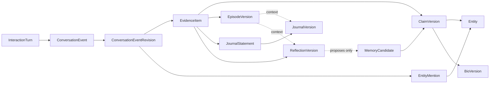
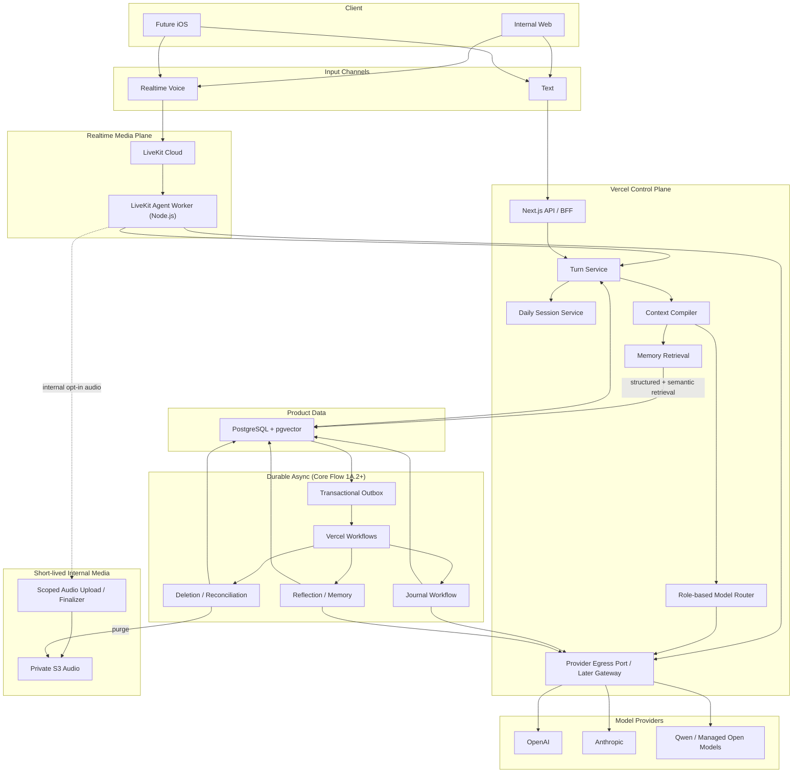
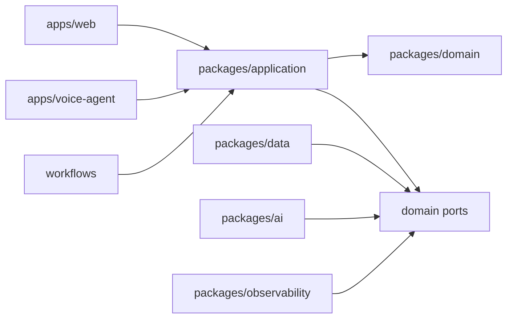

# SayHear Core Agent 架构概览

## TL;DR

- TypeScript 模块化单体承载领域内核，PostgreSQL 是产品 System of Record。
- 模型提出内容，确定性代码控制证据、状态、长期写入、删除与出站边界。
- Text 与 Realtime Voice 共用 Conversation、Evidence、Entity、Journal 和 Memory 领域模型。
- 架构按任务主题拆分；本文件只保留总体边界、原则、技术栈与代码边界。

## Status

Proposed

> 状态：Draft for implementation
>
> 日期：2026-07-24
>
> 最后更新：2026-07-25
>
> 适用范围：Core Feature Flow 1A / 1B
>
> 主要读者：产品、研发、AI/语音工程、未来的安全与数据团队

## 1. 文档目的

本文定义 SayHear 第一套可长期演进的 Core Agent 运行架构，用于指导：

- 内部 Web 实验工具；
- Text 与 Realtime Voice；
- 理解、共情回应与自然追问；
- Daily Session；
- Journal 生成与事实边界校验；
- Reflection 与长期记忆；
- Evidence、Entity 与 Claim 的独立身份和血缘；
- 后续对话中的记忆召回；
- 实时 Speech-to-Speech；
- 英文与中文能力，并从数据边界上保留未来更多语言扩展；
- 多模型 Replay 评估；
- 隐私、音频保留、删除和审计。

本文不是消费者界面设计，也不重新定义产品定位、商业模式或 Phase 2 External MVP。

产品需求和行为边界以
[AI Life Journal 产品文档 v0.1](../product/01-04-overview.md)
为事实来源。架构依据和同类产品调研见
[OpenClaw 与 Tolan 架构研究](../archive/research/openclaw-tolan-architecture-research.md)。

如果本文与产品文档冲突：

1. 产品定义和用户承诺以产品文档为准；
2. 实现便利不能静默改变产品；
3. 冲突必须被明确提出并重新确认。

### 结论先行

- 用 TypeScript 模块化单体建立领域内核；Next.js / Vercel 承载 Web、BFF 和
  Durable Workflow，PostgreSQL 是唯一产品 System of Record；
- Core Flow 1A 先用 Text 完成 Journal、Entity、长期 Memory 与 Replay，
  Core Flow 1B 再直接引入 Realtime Voice；两者共用 Conversation Event、
  Evidence、Entity、Context、Journal、Reflection、Claim 和删除基建，不建设
  临时 Push-to-Talk 产品路径；
- 正式实时媒体层用 LiveKit Cloud Agents，Vercel 不承担常驻音频 Worker；
- 1A.1 只使用一个配置化的 Conversation Text Champion 和一个 Provider adapter；
  1A.2 随 Journal 引入 Role-based Model Registry 和首个受限 Conversation Action
  （Journal Regeneration），1A.3a 增加 Entity / Memory roles、1A.3b 增加
  Reflection role，1A.4 再通过显式 Replay
  开放多 Provider、Challenger 与已验证 fallback，不自动 Shadow 私人对话；
- 1A.1 所有模型调用经过模块化单体内部唯一的 Provider Egress Port；
  独立 Replay / Voice 运行时出现前再按信任边界抽离 Provider Egress Gateway；
- Conversation、Evidence、Entity、Summary、Episode、Journal、Reflection、Claim
  和 Profile 都保留不可变 identity / version；
  Context 和 Replay 引用具体 version，而不是模型 Session 或“当前最新版”；
- InteractionTurn、EventRevision、Evidence、Entity、Claim 与 Artifact 使用独立
  opaque ID；实例 ID 不编码名称、语言或业务含义；
- 用户生活事实只能由 final / corrected User Event 支撑，AI 不能引用自己的回答
  证明自己的推断；
- Core Flow 1A.1 只有完整成功并原子提交的 Assistant Response 进入历史；
  中断片段显式失败且不进入 Context，不建设逐 chunk ACK 或崩溃续传；
- Core Flow 1A.1 通过请求路径、PostgreSQL 权威状态和一个轻量定时恢复扫描器
  处理对话、无活动结束与卡住 Turn；Vercel Workflows、transactional outbox
  和 dispatcher 从首次需要可靠异步派生的 1A.2 开始；
- Core Flow 1A.1 的 Context 只使用预算内的 committed raw Events，并保存可追溯的
  CompiledContext manifest；模型生成的 Rolling Summary 和 DialogueState projection
  从 1A.2 开始；
- Core Flow 1B 分为 1B.1 Realtime Transport Baseline 与 1B.2 Delivered-Prefix
  Correctness；1B.1 用保守的 `turn_only` 语义先跑通闭环，只有 1B.2 完成后
  才算 Core Flow 1B 正式完成；
- 删除能力随实际数据面分阶段扩展：Foundation / 1A.1 只建立 owner、epoch、
  Egress、日志和备份窗口等第一天隐私边界；1A.2 开始提供 operator-only
  Internal Owner Full Purge，1A.3a、1A.3b、1A.4、1B.1 和 1B.2 依次覆盖
  Entity / 长期 Memory、Episode / Reflection / Profile、Replay、音频 /
  transcript 与 delivery 数据；消费者 Account Deletion、完整
  ledger 和备份防复活演练属于 External MVP 门槛；
- 内部音频 72 小时后不可访问，应用目标在随后 15 分钟内物理删除，
  4-day S3 Lifecycle 只作独立兜底而非精确删除承诺；
- 初始 Replay 先在本地、CI 或 `sayhear-app` 受控进程中使用 synthetic、匿名化或
  独立授权 eval dataset；读取 Internal Owner 真实私人 source 前才部署无正式写凭据的
  Private Replay Runtime，真实 Replay output 默认 30 天；
- 先完成可重复的跨日 1A 闭环，随后立即进入 1B，不为未来规模提前拆微服务。

不要按原总稿章节顺序通读架构；请从
[文档地图](../README.md) 选择当前任务对应的主题文件。

## 2. 已确认的决策与范围

### 2.1 已确认产品与研发约束

| 决策 | 当前结论 |
| --- | --- |
| 开发团队 | 相当长时间内以独立开发为主 |
| Phase 1 | Internal Core，默认只有一个 Internal Owner Account 可写真实私人内容 |
| Phase 2 | External MVP，建设正式多用户身份与隔离并首次面向真实外部用户；首发仅提供 Web |
| 第一版界面 | 简单 Web UI，重点是 Agent 运行系统 |
| 核心输入 | Voice 优先，同时支持 Text |
| 核心输出 | 第三人称 Journal |
| Core Flow 范围 | 对话、理解与追问、Evidence / Entity、Reflection、长期记忆、Journal、记忆召回 |
| Voice 路线 | 先完成 Text Agent Core、Journal、长期 Memory 与 Replay，再直接建设 Realtime Voice；Text 是降级路径 |
| Internal Core 语言 | 英文、中文与自然 code-switching；未来语言不应要求重构领域模型 |
| 中国大陆 | 暂不考虑在中国大陆上架或建设大陆专属基础设施 |
| 模型范围 | OpenAI、Anthropic、中国领先开放权重模型 |
| 云平台偏好 | Vercel 优先，明确技术原因时使用其他服务 |
| 音频保留 | 正式用户不长期保留；内部明确授权后保留 72 小时 |
| 多模型比较 | 显式 Replay，不自动 Shadow |

### 2.2 Core Flow 的阶段定义

Phase 1 统一命名为 **Internal Core**，包含 Core Flow 1A 与 1B 两个连续里程碑，
不是两套独立系统。Internal Core 只验证内部工程闭环与 Agent 质量基线，不验证
外部用户需求、留存、付费意愿或消费者体验。

Phase 2 统一命名为 **External MVP**，是第一次面向真实外部用户的阶段。
External MVP 首发仅提供 Web；正式 iOS 待 Web 初步验证持续表达、被理解感以及
Journal 与 Memory 的长期价值后再引入。

#### Core Flow 1A：Text Agent Core

- Text 多轮对话；
- Daily Session；
- Context Compiler；
- Evidence / Entity resolution；
- Journal；
- Reflection；
- Memory Claim；
- 后续召回；
- 多模型 Replay；
- 内部诊断与评估。

Core Flow 1A 按 1A.1 Text Foundation、1A.2 Journal、1A.2P Persona & Safety、
1A.3a Memory & Recall、1A.3b Continuation & Reflection、1A.4 Replay 交付
（ADR-0113）。只有这些核心价值链路完成后才进入 1B，不使用临时
Push-to-Talk 作为过渡产品。

#### Core Flow 1B.1：Realtime Transport Baseline

- WebRTC；
- Speech-to-Speech；
- 非产品 Voice Preflight Harness；
- 长停顿与轮次判断；
- Barge-in 立即停止生成与播放；
- 断线重连；
- provisional 与 independent canonical STT；
- Transcript revision / segment；
- 内部 opt-in 72 小时 AudioAsset 与临时音频删除；
- `delivery_precision=turn_only`；
- 中断时不保存 Assistant 正文，并截断或重建 Provider session；
- Text / Voice 使用同一个 Daily Session；
- 复用 1A 的 Journal、Reflection 和 Memory。

#### Core Flow 1B.2：Delivered-Prefix Correctness

- 客户端单调 playout receipt；
- 保守的 confirmed playout cursor；
- transcript 与时间戳映射；
- `partially_delivered` Assistant Event；
- 下一轮 Context 只包含可证明用户听到的前缀；
- delivery 状态的故障恢复、保留、删除与审计。

1B.1 是可运行基线，但不代表正式实时语音已经完成。只有 1B.2 的已听内容
正确性通过后，Core Flow 1B 才完成。

1A 出现一次可重复的跨多天完整纵向闭环后，应立即进入 1B。
不等待所有记忆策略和 Journal 风格成熟后才开始实时语音。

### 2.3 当前明确不包含

- 消费者级完整 UI；
- 订阅和支付；
- 多人格、多 Voice；
- iOS 正式客户端；
- 中国大陆部署；
- 对话外 / outbound 主动 Follow-up、站外消息与通知；
- 完整 Profile 管理与纠错 UI；
- 外部生活数据接入；
- 自托管大模型；
- 多区域写入；
- 微服务。

这些范围不属于 Internal Core。消费者 Web、订阅与正式账号体系属于
External MVP；正式 iOS 待 Web 初步验证核心产品价值后再引入。

## 3. 架构原则与系统不变量

### 3.1 核心架构原则

1. **PostgreSQL 是 canonical records 与正式产物的 System of Record；不代表每条 row 都是事实证据。**
2. **final / corrected User Conversation Event Revision 是对话衍生知识的 primary evidence root。**
3. **每轮对话重新编译 Context，不依赖模型“自行记住”。**
4. **模型负责不确定性判断和语言生成；代码负责状态变化与事实边界。**
5. **在线回复与异步派生工作解耦。**
6. **Evidence、Entity、Claim、Journal、Reflection、Profile 和 Embedding 是不同对象。**
7. **Text 与 Realtime 必须进入同一领域模型。**
8. **精确性优先于记忆召回率。**
9. **工作流按 at-least-once 执行设计。**
10. **隐私、删除和审计是领域能力，不是部署配置。**
11. **稳定对象 ID 与不可变 Version ID 分离，且不编码名称、语言或模型。**
12. **一次 Conversation Action 表达一个用户语义意图，而不是一个对象写入或工具步骤。**
13. **模型只使用版本化 Conversation Action Catalog；不支持的请求不近似执行。**
14. **Conversation Runtime 是可替换的受限 Agent Harness；Framework 不拥有领域状态。**
15. **ActionDefinition 声明横切契约；Action Gateway 统一执行共同 gate；typed handler 封装领域语义。**
16. **Action 是否受理与执行是否完成是独立状态；只有不可变 Receipt 能证明结果。**
17. **当前模型可见 Catalog 只包含无需二次确认或 step-up 的安全 Action。**
18. **Action 长期审计只保存最小 envelope；临时参数加密短存且不进入日志或 Workflow history。**

### 3.2 必须始终成立的系统不变量

#### 数据与状态

- 模型不能直接发布 Journal、覆盖 Profile 或写入长期 Memory。
- 模型最多提出一个 typed Conversation Action；target、scope、权限、Evidence、
  领域写入与跨对象传播都由确定性代码控制。
- 正常新增 Action 只增加版本化 ActionDefinition、唯一 typed handler binding 与
  conformance fixtures，不修改 Harness loop、Provider Adapter 或 Finalization。
- 内部 Claim、Journal、Profile、Embedding 与 Workflow 操作不作为模型工具暴露；
  当前 Catalog 无法准确实现的请求返回 `unsupported`。
- 向量索引、缓存、模型 Session、LiveKit Room 和 Workflow history 都不是真源。
- Conversation Event 接近 append-only；修正、重转写、撤回使用新 revision 或 tombstone。
- InteractionTurn 只组织一次交互；VoiceTurn 只映射实时运行时，两者都不能代替
  Conversation Event Revision 作为事实证据。
- Append-only 适用于正常修正、supersede 和审计，不覆盖用户 privacy erasure；
  删除时必须清除受影响旧 Version 的正文。
- 用户生活事实只能由 final / corrected User Event revision 支撑；
  Assistant / System Event 不能成为事实证据。
- Evidence 只引用 source，不复制或创造新的底层事实；Claim、Journal、Reflection
  和 Episode 必须通过 Evidence 回到底层 source revision。
- Reflection 可以提出 Memory Candidate，但 Reflection 自己不能成为证明该 Candidate
  或 Claim 的事实证据。
- Entity 是稳定语义身份，Claim 引用 Entity；不得把 Entity 当作 Claim 的下游文本投影。
- Episode 必须有现实事件锚点和 User Evidence；Conversation、Daily Session、
  话题或情绪不能自动成为 Episode，Episode 缺失也不能阻止 Journal 或 Memory。
- Profile、Embedding 和 cache 是可重建投影；JournalVersion、ReflectionVersion、
  ClaimVersion 和 EpisodeVersion 是必须保存历史的派生产物，不能当作普通缓存删除重算。
- 模型本轮没有输出某条旧记忆，不代表删除该记忆。
- 1A.1 Text 只有完整成功的 Assistant Response 才是已发生对话；Realtime 是否保留
  已播放前缀由后续 Voice delivery policy 单独决定。

#### 隐私

- 用户正文不得进入普通日志、错误日志、Trace、消息 payload 或 Workflow history。
- Conversation Action 的完整参数只进入加密临时 payload，并在 Admission checkpoint
  后清除；长期 envelope、Execution 与 Receipt 不复制用户正文。
- Workflow 只传递 ID、revision 和 policy version；正文只由受控
  application / Egress API 在执行点按权限读取。
- Embedding 是敏感派生数据，不视为匿名数据。
- “数据库加密”不能被描述为严格 E2EE。
- 第三方模型和 SayHear 运行时在推理时会看到明文。

#### 删除

- 这些不变量从对应删除能力引入后成立，不表示 Foundation / 1A.1 已建设完整
  Account Deletion 平台。
- Foundation / 1A.1 必须先有 stable owner、`data_epoch`、读取 / Egress fence、
  deletion-compatible lineage 和已核验 backup window，但不提供删除请求或工作流。
- Internal Core 不提供单条 Conversation / Journal 删除；1A.2 开始的
  Internal Owner Full Purge 只按当时已存在的数据面逐阶段扩展。
- 删除事务提交后，所有 SayHear API、读取网关、对话召回和 Replay 必须立即阻断；
  已经传递到用户设备的 bytes 无法由服务端收回。
- 物理删除可以异步，但必须有可验证回执。
- 删除期间启动或仍在运行的任务不能重新写回被删数据。
- External MVP 面向真实用户前，恢复备份后必须先重放完整 deletion ledger，
  再开放服务。

#### Replay

- Replay 只能显式触发。
- Replay 输出永远是 `non_authoritative`。
- Replay 不得更新 Conversation、Evidence、Entity、Journal、Reflection、Claim 或 Profile。
- 真实私人对话不得被后台定时批量 Replay。
- 初始 Replay 不读取正式领域表；Private Replay 读取真实私人 source 前必须通过
  独立部署、job-scoped snapshot API 和无正式写权限门禁。

#### 实时语音

- Realtime Session 是临时传输会话，不等于 Daily Session。
- AI 生成但用户没有实际听到的内容，不能被当作完整已发生对话。
- Realtime 重连不得创建重复用户 turn 或新的产品 Session。
- 1B.1 中断后宁可丢弃已经听到但无法证明边界的 Assistant 前缀，也不能保留
  未听到内容；1B.2 才把可证明的 delivered prefix 写入历史。

### 3.3 四层身份与血缘模型

领域对象分成四层：

```text
Interaction Layer
  InteractionTurn / ConversationEvent / ConversationEventRevision

Evidence Layer
  EvidenceItem / EntityMention

Semantic Layer
  Entity / EpisodeVersion / ClaimVersion

Artifact & Projection Layer
  JournalVersion / ReflectionVersion / BioVersion
```



这不是一条 `Turn → Claim → Entity → Journal` 的单线流水线：

- `InteractionTurn` 是交互分组，不是 evidence；
- `ConversationEventRevision` 才是可精确引用的原始记录；
- `EvidenceItem` 是类型化引用，不是第二份自然语言事实；
- `Entity` 是被 Claim、Mention 和 Artifact 引用的稳定节点；
- 1A.2 Journal 直接从 Evidence 派生；1A.3 后可以使用可展开到同一 Evidence root
  的 Entity / Episode enrichment，但 enrichment 缺失不能阻止 Journal；
- Reflection 可以从 Evidence / Episode 派生；
- Profile 只从当前有效 ClaimVersion 重建；
- 任一中间层都不能引用自己的输出证明自己的推断。

## 4. 总体架构



图中 `Future iOS` 同时支持 Text 与 Realtime Voice；两种输入与 Web 共用
Daily Session、Conversation Event 和 Agent Core。

`Memory Retrieval` 只从 PostgreSQL / pgvector 读取当前有效的
Claim、Entity、Episode 和 Profile projection。它不得读取、向量化或向模型发送
Private S3 中的原始音频。Private S3 只用于内部账号明确 opt-in 后的短期音频质量分析，
并由 Deletion / Reconciliation 在 72 小时保留窗口结束后清除；它不属于长期记忆召回链路。
Realtime 音频在 LiveKit Agent Worker 处分流。Scoped Audio Upload / Finalizer
只签发窄权限上传授权并完成 AudioAsset 校验，不代理普通模型调用，也不向 Voice
Worker 暴露通用 S3 credential。1B.1 的 Voice Preflight Harness 可以使用 fixture
或单独授权样本验证同一音频处理路径，但它不是产品输入渠道。

### 4.1 三层运行模型

SayHear 必须明确区分三种“编排”。

#### 领域编排

由 SayHear 自有 TypeScript 代码负责：

- Daily Session；
- InteractionTurn 与 ConversationEventRevision；
- Evidence 与 Entity lifecycle；
- Context Compiler；
- Conversation Action resolution 与 receipt；
- Journal 发布门禁；
- ReflectionVersion 生命周期；
- Memory Claim 生命周期；
- 删除传播；
- Replay 隔离；
- 所有业务状态机。

#### 单次模型与实时会话运行时

负责调用模型和处理单次推理：

- SayHear application layer 拥有的 Conversation Agent Harness；
- 1A.1 的 response-only 自有实现与单一 Conversation Provider Adapter；
- 1A.2 起受 Conversation Harness Policy 约束的一次 Action proposal / receipt 往返；
- 1A.4+ 经 Replay 与政策准入的其他 Provider Adapter；
- LiveKit AgentSession；
- STT / TTS / Realtime Provider。

这些运行时不得拥有产品长期状态。Conversation Agent Harness 是应用层深 Module，
不是 Framework Session 的别名；其调用方不接触 Provider tool-call 对象、内部 Action
step 或领域 repository。初始实现不引入通用 Agent Framework。未来
Framework-backed Adapter 必须服从相同 Interface、Harness Policy、receipt 与 Replay
conformance，且内部状态可丢弃。1A.1 调用统一经过 15.8 的 in-process Provider
Egress Port；独立 Replay / Voice runtime 出现后，必须在允许真实数据前完成 Gateway
抽离评审。

#### Durable Workflow

从 Core Flow 1A.2 开始，Vercel Workflows 负责：

- 跨请求持久执行；
- 自动重试；
- 步骤恢复；
- 延迟与定时；
- 运行可观测性。

Workflow 状态不是产品状态。引入后，产品仍在 PostgreSQL 中保存自己的
`workflow_runs`、业务 revision 和发布结果。

### 4.2 Trust Boundaries

| 边界 | 信任假设 | 约束 |
| --- | --- | --- |
| Browser / iOS | 不可信客户端 | 不持有长期 Provider key，不决定 owner ID，不直连数据库 |
| Vercel BFF | 受信任控制面 | 鉴权、签发短期 token、调用领域服务 |
| LiveKit | 受控第三方媒体面 | Room-scoped token；不保存产品长期状态；关闭非必要 recording |
| LiveKit Agent Worker | 后续受限服务身份 | 引入前必须复核数据库与 Provider credential 边界 |
| Provider Egress Port | 1A.1 单体内部模块 | 唯一 Provider 调用入口；发送前执行 epoch/revision/policy 检查 |
| Provider Egress Gateway | Replay / Voice 阶段的候选独立边界 | 仅在独立运行时需要 credential / 数据隔离时抽离 |
| Model Provider | 经批准的敏感数据处理方 | 按 role、地区和 retention policy 准入 |
| PostgreSQL | 受信任 System of Record | 仅服务端访问；tenant scoping；完整审计 |
| S3 Audio Bucket | 受信任短期敏感存储 | 私有、SSE-KMS、72 小时策略、无公共访问 |
| Private Replay Runtime | 读取真实私人 source 的受限评估环境 | 无正式数据库凭据；job-scoped 读取；正式领域无写权限 |

客户端获得的 LiveKit / upload token 必须：

- 短期有效；
- scope 到单一用户、Room 或对象 key；
- 由 BFF 根据认证 Session 签发；
- 不允许通过客户端传入的 `user_id` 扩大权限。

## 5. 推荐技术栈

| 层 | 当前选择 | 负责 | 不负责 |
| --- | --- | --- | --- |
| Web | Next.js App Router + TypeScript | 内部 UI、BFF、Text streaming、授权 | 长期业务状态、正式媒体长连接 |
| 部署 | Vercel | Web、API、请求型模型调用、Workflow step | 正式实时音频 media plane |
| 领域内核 | 自有 TypeScript 模块化单体 | 规则、状态机、领域对象 | 模型训练、媒体传输 |
| 内部身份 | Auth.js + GitHub OAuth + PostgreSQL session | 人类登录、allowlist、可撤销 Session | Agent Worker / Replay service identity |
| 模型访问 | Vercel AI SDK + 分阶段自有 adapters | 1A.1 单一 Text adapter；1A.4+ 多 Provider 适配 | 领域 Memory、Daily Session |
| 推理出站 | 1A.1 in-process Provider Egress Port；后续按门槛抽 Gateway | policy fence、server-only credential、egress audit | 领域结果发布 |
| 数据库 | Neon PostgreSQL | System of Record、事务、锁、审计、pgvector | 媒体文件 |
| ORM | Drizzle + SQL migration | 类型、迁移、常规查询 | 隐藏复杂锁和 pgvector SQL |
| Workflow | Core Flow 1A.2+ 使用 Vercel Workflows stable v4 | Journal、Reflection、删除、补偿 | 1A.1 请求路径；业务真源 |
| Realtime | LiveKit Cloud + Agents Node SDK | WebRTC、音频流、轮次、打断、Worker 调度 | Journal、Memory、Profile |
| Audio | AWS S3 + SSE-KMS + Lifecycle | 内部短期音频 | 长期用户生活记录 |
| Observability | PostgreSQL metadata + scrubbed OpenTelemetry/Sentry | 延迟、错误、成本、运行状态 | 用户正文存档 |
| Python | Notebook only | 离线分析、探索性评估 | Internal Core 生产 Worker |

### 5.1 为什么是模块化单体

当前系统由一个开发者维护，核心复杂度来自领域一致性，而不是团队边界。

模块化单体可以：

- 让 Journal、Memory 与删除共享事务；
- 降低跨服务 Schema 和部署复杂度；
- 更容易做故障注入和本地测试；
- 保留未来按运行特征拆分的可能。

只有当某个模块出现独立扩缩容、独立发布、故障隔离或不同运行时需求时才拆分。

Replay、Voice Worker 和 Provider Egress 的独立 deployment 是权限、credential
与运行时隔离，不代表把领域内核拆成分布式微服务；它们仍通过 versioned ports
调用同一 application / domain contract。

### 5.2 为什么 Internal Core 不建 Python Worker

Evidence / Entity Extraction、Journal、Reflection、Memory Extraction 当前主要是：

- 数据读取；
- LLM 调用；
- 结构化结果验证；
- PostgreSQL 事务写入。

它们属于 I/O 密集任务，TypeScript 足以胜任。Internal Core 增加 Python 会引入：

- 跨 TypeScript / Python 的重复 Schema；
- 双部署链路；
- 跨运行时调试；
- 额外队列和权限；
- 更复杂的本地环境。

只有出现 Python-only 模型库、GPU 批处理、规模化聚类或 TypeScript
无法承担的评估工作后才建设 Python Worker。

### 5.3 为什么 Internal Core 不使用 Redis

初期使用：

- PostgreSQL 唯一约束保证幂等；
- row lock / advisory lock 保证并发；
- 从 1A.2 开始由 outbox 保证异步事件发布；
- pgvector 支持检索。

Redis 只在出现以下实测需求后引入：

- 跨实例 presence；
- realtime rate limit；
- 高频热点 Context 缓存；
- PostgreSQL 锁争用；
- LiveKit 之外的跨实例临时状态。

Redis 永远不保存长期记忆真源。

### 5.4 PostgreSQL 连接与事务契约

核心正确性依赖交互事务，不能把 Neon 当成只能执行单条 HTTP SQL 的存储。

- BFF domain API、Workflow step、outbox dispatcher 和 migration 都使用 Node runtime，
  不使用 Edge runtime；
- 应用使用 Neon pooled PostgreSQL endpoint 和支持 interactive transaction 的
  Node PostgreSQL driver；Drizzle 只包装同一 transaction client；
- `SELECT ... FOR UPDATE`、`pg_advisory_xact_lock`、fencing guard、
  业务写入和 outbox insert 必须在同一连接、同一事务中；
- 禁止使用 session-scoped `pg_advisory_lock`，避免连接回池后锁泄漏；
- 不在数据库事务中等待模型、STT、TTS、对象存储或网络调用；
- migration 使用受限的 direct connection 和独立 credential；
- 为 transaction 设置 statement / lock timeout，并只对明确可重试的
  serialization failure / deadlock 做有限重试；
- 每个部署设置连接上限，压测连接池耗尽、Neon 冷启动、事务中断和重试；
- 如果选定 driver / pooler 无法通过 row lock 与 transaction 集成测试，
  不得进入 Foundation exit gate。

## 6. 建议代码边界

目标仓库结构：

```text
apps/
  web/                  # Next.js internal UI and BFF
  voice-agent/          # Core Flow 1B LiveKit Node worker
  eval-runner/          # Deferred until the first real private Replay
  provider-egress/      # Deferred: create only when Replay / Voice trust boundary requires

packages/
  domain/               # Entities, value objects, state machines, invariants
  application/          # Turn, Evidence, Entity, Journal, Reflection, Memory, Replay use cases
  contracts/            # Versioned API and event schemas
  ai/                   # Model ports, adapters, prompt registry
  egress-contracts/     # Deferred contracts for an extracted Gateway
  data/                 # Drizzle schema, repositories, migrations
  observability/        # Redacted telemetry and audit metadata
  evals/                # Replay rubric, graders, synthetic fixtures
  test-support/         # Builders, fakes, fault injection helpers

workflows/
  evidence-extraction/
  entity-resolution/
  episode/
  journal/
  reflection/
  consolidation/
  deletion/
  reconciliation/

docs/
  architecture/
  research/
```

初期使用单一 Node.js active LTS，并在仓库中固定版本。包管理使用 pnpm workspace。
无需为了目录结构立即引入微服务或独立部署。

### 6.1 依赖方向



约束：

- `domain` 不依赖 Next.js、Vercel、LiveKit、模型 SDK 或数据库 ORM；
- `application` 通过 ports 调用数据和模型；
- Provider SDK 类型不能进入领域 Schema；
- Workflow 只调用 application use case，不重复实现业务规则。

---

## 31. 参考资料

### 项目资料

- [AI Life Journal 产品文档 v0.1](../product/01-04-overview.md)
- [OpenClaw 与 Tolan 架构研究](../archive/research/openclaw-tolan-architecture-research.md)

### 官方技术资料

以下链接在本文日期完成核验；具体能力、价格与数据政策在实施前仍需复核。

- [Vercel Workflows](https://vercel.com/workflows)
- [Vercel Workflows GA](https://vercel.com/blog/a-new-programming-model-for-durable-execution)
- [Vercel Cron Jobs](https://vercel.com/docs/cron-jobs/manage-cron-jobs)
- [Vercel WebSocket Public Beta](https://vercel.com/changelog/websocket-support-is-now-in-public-beta)
- [Auth.js](https://authjs.dev/)
- [Neon Connection Pooling](https://neon.com/docs/connect/connection-pooling)
- [OpenAI Realtime WebRTC](https://developers.openai.com/api/docs/guides/realtime-webrtc)
- [OpenAI Realtime server-side controls](https://developers.openai.com/api/docs/guides/realtime-server-controls)
- [OpenAI API data controls](https://developers.openai.com/api/docs/guides/your-data)
- [LiveKit Agents](https://docs.livekit.io/agents/)
- [LiveKit Realtime Models](https://docs.livekit.io/agents/models/realtime/)
- [LiveKit Turn Handling](https://docs.livekit.io/reference/agents/turn-handling-options/)
- [LiveKit Cloud Agent Deployment](https://docs.livekit.io/deploy/agents/)
- [Anthropic Model Overview](https://platform.claude.com/docs/en/about-claude/models/overview)
- [Qwen3.6](https://github.com/QwenLM/Qwen3.6)
- [Qwen3-Omni](https://github.com/QwenLM/Qwen3-Omni)
- [AWS S3 Lifecycle](https://docs.aws.amazon.com/AmazonS3/latest/userguide/object-lifecycle-mgmt.html)
- [AWS S3 Lifecycle Expiration](https://docs.aws.amazon.com/AmazonS3/latest/API/API_LifecycleExpiration.html)

## References

- [原始 核心架构 v0.1 快照](../archive/architecture/sayhear-core-agent-architecture-v0.1.md)
- [产品概览](../product/01-04-overview.md)
- [产品与领域术语](../../CONTEXT.md)
