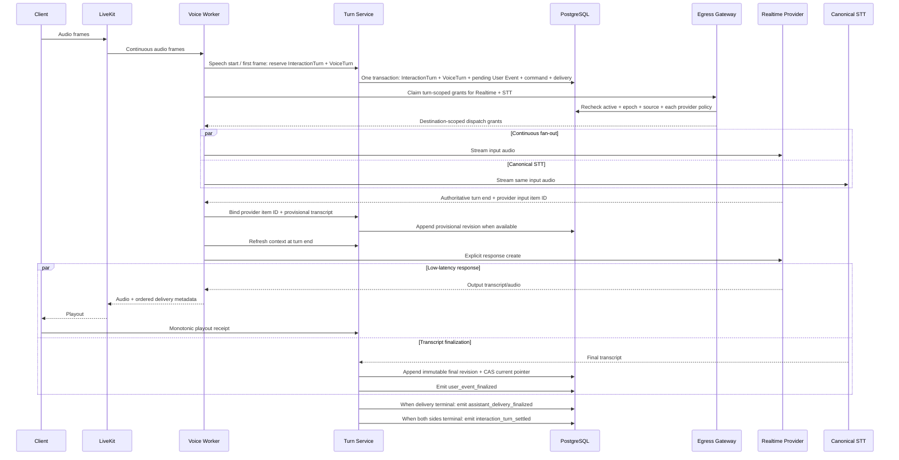

# Realtime Voice 架构

## TL;DR

- Voice 直接进入 Realtime 路线，不建设 Push-to-Talk 产品切片。
- 1B.1 建立传输基线，1B.2 才完成可证明已听前缀的正确性。
- LiveKit 承载实时媒体，Text 是故障降级路径。
- Canonical transcript、barge-in、reconnect 和音频保留共享既有领域边界。

## Status

Proposed

## 14. Voice Architecture

### 14.1 Core Flow 1B.1：Voice Preflight Harness

```text
synthetic audio / recorded fixture / separately authorized sample
  → STT
  → Transcript revision candidate
  → canonical STT evaluation
  → retention / deletion verification
```

这是 1B.1 的非产品测试路径，用于在开放 LiveKit Room 前验证 canonical STT、
Transcript revision、code-switching、音频保留与删除。它不出现在用户界面，
不创建 Product Conversation Turn，也不成为 Realtime 故障降级路径。

使用 Internal Owner 单独授权的真实样本时，原始音频进入 72 小时 AudioAsset。
Synthetic / anonymized fixture 使用独立 eval retention，不自动进入私人 AudioAsset。

没有授权时：

- 不创建长期 AudioAsset；
- 如技术处理必须使用临时对象，STT 完成后立即删除；
- 临时对象使用独立的短 TTL 和 reconciliation；
- 不通过普通 Vercel Function body 代理大音频文件。

Harness 输出是 `non_authoritative` eval artifact，不创建 User / Assistant Event，
不进入 Journal、Reflection 或 Memory。未来若重新考虑 Push-to-Talk，必须重新确认
产品价值、交付真源、retention 与删除语义，并新增 ADR，不能把 Harness 直接产品化。

### 14.2 Core Flow 1B：Realtime

本节描述 1B.1 与 1B.2 共用的运行架构。两者使用同一个 LiveKit / Voice Worker /
SayHear 领域边界；1B.2 增加交付证明，不新增第二套 Voice 架构。

正式路径：

```text
Web / iOS
  ↕ WebRTC
LiveKit Cloud
  ↕
LiveKit Agent Worker (Node.js)
  ↕ authenticated domain API
SayHear Turn Service / Context Compiler / PostgreSQL
  ↕
Realtime model or STT–LLM–TTS providers
```

LiveKit 负责：

- media transport；
- Room；
- Agent worker dispatch；
- weak-network handling；
- VAD / turn detection；
- interruptions；
- playback synchronization；
- Realtime / cascade plugin。

运行与安全约束：

- BFF 签发短期、Room-scoped client token；
- 一个 Voice job 只处理一个 Room / 用户会话；
- Agent Worker 使用独立 service identity 调用 SayHear API；
- Agent Worker 不持有 PostgreSQL、S3 或 Provider 的通用 static credential；
- Worker 崩溃后由 LiveKit 重新 dispatch，SayHear 根据最后确认 Event 恢复；
- Region 以用户、LiveKit、模型 Provider 和 SayHear API 的实测延迟为依据；
- 关闭非必要 transcript、trace、recording 和 egress；
- 扩缩容以并发 Room、CPU 和端到端延迟为主要信号。

SayHear 负责：

- Daily Session；
- InteractionTurn 与 canonical ConversationEventRevision；
- Evidence / Entity；
- Context；
- Memory；
- Journal；
- Reflection；
- privacy；
- deletion；
- model policy。

不要在同一实时路径中同时让 LiveKit AgentSession 和 OpenAI Agents SDK
成为双重 orchestrator。

### 14.3 Realtime Turn 时序

Realtime 是 8.1 的明确例外：为了低延迟，回答会在独立 canonical STT final
之前开始，但不能因此让 provisional transcript 进入长期派生层。

下图是 1B.2 的完整目标。1B.1 不发送 ordered delivery metadata 或客户端
playout receipt；它只接受完整播放终态，任何 barge-in、断线或未知交付都按
`turn_only` 规则收敛为无正文的 `interrupted`。



状态与规则：

1. speech start 或第一帧在同一事务创建 `interaction_turn_id + voice_turn_id`；
   Provider item ID 返回后再绑定，不能假设 LiveKit 会产生 Provider ID；
2. VoiceTurn 必须映射同一个 InteractionTurn；
   `voice_session_id + voice_turn_id` 唯一，已绑定的 `provider_input_item_id`
   也唯一，重连和重复 final 不创建新的 InteractionTurn 或 VoiceTurn；
3. User Event 信封先占用稳定 `sequence_no`，初始为 `transcript_pending`；
4. 音频从第一帧开始并行 fan-out 到 Realtime Provider 和 canonical STT，
   不等待 turn end 才送 STT；
5. provisional transcript 可以作为本轮低延迟模型输入，但 ModelRunAttempt 必须记录其
   revision / keyed HMAC，不能事后声称模型看过 canonical final；
6. 独立 STT 追加 `final` revision；用户修正再追加 `corrected` revision；
7. Evidence、EntityMention、Journal、Reflection、Memory、Episode 和 Embedding 只由
   `final` / `corrected` revision 触发；
8. `user_event_finalized` 立即增加 `source_revision` 并触发 EvidenceItem、
   EntityMention 和用户证据派生，
   不能等待 Assistant ACK；
9. `assistant_delivery_finalized` 增加 `dialogue_revision`；
10. `interaction_turn_settled` 只用于交互完整性、诊断和指标；
11. Journal 是否生成仍由 Session quiescence / eligibility 决定，
    但其 source revision 不依赖 Assistant receipt；
12. canonical STT 永久失败时进入 `transcript_failed / needs_review`，
   该 turn 不进入长期派生层，直到用户修正或受控复核；
13. Provider session history 仍然只属于实时运行时，不能代替上述提交。

1B.1 的完整播放终态可以提交整条 Assistant transcript；barge-in、断线或恢复窗口
到期后仍未知则提交无正文 `interrupted`。1B.2 的 `delivery_unknown` 不是 finalized；
客户端 receipt、保守 interruption resolution 或恢复窗口到期后的 terminal timeout
才能结束它。无论哪种情况，都不阻塞已经 final 的 User Event evidence pipeline。

每个 Voice Session 必须固定一个 `turn_detection_owner`：

- OpenAI Realtime baseline 使用 `provider`，LiveKit AgentSession 配置
  `realtime_llm` / 对应模式；LiveKit 只传输并映射 Provider
  speech-start / speech-end，不再独立结束 turn；
- 如果 Provider 支持“检测边界但不自动回答”，关闭 auto-response，
  Worker 在边界后刷新 sideband Context 再显式 response；
- 如果 Provider 不能把 detection 与 response 分离，必须在该 User turn 开始前完成
  Context 预热，并把这一限制写入 capability / eval；
- cascade 或未来需要自定义长停顿策略时可以配置为 `livekit`，
  同时关闭 Provider 自动 VAD / auto-response，由 Worker 在 LiveKit turn end 后
  显式 commit input / response；
- 同一个 Session 严禁两个 detector 都有权 commit input 或创建 response。

如果 provisional 与 final 的差异超过版本化 `transcript_divergence_policy`：

- Event 标记 `input_divergence`；
- 不回写或伪造当时 ModelRunAttempt 的输入；
- 下一轮 Context 使用 final revision，并加入最小的“上一回答基于实时转写”的状态提示；
- 只有差异实质改变含义且对话仍相关时，Agent 才自然澄清；
- Evidence / Journal / Reflection / Claim 只根据 final / corrected User Event，
  不根据 AI 对错误转写的回答推断生活事实。

### 14.4 双轨转写

Realtime 模型的输入转写可能延迟或不稳定。

因此：

- Realtime 模型转写用于低延迟交互；
- 独立 STT 生成 canonical transcript；
- 正式用户的独立 STT 在流中完成，不保留原始音频；
- 内部账号可以在 72 小时内使用音频做离线复核；
- 低置信度 transcript 标记为 reviewable；
- Evidence / Journal / Reflection / Claim 只消费 final 或 corrected transcript。

### 14.5 Barge-in 与实际已听内容

#### 1B.1：Turn-only baseline

用户打断时：

1. LiveKit 立即停止 Provider 生成和音频播放；
2. 记录 provider truncation / interruption event；
3. 如果 Provider 支持 item truncation，截断其 session state；否则关闭该
   Provider session，并从 SayHear canonical Context 重建；
4. 写入无正文的 `interrupted` 交互标记，不创建 Assistant Event revision；
5. 下一轮 Context 只知道上一回答被打断，不包含任何 Assistant 正文。

完整播放结束且 Worker 能确认终态时，完整 Assistant transcript 才成为 Assistant
Event。无法截断未听内容、也无法安全重建 session 的 Provider 不能成为 1B.1
Champion，因为它会让未听到内容影响下一轮。

#### 1B.2：Confirmed delivered prefix

用户打断时：

1. LiveKit 停止音频播放；
2. 记录 provider truncation / interruption event；
3. 取得保守的 confirmed playout cursor；
4. 按 Provider capability 计算 confirmed delivered prefix；
5. 写入 Assistant Event revision；
6. Assistant Event 标记 `partially_delivered`；
7. 下一轮 Context 只包含 confirmed prefix；
8. 未交付剩余内容按短期 delivery buffer 规则删除；
9. Journal 不把未听到的 AI 语言当作对话事实。

`RealtimeVoiceProvider` 必须声明：

```text
output_transcript
transcript_token_timestamps
playback_cursor
server_truncation
delivery_precision      # exact_prefix / timestamp_estimated / turn_only
```

跨 Provider 的保守算法：

- 1B.2 `exact_prefix`：只保留结束时间不晚于 confirmed playout cursor 的完整 token；
- 1B.2 `timestamp_estimated`：减去版本化 safety margin 后，只保留完整 transcript segment；
- 1B.1 `turn_only` / `unknown`：完整播放结束可以确认整个 turn；一旦中断，
  不保留任何 Assistant 正文，只记录“回答被中断”的无正文交互标记；
- 1B.2 confirmed cursor 取服务端播放进度与客户端单调 ACK 能共同证明的下界；
- 音频已写入 socket 或已发送给 LiveKit 不等于用户已经听到；
- Provider 无 output transcript 时，必须增加 AI 输出音频的独立转写，
  否则不能成为 Core Flow Champion。

1B.1 记录 `turn_only` precision、完整播放终态或 interruption reason。1B.2 的
cursor、safety margin policy 和 receipt 来源必须随 Assistant delivery 持久化，
供 Context 和故障审计解释。1B.2 如引入短期 transcript / delivery buffer，必须
在实现前定义加密、活跃 TTL、备份窗口和删除传播；它不自动成为对话历史。

无法确认完整交付时，领域结果必须是：

1. 1B.1 写入无正文 `interrupted`，不创建 Assistant Event revision；
2. 1B.2 有可靠前缀时创建 `partially_delivered` Assistant Event；无法映射前缀时
   写入无正文 `interrupted`；
3. 下一轮 Context 只包含 1B.2 confirmed delivered portion；
4. 完整未交付结果默认不保存到 ModelRunAttempt。

### 14.6 Reconnect

Reconnect 使用：

- `voice_session_id`；
- `daily_session_id`；
- `last_acknowledged_event_id`；
- Provider / LiveKit resume token；
- 去重后的 final transcript event。

Provider session 过期时，创建新传输会话并从 SayHear CompiledContext 恢复。
不得把 Provider session ID 当作 Daily Session ID。

1B.1 只恢复 settled Event 与无正文 interruption marker。1B.2 还必须恢复或保守
终止未 settled delivery receipt 状态；重连不能把 `delivery_unknown` 猜成完整交付。

### 14.7 降级

如果完整 Realtime 不可用：

- Text 始终可用；
- 不自动切换到未经评估的模型或声音；
- 当前 Session 保持不变；
- UI 明确说明 Realtime 不可用并切换到 Text。

## References

- [原始 核心架构 v0.1 快照](../archive/architecture/sayhear-core-agent-architecture-v0.1.md)
- [Conversation 数据模型](07-01-06-conversation-data-model.md)
- [隐私、安全与生命周期](18-20-privacy-security-lifecycle.md)
