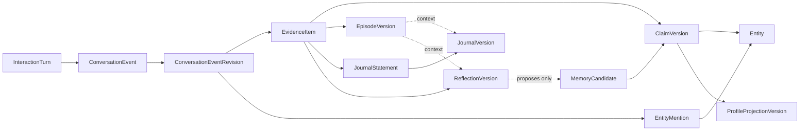
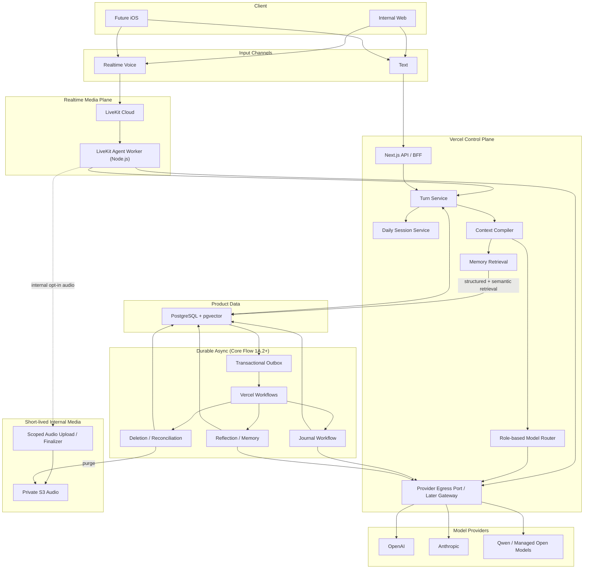
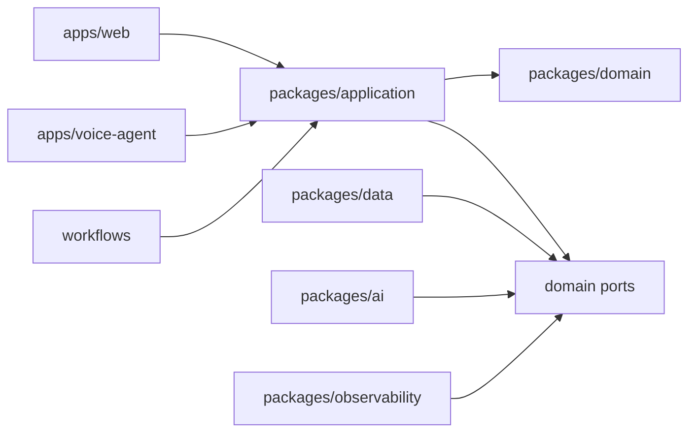
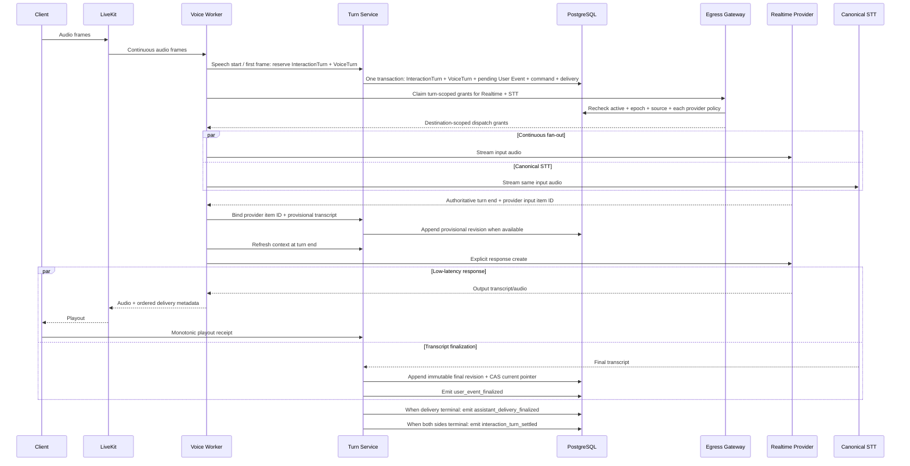

# SayHear Core Agent Architecture v0.1

> 状态：Draft for implementation
>
> 日期：2026-07-24
>
> 最后更新：2026-07-25
>
> 适用范围：Core Feature Flow 1A / 1B
>
> 主要读者：产品、研发、AI/语音工程、未来的安全与数据团队

## 1. 文档目的

本文定义 SayHear 第一套可长期演进的 Core Agent 运行架构，用于指导：

- 内部 Web 实验工具；
- Text 与 Realtime Voice；
- 理解、共情回应与自然追问；
- Daily Session；
- Journal 生成与事实边界校验；
- Reflection 与长期记忆；
- Evidence、Entity 与 Claim 的独立身份和血缘；
- 后续对话中的记忆召回；
- 实时 Speech-to-Speech；
- 英文与中文能力，并从数据边界上保留未来更多语言扩展；
- 多模型 Replay 评估；
- 隐私、音频保留、删除和审计。

本文不是消费者界面设计，也不重新定义产品定位、商业模式或 Phase 2 External MVP。

产品需求和行为边界以
[AI Life Journal 产品文档 v0.1](../product/AI_Life_Journal_Product_Document_v0.1.md)
为事实来源。架构依据和同类产品调研见
[OpenClaw 与 Tolan 架构研究](../research/openclaw-tolan-architecture-research.md)。

如果本文与产品文档冲突：

1. 产品定义和用户承诺以产品文档为准；
2. 实现便利不能静默改变产品；
3. 冲突必须被明确提出并重新确认。

### 结论先行

- 用 TypeScript 模块化单体建立领域内核；Next.js / Vercel 承载 Web、BFF 和
  Durable Workflow，PostgreSQL 是唯一产品 System of Record；
- Core Flow 1A 先用 Text 完成 Journal、Entity、长期 Memory 与 Replay，
  Core Flow 1B 再直接引入 Realtime Voice；两者共用 Conversation Event、
  Evidence、Entity、Context、Journal、Reflection、Claim 和删除基建，不建设
  临时 Push-to-Talk 产品路径；
- 正式实时媒体层用 LiveKit Cloud Agents，Vercel 不承担常驻音频 Worker；
- 1A.1 只使用一个配置化的 Conversation Text Champion 和一个 Provider adapter；
  1A.2 随 Journal 引入 Role-based Model Registry，1A.3 增加 Entity / Memory
  roles，1A.4 再通过显式 Replay
  开放多 Provider、Challenger 与已验证 fallback，不自动 Shadow 私人对话；
- 1A.1 所有模型调用经过模块化单体内部唯一的 Provider Egress Port；
  独立 Replay / Voice 运行时出现前再按信任边界抽离 Provider Egress Gateway；
- Conversation、Evidence、Entity、Summary、Episode、Journal、Reflection、Claim
  和 Profile 都保留不可变 identity / version；
  Context 和 Replay 引用具体 version，而不是模型 Session 或“当前最新版”；
- InteractionTurn、EventRevision、Evidence、Entity、Claim 与 Artifact 使用独立
  opaque ID；实例 ID 不编码名称、语言或业务含义；
- 用户生活事实只能由 final / corrected User Event 支撑，AI 不能引用自己的回答
  证明自己的推断；
- Core Flow 1A.1 只有完整成功并原子提交的 Assistant Response 进入历史；
  中断片段显式失败且不进入 Context，不建设逐 chunk ACK 或崩溃续传；
- Core Flow 1A.1 通过请求路径、PostgreSQL 权威状态和一个轻量定时恢复扫描器
  处理对话、无活动结束与卡住 Turn；Vercel Workflows、transactional outbox
  和 dispatcher 从首次需要可靠异步派生的 1A.2 开始；
- Core Flow 1A.1 的 Context 只使用预算内的 committed raw Events，并保存可追溯的
  CompiledContext manifest；模型生成的 Rolling Summary 和 DialogueState projection
  从 1A.2 开始；
- Core Flow 1B 分为 1B.1 Realtime Transport Baseline 与 1B.2 Delivered-Prefix
  Correctness；1B.1 用保守的 `turn_only` 语义先跑通闭环，只有 1B.2 完成后
  才算 Core Flow 1B 正式完成；
- 删除能力随实际数据面分阶段扩展：Foundation / 1A.1 只建立 owner、epoch、
  Egress、日志和备份窗口等第一天隐私边界；1A.2 开始提供 operator-only
  Internal Owner Full Purge，1A.3、1A.4、1B.1 和 1B.2 依次覆盖长期 Memory、
  Replay、音频 / transcript 与 delivery 数据；消费者 Account Deletion、完整
  ledger 和备份防复活演练属于 External MVP 门槛；
- 内部音频 72 小时后不可访问，应用目标在随后 15 分钟内物理删除，
  4-day S3 Lifecycle 只作独立兜底而非精确删除承诺；
- 初始 Replay 先在本地、CI 或 `sayhear-app` 受控进程中使用 synthetic、匿名化或
  独立授权 eval dataset；读取 Internal Owner 真实私人 source 前才部署无正式写凭据的
  Private Replay Runtime，真实 Replay output 默认 30 天；
- 先完成可重复的跨日 1A 闭环，随后立即进入 1B，不为未来规模提前拆微服务。

建议第一次阅读：2–5 节看决策，7–15 节看 Agent Core，
17–22 节看 Replay / 隐私 / 部署，24–26 节直接转成实施验收计划。

## 2. 已确认的决策与范围

### 2.1 已确认产品与研发约束

| 决策 | 当前结论 |
| --- | --- |
| 开发团队 | 相当长时间内以独立开发为主 |
| Phase 1 | Internal Core，默认只有一个 Internal Owner Account 可写真实私人内容 |
| Phase 2 | External MVP，建设正式多用户身份与隔离并首次面向真实外部用户；Web 必须，正式 iOS 待确认 |
| 第一版界面 | 简单 Web UI，重点是 Agent 运行系统 |
| 核心输入 | Voice 优先，同时支持 Text |
| 核心输出 | 第三人称 Journal |
| Core Flow 范围 | 对话、理解与追问、Evidence / Entity、Reflection、长期记忆、Journal、记忆召回 |
| Voice 路线 | 先完成 Text Agent Core、Journal、长期 Memory 与 Replay，再直接建设 Realtime Voice；Text 是降级路径 |
| Internal Core 语言 | 英文、中文与自然 code-switching；未来语言不应要求重构领域模型 |
| 中国大陆 | 暂不考虑在中国大陆上架或建设大陆专属基础设施 |
| 模型范围 | OpenAI、Anthropic、中国领先开放权重模型 |
| 云平台偏好 | Vercel 优先，明确技术原因时使用其他服务 |
| 音频保留 | 正式用户不长期保留；内部明确授权后保留 72 小时 |
| 多模型比较 | 显式 Replay，不自动 Shadow |

### 2.2 Core Flow 的阶段定义

Phase 1 统一命名为 **Internal Core**，包含 Core Flow 1A 与 1B 两个连续里程碑，
不是两套独立系统。Internal Core 只验证内部工程闭环与 Agent 质量基线，不验证
外部用户需求、留存、付费意愿或消费者体验。

Phase 2 统一命名为 **External MVP**，是第一次面向真实外部用户的阶段。
Web 是确定平台；正式 iOS 是否进入 External MVP 仍待产品确认，当前架构不得
把 iOS 当作 Phase 2 已接受范围。

#### Core Flow 1A：Text Agent Core

- Text 多轮对话；
- Daily Session；
- Context Compiler；
- Evidence / Entity resolution；
- Journal；
- Reflection；
- Memory Claim；
- 后续召回；
- 多模型 Replay；
- 内部诊断与评估。

Core Flow 1A 按 1A.1 Text Foundation、1A.2 Journal、1A.3 Entity 与长期
Memory、1A.4 Replay 交付。只有这些核心价值链路完成后才进入 1B，不使用临时
Push-to-Talk 作为过渡产品。

#### Core Flow 1B.1：Realtime Transport Baseline

- WebRTC；
- Speech-to-Speech；
- 非产品 Voice Preflight Harness；
- 长停顿与轮次判断；
- Barge-in 立即停止生成与播放；
- 断线重连；
- provisional 与 independent canonical STT；
- Transcript revision / segment；
- 内部 opt-in 72 小时 AudioAsset 与临时音频删除；
- `delivery_precision=turn_only`；
- 中断时不保存 Assistant 正文，并截断或重建 Provider session；
- Text / Voice 使用同一个 Daily Session；
- 复用 1A 的 Journal、Reflection 和 Memory。

#### Core Flow 1B.2：Delivered-Prefix Correctness

- 客户端单调 playout receipt；
- 保守的 confirmed playout cursor；
- transcript 与时间戳映射；
- `partially_delivered` Assistant Event；
- 下一轮 Context 只包含可证明用户听到的前缀；
- delivery 状态的故障恢复、保留、删除与审计。

1B.1 是可运行基线，但不代表正式实时语音已经完成。只有 1B.2 的已听内容
正确性通过后，Core Flow 1B 才完成。

1A 出现一次可重复的跨多天完整纵向闭环后，应立即进入 1B。
不等待所有记忆策略和 Journal 风格成熟后才开始实时语音。

### 2.3 当前明确不包含

- 消费者级完整 UI；
- 订阅和支付；
- 多人格、多 Voice；
- iOS 正式客户端；
- 中国大陆部署；
- 主动 Follow-up 产品体验；
- 完整 Profile 管理与纠错 UI；
- 外部生活数据接入；
- 自托管大模型；
- 多区域写入；
- 微服务。

这些范围不属于 Internal Core。消费者 Web、订阅与正式账号体系属于
External MVP；正式 iOS 是否进入 External MVP 仍待确认。底层数据边界、版本、
证据、删除和迁移能力是否必须在 Internal Core 完整实现，仍需按后续架构审查
区分“第一天不变量”与“External MVP 上线门槛”。

## 3. 架构原则与系统不变量

### 3.1 核心架构原则

1. **PostgreSQL 是 canonical records 与正式产物的 System of Record；不代表每条 row 都是事实证据。**
2. **final / corrected User Conversation Event Revision 是对话衍生知识的 primary evidence root。**
3. **每轮对话重新编译 Context，不依赖模型“自行记住”。**
4. **模型负责不确定性判断和语言生成；代码负责状态变化与事实边界。**
5. **在线回复与异步派生工作解耦。**
6. **Evidence、Entity、Claim、Journal、Reflection、Profile 和 Embedding 是不同对象。**
7. **Text 与 Realtime 必须进入同一领域模型。**
8. **精确性优先于记忆召回率。**
9. **工作流按 at-least-once 执行设计。**
10. **隐私、删除和审计是领域能力，不是部署配置。**
11. **稳定对象 ID 与不可变 Version ID 分离，且不编码名称、语言或模型。**

### 3.2 必须始终成立的系统不变量

#### 数据与状态

- 模型不能直接发布 Journal、覆盖 Profile 或写入长期 Memory。
- 向量索引、缓存、模型 Session、LiveKit Room 和 Workflow history 都不是真源。
- Conversation Event 接近 append-only；修正、重转写、撤回使用新 revision 或 tombstone。
- InteractionTurn 只组织一次交互；VoiceTurn 只映射实时运行时，两者都不能代替
  Conversation Event Revision 作为事实证据。
- Append-only 适用于正常修正、supersede 和审计，不覆盖用户 privacy erasure；
  删除时必须清除受影响旧 Version 的正文。
- 用户生活事实只能由 final / corrected User Event revision 支撑；
  Assistant / System Event 不能成为事实证据。
- Evidence 只引用 source，不复制或创造新的底层事实；Claim、Journal、Reflection
  和 Episode 必须通过 Evidence 回到底层 source revision。
- Reflection 可以提出 Memory Candidate，但 Reflection 自己不能成为证明该 Candidate
  或 Claim 的事实证据。
- Entity 是稳定语义身份，Claim 引用 Entity；不得把 Entity 当作 Claim 的下游文本投影。
- Profile、Embedding 和 cache 是可重建投影；JournalVersion、ReflectionVersion、
  ClaimVersion 和 EpisodeVersion 是必须保存历史的派生产物，不能当作普通缓存删除重算。
- 模型本轮没有输出某条旧记忆，不代表删除该记忆。
- 1A.1 Text 只有完整成功的 Assistant Response 才是已发生对话；Realtime 是否保留
  已播放前缀由后续 Voice delivery policy 单独决定。

#### 隐私

- 用户正文不得进入普通日志、错误日志、Trace、消息 payload 或 Workflow history。
- Workflow 只传递 ID、revision 和 policy version；正文只由受控
  application / Egress API 在执行点按权限读取。
- Embedding 是敏感派生数据，不视为匿名数据。
- “数据库加密”不能被描述为严格 E2EE。
- 第三方模型和 SayHear 运行时在推理时会看到明文。

#### 删除

- 这些不变量从对应删除能力引入后成立，不表示 Foundation / 1A.1 已建设完整
  Account Deletion 平台。
- Foundation / 1A.1 必须先有 stable owner、`data_epoch`、读取 / Egress fence、
  deletion-compatible lineage 和已核验 backup window，但不提供删除请求或工作流。
- Internal Core 不提供单条 Conversation / Journal 删除；1A.2 开始的
  Internal Owner Full Purge 只按当时已存在的数据面逐阶段扩展。
- 删除事务提交后，所有 SayHear API、读取网关、对话召回和 Replay 必须立即阻断；
  已经传递到用户设备的 bytes 无法由服务端收回。
- 物理删除可以异步，但必须有可验证回执。
- 删除期间启动或仍在运行的任务不能重新写回被删数据。
- External MVP 面向真实用户前，恢复备份后必须先重放完整 deletion ledger，
  再开放服务。

#### Replay

- Replay 只能显式触发。
- Replay 输出永远是 `non_authoritative`。
- Replay 不得更新 Conversation、Evidence、Entity、Journal、Reflection、Claim 或 Profile。
- 真实私人对话不得被后台定时批量 Replay。
- 初始 Replay 不读取正式领域表；Private Replay 读取真实私人 source 前必须通过
  独立部署、job-scoped snapshot API 和无正式写权限门禁。

#### 实时语音

- Realtime Session 是临时传输会话，不等于 Daily Session。
- AI 生成但用户没有实际听到的内容，不能被当作完整已发生对话。
- Realtime 重连不得创建重复用户 turn 或新的产品 Session。
- 1B.1 中断后宁可丢弃已经听到但无法证明边界的 Assistant 前缀，也不能保留
  未听到内容；1B.2 才把可证明的 delivered prefix 写入历史。

### 3.3 四层身份与血缘模型

领域对象分成四层：

```text
Interaction Layer
  InteractionTurn / ConversationEvent / ConversationEventRevision

Evidence Layer
  EvidenceItem / EntityMention

Semantic Layer
  Entity / EpisodeVersion / ClaimVersion

Artifact & Projection Layer
  JournalVersion / ReflectionVersion / ProfileProjectionVersion
```



这不是一条 `Turn → Claim → Entity → Journal` 的单线流水线：

- `InteractionTurn` 是交互分组，不是 evidence；
- `ConversationEventRevision` 才是可精确引用的原始记录；
- `EvidenceItem` 是类型化引用，不是第二份自然语言事实；
- `Entity` 是被 Claim、Mention 和 Artifact 引用的稳定节点；
- 1A.2 Journal 直接从 Evidence 派生；1A.3 后可以使用可展开到同一 Evidence root
  的 Entity / Episode enrichment，但 enrichment 缺失不能阻止 Journal；
- Reflection 可以从 Evidence / Episode 派生；
- Profile 只从当前有效 ClaimVersion 重建；
- 任一中间层都不能引用自己的输出证明自己的推断。

## 4. 总体架构



图中 `Future iOS` 同时支持 Text 与 Realtime Voice；两种输入与 Web 共用
Daily Session、Conversation Event 和 Agent Core。

`Memory Retrieval` 只从 PostgreSQL / pgvector 读取当前有效的
Claim、Entity、Episode 和 Profile projection。它不得读取、向量化或向模型发送
Private S3 中的原始音频。Private S3 只用于内部账号明确 opt-in 后的短期音频质量分析，
并由 Deletion / Reconciliation 在 72 小时保留窗口结束后清除；它不属于长期记忆召回链路。
Realtime 音频在 LiveKit Agent Worker 处分流。Scoped Audio Upload / Finalizer
只签发窄权限上传授权并完成 AudioAsset 校验，不代理普通模型调用，也不向 Voice
Worker 暴露通用 S3 credential。1B.1 的 Voice Preflight Harness 可以使用 fixture
或单独授权样本验证同一音频处理路径，但它不是产品输入渠道。

### 4.1 三层运行模型

SayHear 必须明确区分三种“编排”。

#### 领域编排

由 SayHear 自有 TypeScript 代码负责：

- Daily Session；
- InteractionTurn 与 ConversationEventRevision；
- Evidence 与 Entity lifecycle；
- Context Compiler；
- Journal 发布门禁；
- ReflectionVersion 生命周期；
- Memory Claim 生命周期；
- 删除传播；
- Replay 隔离；
- 所有业务状态机。

#### 单次模型与实时会话运行时

负责调用模型和处理单次推理：

- Vercel AI SDK；
- 1A.1 的单一 Conversation Provider Adapter；
- 1A.4+ 经 Replay 与政策准入的其他 Provider Adapter；
- LiveKit AgentSession；
- STT / TTS / Realtime Provider。

这些运行时不得拥有产品长期状态。1A.1 调用统一经过 15.8 的 in-process
Provider Egress Port；独立 Replay / Voice runtime 出现后，必须在允许真实数据前
完成 Gateway 抽离评审。

#### Durable Workflow

从 Core Flow 1A.2 开始，Vercel Workflows 负责：

- 跨请求持久执行；
- 自动重试；
- 步骤恢复；
- 延迟与定时；
- 运行可观测性。

Workflow 状态不是产品状态。引入后，产品仍在 PostgreSQL 中保存自己的
`workflow_runs`、业务 revision 和发布结果。

### 4.2 Trust Boundaries

| 边界 | 信任假设 | 约束 |
| --- | --- | --- |
| Browser / iOS | 不可信客户端 | 不持有长期 Provider key，不决定 owner ID，不直连数据库 |
| Vercel BFF | 受信任控制面 | 鉴权、签发短期 token、调用领域服务 |
| LiveKit | 受控第三方媒体面 | Room-scoped token；不保存产品长期状态；关闭非必要 recording |
| LiveKit Agent Worker | 后续受限服务身份 | 引入前必须复核数据库与 Provider credential 边界 |
| Provider Egress Port | 1A.1 单体内部模块 | 唯一 Provider 调用入口；发送前执行 epoch/revision/policy 检查 |
| Provider Egress Gateway | Replay / Voice 阶段的候选独立边界 | 仅在独立运行时需要 credential / 数据隔离时抽离 |
| Model Provider | 经批准的敏感数据处理方 | 按 role、地区和 retention policy 准入 |
| PostgreSQL | 受信任 System of Record | 仅服务端访问；tenant scoping；完整审计 |
| S3 Audio Bucket | 受信任短期敏感存储 | 私有、SSE-KMS、72 小时策略、无公共访问 |
| Private Replay Runtime | 读取真实私人 source 的受限评估环境 | 无正式数据库凭据；job-scoped 读取；正式领域无写权限 |

客户端获得的 LiveKit / upload token 必须：

- 短期有效；
- scope 到单一用户、Room 或对象 key；
- 由 BFF 根据认证 Session 签发；
- 不允许通过客户端传入的 `user_id` 扩大权限。

## 5. 推荐技术栈

| 层 | 当前选择 | 负责 | 不负责 |
| --- | --- | --- | --- |
| Web | Next.js App Router + TypeScript | 内部 UI、BFF、Text streaming、授权 | 长期业务状态、正式媒体长连接 |
| 部署 | Vercel | Web、API、请求型模型调用、Workflow step | 正式实时音频 media plane |
| 领域内核 | 自有 TypeScript 模块化单体 | 规则、状态机、领域对象 | 模型训练、媒体传输 |
| 内部身份 | Auth.js + GitHub OAuth + PostgreSQL session | 人类登录、allowlist、可撤销 Session | Agent Worker / Replay service identity |
| 模型访问 | Vercel AI SDK + 分阶段自有 adapters | 1A.1 单一 Text adapter；1A.4+ 多 Provider 适配 | 领域 Memory、Daily Session |
| 推理出站 | 1A.1 in-process Provider Egress Port；后续按门槛抽 Gateway | policy fence、server-only credential、egress audit | 领域结果发布 |
| 数据库 | Neon PostgreSQL | System of Record、事务、锁、审计、pgvector | 媒体文件 |
| ORM | Drizzle + SQL migration | 类型、迁移、常规查询 | 隐藏复杂锁和 pgvector SQL |
| Workflow | Core Flow 1A.2+ 使用 Vercel Workflows stable v4 | Journal、Reflection、删除、补偿 | 1A.1 请求路径；业务真源 |
| Realtime | LiveKit Cloud + Agents Node SDK | WebRTC、音频流、轮次、打断、Worker 调度 | Journal、Memory、Profile |
| Audio | AWS S3 + SSE-KMS + Lifecycle | 内部短期音频 | 长期用户生活记录 |
| Observability | PostgreSQL metadata + scrubbed OpenTelemetry/Sentry | 延迟、错误、成本、运行状态 | 用户正文存档 |
| Python | Notebook only | 离线分析、探索性评估 | Internal Core 生产 Worker |

### 5.1 为什么是模块化单体

当前系统由一个开发者维护，核心复杂度来自领域一致性，而不是团队边界。

模块化单体可以：

- 让 Journal、Memory 与删除共享事务；
- 降低跨服务 Schema 和部署复杂度；
- 更容易做故障注入和本地测试；
- 保留未来按运行特征拆分的可能。

只有当某个模块出现独立扩缩容、独立发布、故障隔离或不同运行时需求时才拆分。

Replay、Voice Worker 和 Provider Egress 的独立 deployment 是权限、credential
与运行时隔离，不代表把领域内核拆成分布式微服务；它们仍通过 versioned ports
调用同一 application / domain contract。

### 5.2 为什么 Internal Core 不建 Python Worker

Evidence / Entity Extraction、Journal、Reflection、Memory Extraction 当前主要是：

- 数据读取；
- LLM 调用；
- 结构化结果验证；
- PostgreSQL 事务写入。

它们属于 I/O 密集任务，TypeScript 足以胜任。Internal Core 增加 Python 会引入：

- 跨 TypeScript / Python 的重复 Schema；
- 双部署链路；
- 跨运行时调试；
- 额外队列和权限；
- 更复杂的本地环境。

只有出现 Python-only 模型库、GPU 批处理、规模化聚类或 TypeScript
无法承担的评估工作后才建设 Python Worker。

### 5.3 为什么 Internal Core 不使用 Redis

初期使用：

- PostgreSQL 唯一约束保证幂等；
- row lock / advisory lock 保证并发；
- 从 1A.2 开始由 outbox 保证异步事件发布；
- pgvector 支持检索。

Redis 只在出现以下实测需求后引入：

- 跨实例 presence；
- realtime rate limit；
- 高频热点 Context 缓存；
- PostgreSQL 锁争用；
- LiveKit 之外的跨实例临时状态。

Redis 永远不保存长期记忆真源。

### 5.4 PostgreSQL 连接与事务契约

核心正确性依赖交互事务，不能把 Neon 当成只能执行单条 HTTP SQL 的存储。

- BFF domain API、Workflow step、outbox dispatcher 和 migration 都使用 Node runtime，
  不使用 Edge runtime；
- 应用使用 Neon pooled PostgreSQL endpoint 和支持 interactive transaction 的
  Node PostgreSQL driver；Drizzle 只包装同一 transaction client；
- `SELECT ... FOR UPDATE`、`pg_advisory_xact_lock`、fencing guard、
  业务写入和 outbox insert 必须在同一连接、同一事务中；
- 禁止使用 session-scoped `pg_advisory_lock`，避免连接回池后锁泄漏；
- 不在数据库事务中等待模型、STT、TTS、对象存储或网络调用；
- migration 使用受限的 direct connection 和独立 credential；
- 为 transaction 设置 statement / lock timeout，并只对明确可重试的
  serialization failure / deadlock 做有限重试；
- 每个部署设置连接上限，压测连接池耗尽、Neon 冷启动、事务中断和重试；
- 如果选定 driver / pooler 无法通过 row lock 与 transaction 集成测试，
  不得进入 Foundation exit gate。

## 6. 建议代码边界

目标仓库结构：

```text
apps/
  web/                  # Next.js internal UI and BFF
  voice-agent/          # Core Flow 1B LiveKit Node worker
  eval-runner/          # Deferred until the first real private Replay
  provider-egress/      # Deferred: create only when Replay / Voice trust boundary requires

packages/
  domain/               # Entities, value objects, state machines, invariants
  application/          # Turn, Evidence, Entity, Journal, Reflection, Memory, Replay use cases
  contracts/            # Versioned API and event schemas
  ai/                   # Model ports, adapters, prompt registry
  egress-contracts/     # Deferred contracts for an extracted Gateway
  data/                 # Drizzle schema, repositories, migrations
  observability/        # Redacted telemetry and audit metadata
  evals/                # Replay rubric, graders, synthetic fixtures
  test-support/         # Builders, fakes, fault injection helpers

workflows/
  evidence-extraction/
  entity-resolution/
  episode/
  journal/
  reflection/
  consolidation/
  deletion/
  reconciliation/

docs/
  architecture/
  research/
```

初期使用单一 Node.js active LTS，并在仓库中固定版本。包管理使用 pnpm workspace。
无需为了目录结构立即引入微服务或独立部署。

### 6.1 依赖方向



约束：

- `domain` 不依赖 Next.js、Vercel、LiveKit、模型 SDK 或数据库 ORM；
- `application` 通过 ports 调用数据和模型；
- Provider SDK 类型不能进入领域 Schema；
- Workflow 只调用 application use case，不重复实现业务规则。

## 7. 核心领域模型

### 7.1 对象边界

“是否真源”容易把原始证据、正式产物和可重建投影混为一谈。这里改用
“事实角色”描述：

| 对象 | 谁创建 | 事实角色 | 是否可精确重建 | 删除传播 |
| --- | --- | --- | --- | --- |
| User | 认证/账号服务 | 账号记录；通过唯一绑定拥有一个 Self Entity | 否 | 删除主体 |
| DailySession | Session Service | 正式会话边界 | 否 | 删除或失效其全部派生物 |
| InteractionTurn | Turn Service | 正式交互分组，不是 evidence | 否 | 随 Event / Session 删除 |
| VoiceSession / VoiceTurn | Voice Session Service | 临时运行映射 | 否 | 随 User / DailySession 删除 |
| ConversationEvent / Revision | Turn Service | 原始记录；只有有效 User Revision 可作生活事实 evidence | 否 | 触发全部证据和派生物失效 |
| TranscriptSegment | STT / Voice adapter | Source Revision 的时间片细节 | 仅音频存在时可重建 | 随 Event 与 Audio 删除 |
| EvidenceItem / EntityMention | Evidence / Entity Resolver | 类型化引用和解析，不创造事实 | 可重新提取但结果不保证相同 | 随 Source Revision 失效 |
| Entity / EntityVersion | Entity Service | 用户范围内的稳定语义身份 | 否；merge / split 必须保留历史 | 清除来源独有 label 和关联 |
| SummaryVersion | 1A.2+ Summary Builder | 可替换的派生上下文 | 不保证相同；current 可重建 | 随 evidence 失效 |
| Episode / EpisodeVersion | Episode Builder | 必须保留版本的派生语义事件 | 不保证相同 | 随 evidence 失效或重建 |
| Journal / JournalVersion | Journal Workflow | 已发布派生产物，不是生活事实源 | 不保证相同 | 随 Session / Evidence 删除 |
| Reflection / ReflectionVersion | Reflection Workflow | 非权威派生产物，不是 evidence | 不保证相同 | 随 Evidence 删除或失效 |
| MemoryCandidate | Extraction Workflow | 非权威候选 | 是 | 随 source revision 删除 |
| MemoryClaim / ClaimVersion | Memory Service | 正式语义判断，不是 primary evidence | 否 | 撤回、supersede 或删除 |
| RelationshipResolverHint | Entity Resolver Projection | Claim 派生的非权威称呼索引 | 是 | 随 ClaimVersion 失效并重建 |
| ProfileProjectionVersion | Projection Worker | 可重建投影 | 是 | 从有效 ClaimVersion 重建 |
| VectorIndex | Embedding Worker | 可重建索引 | 是 | 立即停止检索并删除向量 |
| WorkflowRun | Workflow Service | 运行元数据 | 否 | 正文不应存在于其中 |
| GenerationCommand | Application Service | 运行意图元数据 | 否 | 随主体失效，不保存正文 |
| ModelRunAttempt | Model Runtime | Provider 调用元数据 | 否 | 随 command 审计，不保存正文 |
| ReplayRun | Replay Service | 非权威评估记录 | 可重跑 | 随源失效或 TTL 删除 |
| AudioAsset | Audio Service | 短期敏感源材料 | 否 | 72 小时或撤回授权后删除 |
| DeletionMarker / DeletionLedger | Deletion Service | 无正文防复活记录；1A.2 先有单 owner 最小 marker，External MVP 扩展为完整 ledger | 否 | 按最长备份窗口保留最小信息 |

ID 约定：

- 持久实例 ID 使用服务端生成的 opaque UUIDv7；ID 不编码名称、语言、用户输入、
  Provider、模型或对象状态；
- 每个对象 row 仍显式保存 `user_id` / owner boundary，不能从 ID 推导租户；
- TypeScript domain 使用 branded ID type，例如 `EntityId`、`ClaimId`、
  `ClaimVersionId`，不能把所有 UUID 当作可互换的 `string`；
- PostgreSQL 使用真实 foreign key 和 typed link table 约束引用，不只靠应用校验；
- 逻辑对象 ID 与 Version ID 分离，例如 `claim_id + claim_version_id`、
  `journal_id + journal_version_id`；
- Entity kind、Claim predicate 等机器语义使用 SayHear 自有、版本化 namespace，
  例如 `sh.entity.person`、`sh.relationship.works_on`；
- Wikidata、GeoNames 等公共 ID 只进入 external identifier mapping，
  永远不作为 SayHear 主键；
- 私人 Entity 默认 user-scoped；不同用户的同名人物不得自动合并；
- 需要暴露在公开 URL 的 ID 另行使用随机 public identifier，不能依赖 UUIDv7
  的生成时间作为访问控制。

### 7.2 Daily Session

建议字段：

```text
id
user_id
logical_date
timezone_at_start
started_at
last_activity_at
activity_state
quiescent_at
closure_policy_version
dialogue_revision
source_revision
journal_id
created_at
updated_at
deleted_at
```

约束：

- 唯一键：`user_id + logical_date`；
- `logical_date` 由用户时区决定，不使用服务器 UTC 日期直接替代；
- `logical_date` 与 `timezone_at_start` 在 Session 创建后不可变；
- 跨午夜仍在进行的连续交流不拆分、不迁移，继续路由到开始时的 Daily Session；
- 午夜不能使 active Session 自动 `quiescent` / `finalized`，也不能单独触发 Journal；
- 连续交流自然结束后，下一条发生在新本地日期的 User Event 创建新 Daily Session；
- 没有进行中交流时，新一天重新打开产品创建新 Daily Session；
- 同日继续表达时复用原 Session；
- 每个 final / corrected User Event 或完整提交的 Assistant Event 增加
  `dialogue_revision`，供在线 Context 使用；
- 只有 final / corrected User Event 以及其修正、撤回、删除增加
  `source_revision`，供 Journal、Reflection、Memory 和 Embedding 使用；
- provisional transcript、Interrupted Response 和未播放 Voice 内容不增加任何
  authoritative revision。

建议把 Session 活动状态和 Journal 状态分开。

```text
active → quiescent → finalized
   ↑         |
   └─────────┘  同日新对话
```

- 只有用户明确结束，或达到 `closure_policy_version` 定义的无活动窗口后，
  才能进入 `quiescent`；
- 模型可以提出自然收尾文案或 closure candidate，但不能直接改变
  `activity_state`；
- inactivity command 必须冻结 expected `dialogue_revision`，提交前通过 CAS
  确认没有新 Event；旧 timer 不能关闭已经恢复交流的 Session；
- `quiescent` 可以触发 Journal；
- 同日新增对话重新进入 `active`；
- 跨日且没有进行中对话后进入 `finalized`；之后的新 Event 不能重新打开旧 Session；
- active Session 跨午夜后自然结束时，先固定完成旧 Session；之后的新 Event
  按当时用户本地日期创建新 Session；
- Journal 发布不意味着 Session 永远不可继续。
- `DailySession.journal_id` 指向稳定 Journal；current Version pointer 只保存在
  `journals.current_version_id`，避免双重真源。

### 7.3 Interaction Turn

`interaction_turns` 是 Text 和 Realtime 共用的交互分组：

```text
id
user_id
daily_session_id
client_turn_id
turn_sequence_no
status                    # open / responding / settled / interrupted / failed
retry_of_interaction_turn_id
started_at
settled_at
deleted_at
```

规则：

- `user_id + client_turn_id` 和 `daily_session_id + turn_sequence_no` 唯一；
- 一个 InteractionTurn 包含一个 primary User Event，以及零个或多个
  Assistant / System Event；
- `conversation_events.interaction_turn_id` 是正式关联，
  `correlation_id` 只用于 Trace，不能承担领域身份；
- 用户显式 Retry 创建新的 InteractionTurn，并通过
  `retry_of_interaction_turn_id` 指向原 Turn；
- barge-in 会先把旧 Turn 标记 `interrupted`，再为新的用户表达创建 Turn；
- Turn 的 settled 状态只表示交互处理完成，不表示其中内容可以成为事实证据；
- Evidence 必须引用具体 ConversationEventRevision，不能引用 InteractionTurn；
- InteractionTurn 随其 User Event 删除；允许保留的诊断 envelope 必须无正文并去关联化。

### 7.4 Voice Session 与 Voice Turn

Realtime 的 Room、Provider item 和重连映射必须持久化，但它们不是产品长期记忆。

`voice_sessions`：

```text
id
user_id
daily_session_id
room_id
turn_detection_owner
realtime_provider
status                    # connecting / active / reconnecting / ended / expired / deleting
expected_data_epoch
last_acknowledged_event_id
started_at
expires_at
ended_at
```

`voice_turns`：

```text
id
voice_session_id
interaction_turn_id
client_turn_id
turn_sequence_no
user_event_id
assistant_delivery_id
provider_input_item_id
status                    # speech_started / streaming / turn_ended / transcript_pending
                          # completed / interrupted / failed
started_at
ended_at
terminal_reason
```

约束：

- `room_id` 唯一绑定一个未结束 VoiceSession；
- `voice_session_id + client_turn_id` 和
  `voice_session_id + turn_sequence_no` 唯一；
- 每个 VoiceTurn 必须映射一个 InteractionTurn；InteractionTurn 是跨渠道领域身份，
  VoiceTurn 只是 LiveKit / Provider 运行映射；
- 非空 `realtime_provider + provider_input_item_id` 唯一；
- speech start 先创建 VoiceTurn，Provider item ID 返回后通过 CAS 绑定；
- Service JWT 的 `voice_session_id / room_id / expected_data_epoch`
  必须与 active VoiceSession 匹配；
- reconnect 只恢复同一 VoiceSession，并从 `last_acknowledged_event_id` 继续；
- Provider resume token 如需保存，进入独立 `voice_runtime_secrets`，
  使用应用层加密、短 TTL 和 access audit；
- Provider resume token 不是产品长期记录，过期后从 CompiledContext 建立新 Provider Session；
- VoiceSession / VoiceTurn / runtime secret 随 User 或 DailySession 删除传播；
- ended / expired runtime metadata 使用独立最小 retention policy，不保存音频或正文。

### 7.5 Conversation Event

`conversation_events` 是稳定的事件信封，不直接保存可被修正的正文：

```text
id
user_id
daily_session_id
interaction_turn_id
sequence_no
client_event_id
actor                 # user / assistant / system
channel               # text / realtime
event_type
current_revision_id
lifecycle_status
correlation_id          # observability only
generation_command_id
created_at
deleted_at
```

`conversation_event_revisions` 是 append-only 正文历史：

```text
id
conversation_event_id
revision
locale
canonical_text
transcript_status
based_on_revision_id
supersedes_revision_id
created_by             # client / stt / user_correction / delivery_reconciler
created_at
content_purged_at
```

数据库约束：

- 唯一键：`user_id + client_event_id`；
- 唯一键：`conversation_event_id + revision`；
- 唯一键：`daily_session_id + sequence_no`；
- 每个 User / Assistant Event 必须属于一个 InteractionTurn；
- Assistant Event 的 `generation_command_id` 唯一；
- `sequence_no` 必须在锁定 Daily Session row 的同一事务中单调分配；
- 客户端重试不能创建重复 event；
- Event 信封只允许通过 compare-and-set 更新 `current_revision_id`；
- 正常修正不得修改原 revision 的 `canonical_text`；
  唯一例外是 privacy erasure 将正文置空并写 `content_purged_at`；
- 修正转写或用户纠错创建新 revision，并保留旧 revision；
- tombstone 只改变可见性，不销毁审计所需的无正文 lineage；
- `CompiledContext`、Evidence、Entity、Journal、Reflection、Claim 和 Replay 必须引用具体
  `conversation_event_revision_id`，不能只引用可变的 Event ID。

用户生活事实的证据边界：

- 事实证据必须引用 `actor=user` 且 transcript 为 `final` 或 `corrected`
  的 Event revision；
- Assistant / System Event 只能作为交互上下文或行为审计，不能证明用户生活事实；
- 如果 AI 先做出推断，后续不能再引用自己的回答把推断“证实”；
- 用户对 AI 回答的反应必须引用后续 User Event；
- `confirmed` 只表示用户明确确认或在多次表达中稳定出现，
  不表示 SayHear 已对外部世界完成事实核验。

Core Flow 1A.1 的 Assistant 响应使用最小提交语义：

- 模型调用前先持久化 User Event、InteractionTurn、GenerationCommand 和
  ModelRunAttempt；
- 文本 token 直接 best-effort stream 给客户端，不写
  `assistant_delivery_chunks`，也不要求 rendered-chunk ACK；
- 进程内累积完整响应；模型完整成功后，在一个事务中创建 Assistant Event /
  Revision、提交 authoritative result、增加 `dialogue_revision` 并 settle Turn；
- 流式异常、客户端中断或进程崩溃时，把 Turn / Attempt 标记为 `interrupted`
  或由 reconciler 收敛为该状态，不创建 Assistant Event；
- Interrupted Response 即使可能被用户看到，也不进入后续 Context；UI 必须显示
  中断并提供显式 Retry；
- 一旦已有 token 可能展示，系统不得在同一 Turn 中静默生成不同回答。

逐 chunk 持久化、客户端 ACK、断点恢复或 delivered-prefix reconstruction
不属于 1A.1。Realtime 或未来明确批准的交付渠道只有在评估证明需要时，才通过后续
ADR 引入对应 delivery object、retention 和删除语义。14.5 的 Voice 保守交付规则
不代表 1A.1 预先实现通用 delivery buffer。

### 7.6 Transcript Segment

```text
id
conversation_event_id
event_revision_id
revision
speaker
text
locale
start_ms
end_ms
confidence
status                 # provisional / final / corrected / rejected
provider
model
audio_asset_id
created_at
content_purged_at
```

规则：

- Realtime 低延迟转写可以是 `provisional`；
- 创建 factual / subjective Evidence，并进入 Journal、Reflection 和 Claim 的
  必须是 `final` 或 `corrected`；
- 低置信度片段不得直接生成高置信度 Memory Claim；
- 原语言转写为 canonical，翻译不能覆盖原文；
- code-switching 可以在同一 Event 内由多个 Segment 表示。

### 7.7 Evidence 与 Entity

#### EvidenceItem

Evidence 是可复用、可删除传播的类型化 source reference，不保存第二份自然语言事实。

```text
evidence_items
  id
  user_id
  source_type              # conversation_event_revision in Core Flow
  source_id
  source_version_id
  locator_type             # whole_revision / segment / text_span / time_range
  locator_key              # normalized, non-content idempotency key
  start_offset
  end_offset
  source_actor
  source_status
  extraction_policy_version
  status                   # active / superseded / invalid / purged
  supersedes_evidence_id
  created_at
  content_purged_at
```

规则：

- Core Flow 的 factual / subjective Evidence 只能指向 `actor=user` 且
  `final` / `corrected` 的 ConversationEventRevision；
- 未来引入外部数据时，为其定义独立 immutable SourceRevision 类型、owner、
  consent 和 evidence policy；不能伪装成 User ConversationEvent；
- Assistant / System Event 只能创建 `interaction_context` Evidence；
- EvidenceItem 不复制 source quote；UI 需要展示时按权限读取 source revision；
- text offset、time range、keyed HMAC 等 locator 都是敏感派生数据，随 source 删除；
- EvidenceItem 创建后不可原地改 source；纠正创建新的 EvidenceItem，并使旧项失效；
- Evidence ID 可以被 MemoryCandidate、Claim、Episode、JournalStatement 和 ReflectionStatement
  共同引用；
- 物理表使用带外键的 typed link table，不依赖无法约束的任意 polymorphic target：

```text
claim_evidence_links
memory_candidate_evidence_links
episode_evidence_links
journal_statement_evidence_links
reflection_statement_evidence_links
```

每个 link 至少保存：

```text
id
evidence_id
target_id
target_version_id           # versioned target 时必填
evidence_role              # factual_support / subjective_report / counter / context
strength
status
created_at
```

Evidence 与 `data_lineage_edges` 不同：

- Evidence 回答“这条 Statement / Claim 凭什么成立”；
- lineage 回答“这个对象由哪些输入和运行步骤生成”；
- 两者都必须存在，不能用一张无语义的依赖表互相替代。

#### Entity 与 EntityMention

```text
entities
  id
  user_id
  current_version_id
  created_at
  deleted_at

user_self_entities
  user_id                  # primary key
  entity_id                # unique
  created_at

entity_versions
  id
  entity_id
  revision
  entity_kind_id           # sh.entity.person / place / project / ...
  status                   # active / merged / split / unresolved / deleted
  merged_into_entity_id
  supersedes_version_id
  created_at
  content_purged_at

entity_labels
  id
  entity_id
  locale
  label
  label_kind               # primary / alias
  source_evidence_id
  created_at
  content_purged_at

entity_mentions
  id
  event_revision_id
  evidence_id
  locator_type
  start_offset
  end_offset
  resolved_entity_id
  resolution_status          # resolved / unresolved / ambiguous
  confidence
  resolver_policy_version
  created_at
  content_purged_at

entity_external_identifiers
  entity_id
  namespace
  external_id
  mapping_status
  confidence
  mapping_evidence_id
  verified_at
```

规则：

- 每个 User 在写入第一条 1A.3 Entity 或 Memory Claim 前必须恰好绑定一个
  `sh.entity.person` Self Entity；`user_self_entities` 的双向唯一约束建立
  Account 与领域身份的一对一关系；
- 现有 Internal Owner 在进入 1A.3 时幂等创建 active Self Entity 与 binding；
  1A.1 / 1A.2 不为此提前建设 Entity 子系统。External MVP 的新 Account
  provisioning 在同一事务创建 Self Entity 与 binding；
- provisioning 或 migration 重试必须收敛到同一 `user_id + entity_id`，
  不能产生第二个 Self Entity；
- `user_id` 负责认证、授权、租户隔离和删除 scope；Self Entity 负责作为 Memory Claim
  与人物关系的 subject / object，二者不能互相替代；
- Self Entity 的角色来自 `user_self_entities`，不编码进 Entity label、名称或
  `entity_kind_id`；第一人称“我”可以确定性解析到当前 User 的 Self Entity；
- Self Entity 不能 merge、split、绑定到其他 Account 或由普通 Entity promotion
  产生；另一 User 对同一现实人物的 Mention 仍解析为其作用域内的私人 Entity，
  不与该人物自己的 Self Entity 跨用户合并；
- label 改名或语言变化不改变 `entity_id`；
- Entity label 只保存名称与不表达关系事实的 alias；同事、朋友、伴侣、前任、
  妈妈等关系称呼不进入 `entity_labels`；
- 人物关系保存为有 User Evidence 和时间有效性的版本化 Objective Memory Claim；
  ClaimVersion 冻结相关 EntityVersion，关系变化不创建新 Entity；
- 同一个 Entity 可以同时参与多个关系 Claim，也可以在不同时间具有不同关系状态；
- 关系称呼由 Relationship Memory Claim 的 current ClaimVersion 与时间状态投影为
  `relationship_resolver_hints`；Hint 不具权威性、不决定 identity、不直接写回
  `entity_labels`，也不能成为 Memory / Journal / Reflection 的 Evidence；
- “妈妈 / Mom / 我妈”等跨语言称呼可以通过同一 Relationship Memory Claim
  辅助 Mention 解析到同一 Entity；“我之前那个同事”等多候选称呼仍保持 ambiguous；
- Entity merge / split 创建新 EntityVersion，不覆写历史映射；
- 同名不等于同一实体；不得跨用户自动合并私人 Entity；
- 现有身份唯一且置信度高时，Mention 可以绑定已有 Entity；
- 用户明确介绍一个新的人、地点或项目时，创建 user-scoped
  `status=unresolved` Entity；仅凭同名不得复用或合并已有 Entity；
- 代词、多名候选或仍不清楚的指代只创建未绑定的 EntityMention，
  `resolved_entity_id` 保持为空，不强行创建 Entity；
- 是否向用户澄清由身份歧义的语义影响决定，不由“存在 unresolved Mention”
  或置信度阈值单独决定；只有歧义会实质改变对经历和想法的理解、当前回应、
  Journal 含义或未来 Memory 归属时，Conversation 才能紧扣当前表达自然追问一次；
- 用户明确回答后可以完成 Entity 新建或绑定；promotion、merge 或 split
  还可以由稳定重复 Evidence 或用户纠正触发；
- 用户简短回答、回避、拒绝或转换话题后，不得继续身份追问；
  EntityMention 保持 unresolved / ambiguous，不能因此创建错误连续性；
- 未解析身份不阻止 Understanding Response 或 Journal。回应和 Journal
  使用 Evidence 支持的原称呼或中性关系描述，不编造具体身份、关系或跨日联系；
- External ID 只是可撤销映射，不决定 SayHear 内部身份；
- `EntityMention` 是解析结果，不是生活事实 Claim；
- `EntityMention.evidence_id` 必须指向同一个 `event_revision_id`，防止跨 source 误绑；
- 删除唯一 source 时，相关 label、mention 和映射立即不可见；
  Entity 是否 retract / unresolved 由剩余 Evidence 决定。

### 7.8 Journal

建议拆分：

```text
journals
journal_versions
journal_statements
journal_validation_results
```

`journals` 是一个 Daily Session 的稳定 Journal 身份：

```text
id
user_id
daily_session_id
current_version_id
created_at
deleted_at
```

`journal_versions` 关键字段：

```text
id
journal_id
daily_session_id
source_revision
generation_policy_version
status
locale
content
generation_command_id
authoritative_model_attempt_id
prompt_version
schema_version
validator_version
publication_policy_version
created_at
published_at
supersedes_version_id
deleted_at
content_purged_at
```

`journal_statements` 只保存 Statement 本身；证据和 Entity 引用分别使用有类型的
`journal_statement_evidence_links` 与 `journal_statement_entity_links`：

```text
journal_statements
  id
  journal_version_id
  statement_index
  statement_text
  epistemic_status
  validation_status
  content_purged_at

journal_statement_evidence_links
  id
  journal_statement_id
  evidence_id
  evidence_role          # factual_support / subjective_report / interaction_context

journal_statement_entity_links
  id
  journal_statement_id
  entity_id
  entity_version_id
  entity_mention_id      # nullable; inferred observation may use multiple Evidence items
  evidence_id
  entity_role            # actor / target / relationship_context / reference
```

每条 JournalStatement 必须区分用户明确表达与 `inferred_observation`。
`inferred_observation` 必须有充分 User Evidence，并在正文中使用与认识状态一致的
自然不确定性语言；技术状态不直接展示给用户。程序校验认识状态与 Evidence，
模型校验文字是否把推断说成事实。

每条使用 Entity enrichment 的 JournalStatement 必须保存生成时采用的
`entity_id + entity_version_id + entity_role`。Entity link 只用于身份引用、
反向影响分析和精确 Replay，不能替代 Statement 的 typed Evidence。

同一 `journal_id + source_revision + generation_policy_version`
最多只能有一个正式 published 版本。

### 7.9 Reflection

Reflection 是独立、非权威派生产物，不能只作为 Workflow 日志或直接覆盖上一次结果。

```text
reflections
  id
  user_id
  scope_type               # daily_session / episode_set / date_range
  scope_id
  reflection_kind          # daily / weekly
  current_version_id
  created_at
  deleted_at

reflection_versions
  id
  reflection_id
  revision
  source_revision
  status                   # draft / validated / committed / stale / superseded / deleted
  locale
  content
  generation_command_id
  authoritative_model_attempt_id
  prompt_version
  schema_version
  policy_version
  created_at
  committed_at
  supersedes_version_id
  content_purged_at

reflection_statements
  id
  reflection_version_id
  statement_index
  statement_text
  epistemic_status
  content_purged_at
```

规则：

- 每次生成创建新的 ReflectionVersion，旧版本不原地覆盖；
- ReflectionStatement 必须通过 `reflection_statement_evidence_links`
  回到 EvidenceItem；
- Reflection 是“当时基于哪些证据形成的观察”，不是新的 primary evidence；
- Reflection 可以提出 MemoryCandidate，但 Candidate 必须继承底层 Evidence ID；
- Claim validator 拒绝以 `reflection_version_id` 代替底层 Evidence；
- source revision 变化后旧版本可保留审计，但必须标记 stale / superseded，
  不能继续驱动当前 Profile；
- 因模型、Prompt 和 policy 会演进，ReflectionVersion 即使可重新生成，
  也不能假定能精确重建。

### 7.10 Memory

建议对象：

```text
memory_candidates
memory_candidate_evidence_links
memory_claims
memory_claim_versions
claim_localized_projections
claim_evidence_links
relationship_resolver_hints
profile_projections
profile_projection_versions
retrieval_runs
```

`memory_candidates` 是有独立 ID、短期保留的非权威提案：

```text
id
user_id
candidate_kind
subject_entity_id             # nullable until resolved
subject_entity_mention_id     # nullable
predicate_id                # unresolved 时为空
predicate_registry_version
predicate_resolution_status # mapped / ambiguous / unmapped
proposed_concept             # 仅 ambiguous / unmapped 使用
mapping_confidence
proposed_object_entity_id     # nullable until resolved
proposed_object_entity_mention_id # nullable
proposed_typed_value
proposed_temporal_status
proposed_valid_from
proposed_valid_from_precision
proposed_valid_to
proposed_valid_to_precision
source_reflection_version_id
status                    # proposed / needs_entity_resolution / needs_predicate_review
                          # accepted / rejected / stale / deleted
extraction_policy_version
created_at
content_purged_at
```

Candidate 与 EvidenceItem 通过 `memory_candidate_evidence_links` 连接。
`source_reflection_version_id` 只表示运行 lineage，不能替代 Evidence。

`memory_claims` 是稳定身份：

```text
id
user_id
canonical_key             # structured, language-independent identity
subject_entity_id
predicate_id              # versioned sh.* namespace
scope_key
current_version_id
created_at
deleted_at
```

`memory_claim_versions` 是 append-only 状态与正文历史：

```text
id
memory_claim_id
revision
kind                   # objective / impression
subject_entity_version_id
object_entity_id
object_entity_version_id
typed_value
epistemic_status       # confirmed / observed / inferred / contested
confidence
status                 # active / review_due / dormant / superseded / retracted
temporal_status        # current / ended / unknown
valid_from             # nullable normalized bound
valid_from_precision   # exact / month / year / approximate / unknown
valid_to               # nullable normalized bound
valid_to_precision     # exact / month / year / approximate / unknown
last_observed_at
supersedes_version_id
created_by
model_version
prompt_version
predicate_registry_version
created_at
content_purged_at
```

自然语言表达单独保存：

```text
claim_localized_projections
  id
  claim_version_id
  locale
  projection_revision
  statement
  projection_policy_version
  status
  supersedes_projection_id
  created_at
  content_purged_at
```

同一 `claim_version_id + locale` 只有一个 current projection。

`relationship_resolver_hints` 是可删除、可重建的解析投影，不是关系真源：

```text
id
user_id
source_claim_version_id
subject_entity_id
target_entity_id
locale
phrase
normalized_phrase_key
temporal_view              # current / former / historical
status                     # active / stale / deleted
projection_policy_version
created_at
content_purged_at
```

只有被 `memory_claims.current_version_id` 指向、非 contested / retracted /
review_due 的 Relationship ClaimVersion 且双方 EntityVersion 仍有效时才能生成
Hint。Resolver 读取时必须再次核验
`source_claim_version_id` 仍是 Claim current version；异步投影落后时 fail closed，
不能使用 stale Hint 完成绑定。伴侣 Claim 的 current version 已结束时可以按
Registry temporal policy 投影“前任 / ex-partner”，但不能因此创建第二条关系事实。
`temporal_status=unknown` 时不得生成暗示 `current` 或 `former` 的确定性 Hint。
第三方 Hint 必须保留 anchor Entity；例如“Lily 的丈夫”只能在 Lily 已解析时把
Tom 作为候选，不能把“丈夫”当作 user scope 内的全局唯一称呼。每个 Hint 只由一条
Relationship ClaimVersion 生成，不执行多边传递推导。

`claim_evidence_links` 保存 ClaimVersion 与 EvidenceItem 的多对多关系，并区分
`support / counter / subjective_report / context`。状态变化通过新 ClaimVersion 表达；
不原地改写旧 Statement、对象、置信度或认识状态。
`memory_claims.current_version_id` 仅作为经过 CAS 更新的读取指针。

规则：

- `canonical_key` 由 user scope、subject Entity、predicate 和业务 scope 生成，
  不能由某一种语言的自然语言 Statement 直接 hash；
- 人物关系必须是 `kind=objective`、由 User Evidence 支撑并具有 Registry 定义的
  subject / object 方向与 temporal semantics；不同关系可以同时有效；
- 用户本人的人物关系使用当前 User 的 Self Entity 作为一端；例如“我和小王是同事”
  绑定 Self Entity 与小王 Entity，而不是把 `user_id` 填入 Entity reference；
- Relationship Claim 也可以连接同一 user scope 内的两个非 Self Person Entity；
  Claim 的 `user_id` 表示 owner boundary，不表示 User 必须是 subject；
- active Relationship Claim 要求 subject / object EntityVersion 都是可绑定的 current
  Person EntityVersion。任一 Mention 仍 unresolved / ambiguous 时，Candidate 进入
  `needs_entity_resolution`，保留 Mention 与 Evidence，但不得 promote；
- 第三方关系只接受直接 User Evidence。一个或多个现有 Claim、Resolver Hint、
  Journal、Reflection 或 Profile 不能通过传递闭包生成新的 Objective Memory Claim；
- 每种可以独立成立、拥有独立 Evidence、有效时间、Correction 或 Forget 状态的关系
  使用独立 Predicate 与 logical Claim；同事和朋友可以同时成立，不能折叠为一个
  omnibus `relationship_type[]` Claim；
- 同一稳定关系所回答的问题未改变时，状态或有效时间变化创建新 ClaimVersion；
  另一种可独立关系创建新 logical Claim。结束一条 Claim 不得 supersede 同一
  Entity pair 上的其他关系 Claim；
- “前任”由已结束伴侣 Claim 的时间状态投影，不为同一事实创建独立
  `former_partner` Claim；稳定亲属关系可以长期保持一个 `valid_to = null`
  ClaimVersion，只有纠正、反向 Evidence 或状态变化才推进版本；
- `temporal_status` 与 Claim `status`、epistemic status 分离：前者回答关系当前仍成立、
  已结束或未知，后两者回答该 Claim 是否可用以及系统如何知道；
- `valid_from / valid_to` 允许为空，且各自记录时间精度。`current` 不要求已知
  `valid_from`，`ended` 不要求已知 `valid_to`，不能用 Evidence 创建时间、
  `created_at` 或 `last_observed_at` 猜测关系边界；
- Relationship Candidate 必须携带 `temporal_status`、可用时间边界与各自精度；
  Extraction 没有得到时间信息时显式返回 `unknown`，不得省略后由 server 猜测；
- “2023 年夏天左右”等表达只保存 policy-normalized 的近似边界与原始 User Evidence，
  不能升级成精确日期；Memory Source Explanation 必须区分 Evidence 日期与关系日期；
- Relationship Memory Claim 的 logical identity 必须包含双方 Entity 的稳定身份；
  `scope_key` 按 Registry schema 纳入 counterparty Entity 与方向，不能把同一
  predicate 下涉及不同人物的关系折叠为一个 Claim；
- 中文与英文 Statement 可以是同一 ClaimVersion 的不同 localized projection；
- ClaimVersion 冻结 subject / object 的具体 EntityVersion；Entity 不由 Claim 文本
  派生身份；
- Retrieval 必须 fail closed：ClaimVersion 引用的 EntityVersion 已 merged、split、
  deleted、unresolved 或不再满足 resolver policy 时，该 Claim 立即停止 Recall，
  不能等待异步 consolidation；
- “用户说过”不自动等于客观世界事实；
- Objective Memory 的召回语言可以归属于用户先前陈述，但不能暗示系统已独立核验；
- AI Impression 的召回语言必须显式保留观察性和不确定性，不能使用
  “我记得你就是……”等事实化 framing；
- Claim 的 factual evidence 必须通过 EvidenceItem 回到有效的
  final / corrected User Event revision；
- Assistant / System Event 不能创建或 reinforce Objective / Impression Claim；
- ReflectionVersion、JournalVersion、ProfileProjection 不能作为 Claim 的底层 evidence；
- AI Impression 永远不升级为 Objective Memory；
- 一次情绪不形成稳定人格判断；
- 新状态不能覆盖并抹去历史状态；
- 模型只能提出 candidate 或 diff；
- 代码执行 claim promote、supersede、retract；
- 模型遗漏旧 Claim 不得产生删除；
- Profile Projection 只读取有效 Claim，可随时重建。

#### 7.10.1 Predicate Registry

Predicate Registry 是 SayHear 自有、版本化的受控语义词表。模型负责把自然语言
映射到 Registry，不能创建或修改 Predicate ID。`canonical_key` 只能保证相同
Predicate ID 的 Claim 去重，不能修复 Registry 自身存在的同义 Predicate，因此
词表治理是 Claim identity 的一部分。

##### Predicate ID 命名

使用稳定的：

```text
sh.<semantic_domain>.<concept>
```

约束：

- 使用小写 ASCII 与 `snake_case`，不把 display label 当作 ID；
- ID 表达“这个 Claim 在回答什么稳定问题”，不表达某一次答案；
- object value、正负方向、置信度、`objective / impression`、认识状态、时间、
  locale 和模型不得编码进 ID；
- 同义词、翻译和自然语言别名进入 localization，不创建第二个 Predicate；
- 具体人物、地点、项目和 Episode 使用 Entity / Episode ID，不扩张成 Predicate；
- 发布后的 ID 永不复用，也不静默改变语义。

例如：

```text
# 推荐
predicate_id = sh.preference.relationship_horizon
typed_value  = { type: enum, value: long_term }

predicate_id = sh.preference.business_travel
typed_value  = { type: sentiment, value: negative }

predicate_id     = sh.value.relationship_continuity
kind             = impression
epistemic_status = inferred

# 禁止
sh.preferences.long_term_relationships
sh.preference.dislikes_business_travel
sh.impression.probably_values_relationships
sh.zh.preference.business_travel
```

##### Registry Entry

每个 Predicate 至少定义：

```text
predicate_id
registry_version
status                         # draft / active / deprecated / retired
definition_version
allowed_subject_kind_ids
allowed_claim_kinds
object_value_schema
scope_schema
temporal_semantics
evidence_policy_id
replaced_by_predicate_id
created_at
deprecated_at
```

Relationship Predicate 的 `temporal_semantics` 必须声明允许的
`temporal_status`、边界精度、缺失边界规则，以及 current / former Resolver Hint
投影条件。Registry 不得要求模型为了满足 Schema 伪造精确日期。

自然语言资料与机器身份分开：

```text
predicate_localizations
  predicate_id
  locale
  label
  definition
  positive_examples
  negative_examples
  localization_version

predicate_relations
  predicate_id
  related_predicate_id
  relation_type              # confusable_with / broader / narrower / replaced_by
```

中文、英文和 code-switching 输入必须映射到同一个 Predicate ID；模型选择时看到
目标 locale 的定义，并在高混淆场景同时看到正例、反例和 `confusable_with`。

##### 运行时映射

模型不得返回任意字符串形式的 Predicate：

1. Extraction 运行固定 `predicate_registry_version`；
2. Registry 较小时提供完整 allowed list；增长后先按 Evidence 类型、Entity kind
   和语义检索得到有限候选；
3. 模型只能从候选中选择，或返回 `ambiguous / unmapped`；
4. 输出必须包含 `predicate_id`、Registry version、typed value、scope、
   Evidence ID、mapping confidence 和必要 alternatives；Relationship Candidate
   还必须包含 temporal status、可用边界与各自 precision；
5. 服务端重新校验 ID 状态、subject / object Schema、scope、temporal semantics、
   Evidence policy 和版本，不信任模型的字符串或补造缺失时间；
6. `ambiguous / unmapped` Candidate 进入 `needs_predicate_review`，不得创建
   active MemoryClaim；
7. 拼写错误、未知 ID、deprecated ID 的新写入和不匹配 typed value 一律 fail closed。

Registry 没有合适概念时，模型只可提交：

```text
predicate_id = null
predicate_resolution_status = unmapped
proposed_concept = {
  description,
  suggested_object_schema
}
```

Review 只能将其映射到已有 Predicate、批准新 Predicate，或拒绝长期记忆化；
模型不能在生产运行中自动扩充 Registry。

##### 相同与相近 Predicate 的判定

新增前必须回答：

- 两者是否在回答同一个稳定问题？
- 新值是否应该 supersede 旧值？如果是，使用同一 Predicate 和新 ClaimVersion；
- 两者是否可以同时独立成立？如果是，可以使用不同 Predicate；
- 差异是否只是 value、scope、时间、locale、kind 或 epistemic status？
  如果是，不创建新 Predicate；
- 该内容是否更适合 Entity relation、Episode、Open Loop 或 Reflection？

例如，“重视关系的长期延续”与“偏好长期浪漫关系”可以同时独立成立：

```text
sh.value.relationship_continuity
sh.preference.relationship_horizon
```

它们不得仅凭字符串相似度合并。相反，“喜欢工作出差”与“不喜欢工作出差”
是在回答同一个问题，应使用 `sh.preference.business_travel` 的不同 typed value。

##### 发布、演进与验证

- Internal Core 使用代码库内版本化 TypeScript / YAML Registry，并通过 migration 同步数据库；
- 新 Predicate 必须经过同义项搜索、正反例、confusable pair、中英文与
  code-switching mapping test；
- display label、翻译或不改变语义的定义澄清只增加 definition /
  localization version，不改变 Predicate ID；
- 语义实质扩大、缩小或改变时创建新 Predicate，旧项标记 deprecated 并设置
  `replaced_by_predicate_id`；
- deprecated Claim 保留历史引用；迁移必须逐 Claim revalidate，不假定批量等价；
- Extraction、MemoryCandidate、ClaimVersion、Replay 和 Eval 固定 Registry version；
- 回归测试至少覆盖同义跨语言映射、高混淆 Predicate 分离、未知概念返回
  `unmapped`、非法 value 拒绝，以及旧 Registry version 的可重放性。

### 7.11 派生对象的历史版本

需要被未来 Context 或 Replay 精确引用的派生对象必须保留不可变版本：

```text
session_summaries
session_summary_versions
dialogue_state_versions
episodes
episode_versions
profile_projections
profile_projection_versions
```

`session_summary_versions` 和 `dialogue_state_versions` 从 1A.2 开始创建；1A.1
不为了 Context 压缩提前建设模型生成的持久化 projection。

`Episode` 表示“一次旅行、一次搬家、一个项目阶段”等可跨 Turn / Session
持续补充的生活事件，不等于 ConversationEvent 或 InteractionTurn：

```text
episodes
  id
  user_id
  episode_kind_id
  current_version_id
  status
  created_at
  deleted_at

episode_versions
  id
  episode_id
  revision
  source_revision
  content
  status
  policy_version
  supersedes_version_id
  created_at
  content_purged_at
```

EpisodeVersion 通过 `episode_evidence_links` 引用 EvidenceItem。新信息追加新 Version；
不得为了补充一次旅行而改写旧 Version，也不得把“一次聊天”自动建模成 Life Episode。

稳定主对象只保存 identity、owner 和 `current_version_id`。版本表至少保存：

```text
id
logical_object_id
revision
source_revision
policy_version
content
status
supersedes_version_id
created_at
content_purged_at
```

EpisodeVersion 必须通过 EvidenceItem 展开到底层 User Event Revision，不能只引用 Summary。
Profile Projection Version 必须引用具体 Memory Claim Version。

派生对象分为：

- 可重建 Projection：ProfileProjection、Embedding、VectorIndex、cache；
- 可替换但历史需按引用保留的 Context Projection：SummaryVersion、DialogueStateVersion；
- 必须保留历史的 Derived Artifact：EpisodeVersion、JournalVersion、
  ReflectionVersion、ClaimVersion。

“可重新运行模型”不等于“可精确重建旧产物”。后者受当时的 Evidence、模型、
Prompt、policy、随机性和用户确认影响，必须保留原 Version ID 和 lineage。

`CompiledContext.referenced_versions` 保存所有 Event、Evidence、Entity、Summary、
Episode、Journal、Reflection、Claim 和 Profile 的具体 version / identity ID。
只要任一版本已过 TTL、删除或无法读取，
历史 Replay 就 fail closed；不得用“当前最新版”近似重建过去的 Context。

### 7.12 运行、版本与 lineage

建议对象：

```text
compiled_contexts
prompt_versions
model_configs
generation_commands
model_run_attempts
workflow_commands
workflow_runs
outbox_events
data_lineage_edges
provider_egress_authorizations
provider_egress_events
access_audit_events
```

逻辑任务和真实 Provider 调用必须分开：

```text
generation_commands
  id
  operation_type
  intent_key
  subject_type
  subject_id
  input_revision_kind
  input_revision
  freshness_policy
  model_config_version
  expected_data_epoch
  status
  authoritative_result_id
  created_at
  settled_at

model_run_attempts
  id
  generation_command_id
  attempt_no
  provider
  model
  provider_request_id
  status                 # started / succeeded / failed / result_unknown / discarded
  error_code
  started_at
  completed_at
```

`generation_commands` 的 `operation_type + intent_key` 承担业务幂等；
`intent_key` 不包含模型或部署配置，例如：

```text
conversation-response/<user-event-id>
conversation-retry/<retry-request-id>
journal-eligibility/<daily-session-id>/<source-revision>/<policy-version>
journal-draft/<journal-id>/<source-revision>/<policy-version>
reflection-draft/<reflection-id>/<source-revision>/<policy-version>
evidence-extract/<event-revision-id>/<policy-version>
entity-resolve/<event-revision-id>/<policy-version>
memory-extract/<event-revision-id>/<policy-version>
```

Command 创建时冻结 `model_config_version`；从 1A.4 开始支持 fallback 时，再同时冻结
已通过 Replay 的 `fallback_policy_version`。配置版本不属于幂等键。
Command 同时冻结 `freshness_policy` 和具体 source version / coverage range。
一次 command 可以有多个
`model_run_attempts`。1A.1 的 timeout 或结果未知只允许使用同一冻结 model config
做有限技术重试；Schema repair 和 1A.4+ 的已验证 fallback 也创建新 attempt，
不覆盖旧 attempt。只有 command 在 fencing 检查后通过 CAS 设置的
`authoritative_result_id` 可以进入正式领域对象；晚到结果标记 `discarded`。

`data_lineage_edges`：

```text
id
user_id
source_type
source_id
source_version_id
derived_type
derived_id
derived_version_id
relation
created_at
purged_at
```

所有 Entity resolution、Journal、Reflection、Summary、Episode、Memory、
Profile、Embedding 和 Replay 输出都必须建立 lineage。Lineage edge 使用独立 ID，
便于删除回执和故障审计，但不得保存 source / derived 正文。

`data_lineage_edges` 记录运行依赖；Claim / Journal / Reflection 的认识论依据仍通过
typed Evidence link 表达。一个 derived object 可以有 lineage 而没有资格把其
source 当作 factual evidence。

`users.data_epoch` 是用户级 fencing token：

- 会创建派生内容的 command 在开始时保存当前 epoch；
- 所有异步写入在 commit 前再次比较 epoch；
- 删除或全局数据失效操作会原子增加 epoch；
- epoch 不一致时，任务只能放弃提交并进入 `canceled` / `stale`；
- source-level revision 检查仍然保留，不能只依赖用户级 epoch。

`provider_egress_events` 记录敏感内容曾发送到哪里，但不保存内容本身：

```text
user_id
egress_authorization_id
source_type
source_id
source_revision
provider
model
provider_request_id
data_region
retention_mode
policy_version
disposition
sent_at
```

它用于数据透明、供应商审计和删除调查。

## 8. 在线 Turn 路径

### 8.1 Text 标准时序

```mermaid
sequenceDiagram
    participant C as Client
    participant API as Vercel API
    participant T as Turn Service
    participant DB as PostgreSQL
    participant CC as Context Compiler
    participant E as In-process Egress Port
    participant M as Model Provider
    C->>API: Text + client_event_id
    API->>T: Authenticated TurnCommand
    T->>DB: One transaction: InteractionTurn + User Event Revision + command
    T->>CC: Compile context at dialogue revision
    CC->>DB: Committed raw Events (+ 1A.2 projections)
    CC-->>T: Versioned CompiledContext reference
    T->>DB: Create ModelRunAttempt
    T->>E: Attempt + CompiledContext reference
    E->>DB: Check source + epoch + policy; record egress metadata
    E->>M: Stream response with server-only credential
    M-->>E: Response chunks
    E-->>T: Response chunks
    T-->>C: Best-effort text stream
    T->>T: Accumulate full response in request process
    T->>DB: On complete: Assistant Event Revision + authoritative result + settle Turn
```

关键顺序是“先提交 User Event 和运行身份，再调用模型；完整成功后才提交
Assistant Event”。流式 token 是 1A.1 的暂态展示，不是可恢复消息日志。
后续 Context 只消费完整提交的 Assistant Event revision。

1A.1 的请求路径到此结束，不依赖 Workflow 或 outbox 才能恢复。一个轻量定时
恢复扫描器从 PostgreSQL 读取到期的 `next_evaluation_at_utc` 与长期未 settled
的 InteractionTurn / ModelRunAttempt；它直接调用带 revision fencing 的领域命令，
重复扫描不得重复结束 Exchange 或产生 Assistant Event。从 1A.2 开始，完整 Turn
提交可在同一事务中插入 outbox row，先触发 Journal 派生；1A.3 再增加
Entity、Reflection 和 Memory 等消费者。

### 8.2 失败语义

| 失败点 | 领域结果 |
| --- | --- |
| 重复 `client_event_id` | 返回已有 Event，不重复写入 |
| 用户 Event 已提交、模型调用前失败 | Event 保留；attempt 标为 failed；可以技术重试 |
| 尚未展示 token 时模型超时 | Event 保留；同一 command 可以创建新 attempt |
| 已有 token 可能展示后流式中断 | Turn / attempt 标为 `interrupted`；不创建 Assistant Event；UI 提供显式 Retry |
| 模型成功但 Assistant Event 提交前进程崩溃 | attempt 标为 `result_unknown`，Turn 由 reconciler 收敛为 `interrupted`；不猜测或补写正文 |
| Provider 429 / 5xx | 受控退避与 jitter；不产生部分领域状态 |
| Schema 非法 | 有限次数修复；随后 `needs_review` |
| 用户删除与生成并发 | `data_epoch` / fencing token 阻止结果提交 |

自动重试只允许发生在“没有任何 token 可能展示给用户”时。其余情况显式告诉用户
回答被中断；不能让新生成内容伪装成用户刚才已经看到的原回答。

系统在没有任何 token 可能展示时的技术重试，继续使用同一 GenerationCommand，
只增加 ModelRunAttempt。

用户可以显式要求“重新回答”；API 先用客户端幂等 key 创建稳定
`retry_request_id`，再创建：

```text
intent_key = conversation-retry/<retry_request_id>
retry_of_interaction_turn_id = <original turn>
```

它创建新的 InteractionTurn、无正文的 User retry action Event 和
GenerationCommand；只有新回答完整成功后才创建 Assistant Event，UI 与历史必须
显示为一次显式 Retry。
重复提交同一 retry request 仍只创建一次，且不会与原
`conversation-response/<user-event-id>` intent 冲突。

### 8.3 在线路径不执行的工作

以下任务不能阻塞首个回复：

- Journal；
- Daily Reflection；
- Weekly Consolidation；
- Profile Projection；
- 全量 Embedding 重建；
- Replay；
- 删除 reconciliation。

1A.1 不触发这些派生任务。从 1A.2 开始，Turn 完成后通过 transactional outbox
按当前 Slice 已启用的消费者触发异步工作。

### 8.4 延迟观测点

Internal Core 先建立基线，不在架构文档中虚构绝对阈值。

必须分别观测：

- 请求接收 → 用户 Event commit；
- Context Compiler 总耗时；
- retrieval query 与 rerank；
- 模型 time-to-first-token；
- 模型完整生成；
- STT 首段与 final transcript；
- Realtime end-of-turn → first audio；
- Barge-in → audio stop；
- Assistant Event 最终 commit。

## 9. Context Compiler

Context Compiler 是正式应用服务，不是散落在 API handler 中的字符串拼接。

### 9.1 输入层

按优先级编译：

1. 不可覆盖的产品、安全与关系边界；
2. Persona 稳定特征；
3. 当前 Daily Session 信息；
4. 当前 Session 滚动摘要（1A.2+）；
5. 最近 committed raw Events（1A.1 起）；
6. 模型生成的当前会话状态和语气（1A.2+）；
7. 相关 Objective Memory（1A.3+）；
8. 少量相关且未过期的 AI Impression（1A.3+）；
9. 必要的 Open Loop（1A.3+）；
10. 实时客户端信号（1B）；
11. 输出格式和工具定义。

1A.1 只使用 DailySession / InteractionTurn 上的确定性领域状态，例如
`activity_state`、revision 和 closure policy；它不持久化或消费模型生成的
DialogueState projection。

从 1A.2 开始，`DialogueState` 是当前 Session 的短期结构化 projection，可以包括：

```text
current_topic
emotional_intensity
advice_explicitly_requested
close_intent
follow_up_relevance
user_willing_to_elaborate
safety_state
```

它必须带来源与置信度，不能直接晋升为长期 Profile。
尤其是 `advice_explicitly_requested`，用于落实“默认倾听，只有用户主动询问才给建议”。

### 9.2 输出

`CompiledContext` 至少包含：

```text
compiler_version
dialogue_revision
source_revision
locale
sections[]
retrieval_manifest
referenced_object_ids
referenced_revisions
referenced_version_ids
referenced_evidence_ids
referenced_entity_version_ids
token_budget_by_section
total_tokens
degraded_reason
content_hmac
created_at
```

Context Compiler 在受控 application boundary 内读取源数据，把引用清单以及必要的
加密 rendered payload 写入 `compiled_contexts`，向 Turn、Workflow 和 Replay
调用方只返回 `compiled_context_id + revisions + non-sensitive stats`。
1A.1 的 Provider Egress Port 在实际发送前重新执行 epoch、source 和 policy 检查，
并读取或按引用重建 outbound payload；Gateway 抽离后由 `claim-and-fetch` 承担
同一职责。这样，预编译不构成绕过删除 fence 的第二条 Provider 出站路径。

为支持真实回放，可以保存：

- 不可变对象引用和 revision；
- section keyed HMAC；
- Prompt / policy version；
- 必要时保存加密的 rendered snapshot。

不应为了“可复现”默认复制一份完整明文 Context。任何加密快照都必须进入 lineage，
并随源数据删除。

1A.1 Text 只有完整提交的 Assistant Event revision 可进入 Context；
Interrupted Response 和未播放 Voice 内容一律排除。

### 9.3 Token Budget

每层有独立预算和截断策略：

- 产品与安全边界不可被动态内容挤出；
- 1A.1 按 sequence 从新到旧选择预算内的 committed raw Events；超出预算时在
  CompiledContext 记录 `raw_event_budget_exceeded`，不静默生成临时摘要；
- 从 1A.2 开始，最近原始 turn 优先于陈旧摘要；
- Objective Memory 优先于低置信度 Impression；
- Entity label 按当前 locale 投影，但 Context manifest 保留稳定 `entity_id`；
- 人物卡片由 Entity、选中的 Relationship ClaimVersion 与 localized projection
  在 Context Compiler 中合并渲染；Relationship Resolver Hint 只用于候选解析，
  不能作为事实注入 Context；
- 注入 Claim 时保留 `claim_version_id + evidence_id`，不能只发送无来源的自然语言 Memory；
- 检索结果按相关性、置信度、时效和重复度裁剪；
- 不把完整历史持续发送给模型。

### 9.4 Realtime 使用

Realtime Session 打开前预热一次 Context。

之后：

- 每个用户 turn 边界刷新必要记忆；
- 同日新增重要信息可以进入 session-local context；
- 长 Session 按摘要和最近 turn 重新压缩；
- Provider session 到期或断线时，用 SayHear Context 重建；
- Provider session history 永远不是长期真源。

### 9.5 Rolling Summary 与 DialogueState 生命周期

1A.1 不创建 `session_summary_versions` 或 `dialogue_state_versions`。如果 committed
raw Events 超出 Context section budget，Compiler 保留预算内最新 Events，并在
CompiledContext manifest 写入 degraded reason；产品、安全、关系边界和当前用户
输入不能被截断。轻量恢复扫描器不得承担 Summary 或 DialogueState 生成。

从 1A.2 开始：

`session_summary_versions` 至少保存：

```text
daily_session_id
covered_from_sequence_no
covered_through_sequence_no
dialogue_revision
source_revision
prompt_version
model_config_version
summary_policy_version
content
status
created_at
```

初始 `summary_policy` 在未摘要的 confirmed Event 超过 12 个或估算超过
3,000 tokens 时异步创建 Summary；阈值版本化并由真实 Context 指标调整。
Summary 固定一个连续 Event 区间，只在所有引用 Version 仍有效时发布。
晚到的新 Event 在覆盖范围之后，不会改变已冻结的 Summary。

每次 Context 只能采用：

```text
one newest valid SummaryVersion
+ confirmed raw Events where sequence_no > covered_through_sequence_no
```

不得同时加入 Summary 已覆盖的 raw Event。provisional、interrupted、purged、
deleted 和未播放内容不得进入 Summary。Summary 失败时退化为预算内的最近 committed
raw Events，并记录 degraded reason；不阻塞用户回复。

`dialogue_state_versions` 至少保存：

```text
daily_session_id
dialogue_revision
state_policy_version
field_values
field_confidences
source_event_revision_ids
created_at
```

- 每次 confirmed User / Assistant Event 后异步更新；
- Context 读取 `dialogue_revision <= current` 的最新有效 Version；
- State 落后时，Context 同时加入其 revision 之后的 raw Events，不假装状态已经更新；
- 每个 field 有 evidence 和 confidence；
- 它只用于当前 Session，不进入长期 Profile；
- source 修正、删除或 delivery reconciliation 会使受影响版本失效并重建。

## 10. 检索与记忆召回

### 10.1 初期检索

使用 PostgreSQL + pgvector：

- 最近 turns；
- Daily Session summary（1A.2+）；
- structured filters；
- stable entity ID / Claim canonical key；
- localized Entity label / alias；
- validated Relationship Resolver Hint；
- 时间范围；
- semantic vector；
- 必要时 lexical query。

### 10.2 查询构建

不只用用户最后一句话。

查询可以来自：

- 当前 utterance；
- 当前话题；
- 最近数轮中的 EntityMention 和 Episode；
- Dialogue State；
- 当前日期和历史时间表达；
- Open Loop。

多路结果进行去重和 rerank。

### 10.3 精度策略

错误召回比漏召回更伤害信任，因此：

- 高 precision 优先；
- 低置信度内容不主动说“我记得”；
- Impression 的注入数量严格限制；
- Objective Memory 与 AI Impression 使用不同的 recall projection policy；
  kind / epistemic status 与输出 framing 不一致时拒绝交付；
- 已 contested / retracted 的 Claim 不能被召回；
- 跨语言查询先解析到同一 Entity / Claim identity，再比较 localized projection；
- 每次召回保存候选 ClaimVersion、EntityVersion、Evidence ID、最终选择和理由元数据；
- 用户询问或质疑记忆时，从实际选中的 ClaimVersion 和 typed Evidence 生成
  Memory Source Explanation，说明来源日期、相关用户表达以及
  objective / impression 类型；不得从模型自身回答、Journal、Reflection 或
  Profile 反向生成来源；
- Memory Source Explanation 通过正常对话交付，不要求专门的引用 UI；
  Evidence 无法展开到有效 User Event Revision 时必须 fail closed，明确说明无法核实；
- 检索失败时自然继续对话，不强行展示记忆。

### 10.4 向量版本

每个 Embedding 保存：

```text
provider
model
dimension
embedding_policy_version
source_type
source_id
source_version_id
created_at
```

Embedding 必须能从 PostgreSQL 中的当前有效 Version 重建；旧 Version 被
supersede、retract 或 purge 后，其向量立即停止检索。

## 11. Journal Workflow

1A.2 的 Journal Workflow 对 Entity、Episode、Reflection 和 Memory 没有硬依赖。
它必须只用冻结的 User Event Revision 与 EvidenceItem 完成可信的同日 Journal。
1A.3 启用后可以增加稳定 Entity / Episode enrichment 和过去 Memory 联系，但 enrichment
缺失、低置信度或失败时必须降级到 Evidence-only，不能阻止发布或临时编造身份关系。

### 11.1 触发条件

- 用户明确结束交流后触发 eligibility evaluation；
- Session 进入 `quiescent` 后触发 eligibility evaluation；
- 每日后台扫描发现发生过 Conversation 但尚未完成 evaluation；
- 同日新事件使已发布 Journal 过期。

Cron 只负责触发扫描，不决定业务 eligibility。
active Session 即使跨过 `logical_date` 的午夜也不能被扫描器提前评估。
模型生成的收尾语句不能单独触发 eligibility；必须先由确定规则提交
Continuous Exchange End。

每个 Session 保存或派生 `next_evaluation_at_utc`。一个全局 UTC scheduler
周期扫描到期记录并创建幂等 command，而不是为每个用户创建一条 Cron。
用户时区只在领域层计算，Cron 漏触发后由下一次扫描补捞。

Journal Eligibility 只判断有效 User Event Evidence 是否足以支撑至少一条真实
Journal Statement。阈值必须很低，不能包含“重要性”“情绪深度”或“是否值得记录”
一类价值判断；日常琐事和事务性内容可以 eligible，仅有 “Hi” 等问候可以
`insufficient_expression`。

三种日期产品状态必须区分：

```text
no_activity               # 没有 Conversation；不创建 Journal 或 UI placeholder
insufficient_expression   # 有 Conversation，但不足以支撑真实 Statement；显示 No Journal Notice
journal_available         # 通过 eligibility 并完成 Journal Workflow
```

`no_activity` 不进入 eligibility evaluation，也不持久化成 Journal 任务。
No Journal Notice 是 Daily Session 的派生展示状态，不是 JournalVersion，
不进入 Journal 导出、Profile、Reflection 或 Memory。

### 11.2 状态机

`publication_policy` 是版本化配置：

```text
auto_after_validation
manual_approval
```

Core Flow v0.1 默认使用 `auto_after_validation`，因为内部阶段也必须实际验证
“交流后自动形成 Journal”的核心体验。任何程序或模型校验失败的结果都不自动发布。
用户不需要提交生成命令或在发布前审核批准；明确结束意图与后台 eligibility
都由系统转化为幂等 Journal command。
内部诊断环境可以把某一 Session / eval dataset 切到 `manual_approval`，但必须记录
policy version，不能静默改变同一 run 的规则。

```text
evaluation_pending
  ├→ insufficient_expression
  └→ queued
  → drafting
  → validating
  → validated

auto_after_validation:
  validated → published

manual_approval:
  validated → awaiting_review → approved → published
                             └→ rejected

published
  → superseded / deleted

异常：
  retryable_failed
  terminal_failed
  needs_review
```

### 11.3 执行步骤

1. 锁定 `daily_session_id + source_revision + eligibility_policy_version`；
2. 评估 eligibility，只以可支持真实 Statement 的 Evidence 充分性为准；
3. `insufficient_expression` 保存日期状态并结束；
4. 对 eligible Session 创建或取得 `journal_id`，冻结输入 EventRevision 范围和
   EvidenceItem 集合；
5. 直接从 Evidence 构建 factual substrate；1A.3+ 如有可验证 Entity / Episode，
   只作为 optional enrichment；
6. 生成结构化 Draft；
7. 校验 Schema、语言、Statement ID 和 Evidence ID；
8. 校验事实支持和认识状态；
9. 检查删除、tombstone 和 `data_epoch`；
10. 建立 statement-level Evidence link 与运行 lineage；
11. 根据固定的 publication policy 自动发布或等待批准；
12. 通过 fencing guard 原子发布 JournalVersion；
13. supersede 旧版本；
14. 发送完成事件。

Manual 模式的 reviewer 只能 approve / reject。若需要编辑正文，必须创建新的
human-edited JournalVersion，保留原 Draft 和编辑者审计，避免把人工修改算成模型质量。

### 11.4 晚到事件

如果 Journal 生成过程中出现新 turn：

- 当前生成可以继续完成旧 `source_revision` 的 Draft / Validation，供审计和 eval；
- 新 turn 不混入正在生成的 Draft；
- publish CAS 必须检查 Session 当前 `source_revision`；
- revision 已变化时，旧 run 标记 `stale`，不得成为 published / current；
- 为新 revision 创建新的 Journal command；
- 如果旧 Journal 在新 turn 到来前已经发布，可以暂时显示为 `outdated / updating`，
  直到新版本通过后 supersede；
- 不允许生成中的旧版本在晚到事件后短暂发布；
- 旧版本不原地修改。

### 11.5 验证

程序化验证：

- 每个 EvidenceItem 必须指向冻结范围内的具体 Event revision；
- factual / subjective Evidence 的 source actor 必须是 `user`；
- User source revision 必须为 `final` 或 `corrected`；
- Assistant / System Event 只允许 `interaction_context`，不得支撑生活事实；
- 如果使用 Episode enrichment，其引用必须能继续展开到底层有效 User Event revision；
- 证据没有被删除或撤回；
- 必填字段和 Schema 有效；
- 语言与目标 locale 一致；
- 没有空 Journal 或重复段落。

模型验证：

- 是否存在无证据事实；
- Journal Observation 是否有充分依据并使用自然不确定性语言；
- 是否把推断写成确定事实；
- 是否诊断、说教或成长化；
- 是否盲目认同用户的事实判断；
- 是否遗漏当天关键事件；
- 是否符合第三人称观察视角。

未通过验证的结果进入 `needs_review`，不静默发布。

### 11.6 Entity 身份变更的 Journal 影响检查

Entity merge、split 或用户身份纠正不能触发全部历史 Journal 的文本扫描或批量重生成。
系统使用 `journal_statement_entity_links`、EntityMention、Evidence link 和 lineage
反向定位受影响的 JournalStatement，并只对这些 Statement 执行版本化影响检查：

1. 冻结触发本次检查的 EntityVersion 变化、受影响 Statement、原始 Evidence 和
   纠正后的 User Evidence；
2. 如果只是补全姓名、别名或统一两个实际相同的身份，且原 Statement 仍由同一
   Evidence 支撑，结果为 `no_change`；
3. 如果纠正后的 Evidence 能确定 Statement 把行为、关系或跨日联系归给了错误的人，
   结果为 `deterministic_error`；
4. 如果现有 Evidence 不能确定原 Statement 是否错误，结果为 `needs_review`，
   不得静默改写已发布 Journal；
5. 用户明确纠正身份，或结果为 `deterministic_error` 时，为受影响日期创建新的
   Journal command；生成新的 JournalVersion，而不是原地修改旧 Version；
6. 未引用受影响 Entity 的 Statement 和 Journal 不进入本次检查；
7. 影响检查、判定依据、新旧 EntityVersion、Evidence 与生成结果全部保留 lineage。

Entity impact model 只能提出分类和修订 Draft。程序必须校验反向引用、User Evidence、
`data_epoch`、source revision 和 publication policy，才能发布新的 current
JournalVersion。

影响检查使用独立状态对象，不修改旧 JournalStatement：

```text
journal_identity_impact_reviews
  id
  journal_statement_id
  triggering_entity_id
  triggering_entity_version_id
  evidence_revision
  review_policy_version
  status                    # identity_review_pending / no_change
                            # correction_required / still_ambiguous / corrected
  last_evaluated_at
  correction_journal_version_id
  created_at
  updated_at
```

`needs_review` 的运行语义：

- 只有受影响 Statement 创建 `identity_review_pending`；其所在 JournalVersion
  继续保持 current 和可见，不能因一个未确定身份整体下架；
- 所有 Journal-to-Entity enrichment、跨日叙事连接与 Recall query 排除存在
  `identity_review_pending` 或 `still_ambiguous` review 的 Statement；
  Journal 本身仍不能成为 Claim 的事实 Evidence；
- 不设置周期性 retry timer。新相关 User Evidence、用户身份纠正或用户打开该
  Journal 时，才按当前 Entity / Evidence revision 触发或取得一次幂等检查；
- intent key 至少包含
  `journal-identity-impact/<statement-id>/<entity-version-id>/<evidence-revision>/<policy-version>`；
  相同 revision 下重复打开 Journal 只读取已有结果，不重复调用模型；
- 用户打开受影响 Journal 时，产品只显示非技术化提示
  “这篇记录中有一处人物指代暂时无法确认”，不弹窗、不自动提问、不创建用户待办；
- `no_change` 清除 retrieval fence；`correction_required` 创建新的 Journal command，
  成功发布 superseding JournalVersion 后标记 `corrected`；
  `still_ambiguous` 保持 retrieval fence，等待新的触发 Evidence；
- Internal Core 诊断界面可以列出 pending / ambiguous Statement、EntityVersion
  和 Evidence，供受控复核；它不是消费者 Review Inbox。

## 12. Reflection 与 Memory Workflow

### 12.1 两速系统

#### 快速路径

每个重要用户 Event 后异步运行：

- 创建或复用 EvidenceItem；
- 提取 EntityMention 并进行 user-scoped resolution；
- 提取 candidate；
- 轻量去重；
- 标记人物、事件、偏好、情绪和开放状态；
- 允许为同日后续交流提供 session-local context；
- 不直接升级长期 Profile；
- 不阻塞回复。

#### 慢速路径

Daily：

- Episode Builder；
- 创建新的 Daily ReflectionVersion；
- Objective / Impression candidate；
- 冲突和重复检查；
- 候选晋升或暂存。

Weekly：

- 多日证据聚合；
- 创建新的 Weekly ReflectionVersion；
- Claim merge / supersede；
- 趋势和变化识别；
- Impression 过期或降级；
- Profile Projection 重建。

### 12.2 Reflection 的提交边界

1. 锁定 `reflection_id + source_revision + policy_version`；
2. 冻结 EvidenceItem、EpisodeVersion 和必要 SummaryVersion；
3. 生成结构化 Reflection Draft 与 ReflectionStatement；
4. 校验每条 Statement 的 Evidence link 能展开到底层 User Event Revision；
5. 通过 `data_epoch + source_revision` fence 把新的 ReflectionVersion 提交为 current；
6. source 已变化时旧 Draft 可以保留审计，但标记 `stale`，不能成为 current；
7. Reflection 提出的 MemoryCandidate 保存 `reflection_version_id` 作为 lineage，
   同时复制底层 `evidence_id` 作为认识论依据；
8. Memory promotion 只读取 Candidate 的底层 Evidence，不能把 Reflection 文本
   作为自证循环。

同一 `reflection_id + source_revision + policy_version` 最多一个 current
ReflectionVersion。Daily 与 Weekly Reflection 使用不同 logical Reflection ID，
不得互相覆盖。

### 12.3 更新规则

模型返回显式 diff：

```text
propose_new
reinforce_existing
contest_existing
supersede_existing
mark_review_due
no_change
```

代码验证：

- 引用的是具体 EvidenceItem，并能展开到 Event revision；
- factual Evidence 只来自 `actor=user` 且 `final` / `corrected` 的 transcript；
- Assistant / System Event 不能创建、reinforce 或提高用户生活 Claim 的置信度；
- Reflection / Journal / Profile 不能替代底层 Evidence；
- Episode / Summary 作为中间输入时仍可展开到底层 User Event evidence；
- Entity reference 属于当前 user scope，merge / split version 仍有效；
- confidence 达到策略阈值；
- kind 和 epistemic status 合法；
- 不把一次性状态晋升为长期特征；
- 不因 omission 删除；
- 删除与 tombstone 检查通过。

`confirmed` 的含义是“用户明确确认或在多次表达中稳定出现”，
不是对外部世界事实完成独立核验。该语义必须进入 Schema 注释、Prompt 和 Review UI。

### 12.4 Open Loop

Open Loop 与长期 Profile 分开：

- 有明确来源；
- 有过期时间；
- 可完成、取消或自然消失；
- 不形成目标管理；
- 不用于监督用户完成情况。

### 12.5 Entity 身份变化的 Claim 影响检查

Memory Claim 会主动进入未来回应，因此 Entity merge、split 或身份纠正对 Claim
采用“先暂停 Recall，验证后恢复”的策略。

1. EntityVersion 变化提交后，Retrieval 立即排除引用旧或不再有效
   `subject_entity_version_id / object_entity_version_id` 的 ClaimVersion；
   Profile Projection 同样只读取 EntityVersion 仍有效的 Claim；
2. 通过反向 Entity / Claim / Evidence link 只定位受影响的 current ClaimVersion，
   创建版本化 impact command，不扫描全部 Memory；
3. 对每个受影响 logical Claim 创建新的 `review_due` ClaimVersion 并 CAS
   `current_version_id`；旧 ClaimVersion 保持不可变，不能原地替换 Entity、
   Statement、confidence 或 epistemic status；
4. Validator 从每条 ClaimVersion 的原始 User Evidence 重新判断 Entity 归属、
   predicate、typed value、scope、认识状态和 confidence；
5. 如果 Entity ID 未改变且 Claim 仍成立，创建引用 current EntityVersion 的新
   active ClaimVersion；
6. 如果 merge / split 改变 subject / object Entity，导致 `canonical_key`
   改变，创建新的 logical MemoryClaim 与 ClaimVersion，并通过 lineage
   supersede 或 retract 旧 Claim；不得改写旧 Claim identity；
7. 多个旧 Claim 因 Entity merge 发生 canonical-key collision 时，必须逐 Evidence
   去重和重新验证；不能把 Evidence count 或 confidence 机械相加；
8. 仍无法确定身份时，current ClaimVersion 保持 `review_due`，继续排除 Recall、
   Profile、Embedding 和 cross-day narrative；
9. 通过验证的新 ClaimVersion 提交后，重建 localized projection、Embedding 和
   Profile Projection，再允许 Recall；
10. 所有提交仍受 `data_epoch + EntityVersion + Evidence revision` fencing；
    晚到 Workflow 不能把旧 Entity 绑定重新激活。

推荐 intent key：

```text
claim-identity-impact/<claim-id>/<entity-version-id>/<evidence-revision>/<policy-version>
```

影响检查只读取底层 User Evidence。Reflection、Journal、Profile 和模型自己的旧回答
不能用于证明 Claim 在新 Entity 身份下仍然成立。

## 13. Durable Workflow 可靠性

### 13.1 选择

从 Core Flow 1A.2 开始使用 Vercel Workflows stable v4。1A.1 不用 Durable
Workflow 承载在线回复、inactivity timeout 或卡住 Turn 的恢复。

原因：

- 与 Next.js / Vercel 一体；
- TypeScript 控制流；
- durable step；
- 自动重试；
- 部署版本隔离；
- 无需长期运行通用 Worker；
- 内建运行可观测。

### 13.2 业务幂等

Workflow run ID 不能作为业务幂等键。

建议唯一约束：

```text
interaction_turns(user_id, client_turn_id)
conversation_events(user_id, client_event_id)
journal_versions(journal_id, source_revision, generation_policy_version)
reflection_versions(reflection_id, source_revision, policy_version)
evidence_items(source_type, source_version_id, locator_key, extraction_policy_version)
entity_mentions(event_revision_id, start_offset, end_offset, resolver_policy_version)
generation_commands(operation_type, intent_key)
model_run_attempts(generation_command_id, attempt_no)
workflow_commands(command_type, subject_type, subject_id, source_revision, policy_version)
outbox_events(aggregate_type, aggregate_id, aggregate_revision, event_type)
```

`interaction_turns.client_turn_id` 和 `conversation_events.client_event_id` 应实现为
只覆盖非空值的 partial unique index。
`generation_commands` 的稳定 intent key 控制一个逻辑生成任务，不能因 model config、
部署滚动或 fallback policy 改变而产生第二个 command；`model_run_attempts` 不按业务
字段去重，因为同一个 command 可以合法发生多次真实 Provider 调用。

### 13.3 Transactional Outbox

从 1A.2 开始，领域状态更新和 outbox insert 在同一数据库事务中完成。

Outbox dispatcher：

- 可以重复读取；
- 发布成功后记录 receipt；
- 未确认事件持续重试；
- 不把用户正文放进 payload；
- payload 只包含 aggregate ID、revision、event type。

可运行拓扑：

1. 领域事务 commit 后，请求路径 best-effort 调用一次短生命周期 dispatcher；
2. Vercel Cron 周期调用同一个 dispatcher，补捞所有到期且未确认的 row；
3. dispatcher 在短事务中用 `FOR UPDATE SKIP LOCKED` 领取 batch，
   写入 `lease_owner / lease_expires_at / attempt_count` 后提交；
4. 事务外启动对应 Vercel Workflow；
5. 只有取得 Workflow start receipt 后，才在新事务中标记 `dispatched`；
6. 超时或失败根据 `next_attempt_at` 重试，过期 lease 可由其他 invocation 接管；
7. `workflow_commands` 的稳定 intent key 吸收重复 dispatch；
8. dead-letter 只停止自动重试，不删除 outbox 或领域状态。

1A.1 已有的轻量定时恢复扫描器直接处理 `next_evaluation_at_utc` 和卡住 Turn，
不创建 WorkflowCommand 或 outbox row。1A.2 引入 dispatcher 后，可以由同一 Cron
route 先运行恢复扫描，再补捞 outbox；不要建设第二套调度服务。异步派生的即时
best-effort 提供低延迟，Cron + lease 才提供最终启动保证。

部署要求：

- `sayhear-app` 使用支持 minute-level Cron 的 Vercel plan；
- Cron route 使用独立 `CRON_SECRET` / service scope；
- Vercel Cron 可能重复触发且失败不自动重试，因此正确性只依赖数据库 lease、
  idempotency 和下一次扫描；
- 如果当前 plan 只能按日触发，Core Flow async reliability gate 不通过；
  应升级 plan 或在本地使用同一 dispatcher runner，不能把每日补捞当成正式方案。

`outbox_events` 至少保存：

```text
status
next_attempt_at
lease_owner
lease_expires_at
attempt_count
workflow_receipt_id
last_error_code
```

Workflow step 必须使用同样的数据最小化模式：

1. step 参数只接收 command / attempt / source ID、revision 和 policy version；
2. step 调用同一 application service，由服务端 repository 读取冻结 source，
   并通过 in-process Provider Egress Port 完成 policy check 与 Provider 调用；
3. Workflow history 不接收正文或 Provider credential；credential 只存在于
   执行 Egress Port 的 server runtime；
4. application service 校验 attempt、Schema 和大小上限，把结果写入
   role-specific 非权威结果表，例如 Journal Draft、Reflection Draft、
   Entity resolution candidate、Memory Candidate 或 Replay Output；
   1A.1 Conversation streaming 不经过该异步 ingest，也不写 delivery chunk；
5. ModelRunAttempt 只保存结果 ID 和运行元数据；Workflow 只接收结果 ID、状态和
   非敏感统计，再由领域 Service 执行 commit fence 和 authoritative CAS；
6. 不把 Transcript、Journal / Reflection Draft、Entity label、Memory statement
   或完整模型结果作为
   step input / output 返回给 Workflow history；
7. 禁止 step closure 捕获 Prompt、Transcript、Journal、Reflection、Entity label
   或 Memory 正文；
8. Provider 原始异常必须先清洗成 allowlisted `error_code`，再抛给 Workflow；
9. step 间只能传递 ID、revision、状态和错误代码；
10. content HMAC 也不得进入 Workflow history；需要比对时由受控 API
    在数据库事务内按 ID 完成。

Provider Egress Gateway 抽离后，第 2–4 步再替换为 authorization、
`claim-and-fetch` 和受控 `result-ingest`，不提前把这套网络协议塞进 1A.1。

实现时提供统一 `safeWorkflowStep()` wrapper 和窄类型，
并以 canary 集成测试扫描 Workflow history。该约束不能只依赖人工 code review。

### 13.4 并发控制

Vercel Workflows v4 原生 keyed concurrency 不作为前提。

使用：

- PostgreSQL unique constraint；
- `SELECT ... FOR UPDATE`；
- advisory lock；
- compare-and-set；
- source revision；
- `data_epoch` fencing token。

`users.data_epoch` 使用 `bigint not null`。`workflow_commands`、`generation_commands`
和 `replay_runs` 保存启动时的 `expected_data_epoch`。

每次 authoritative write 必须在同一个数据库事务中：

1. 锁定 User / Aggregate；
2. 检查主体仍为 `active`；
3. 检查 `data_epoch = expected_data_epoch`；
4. 检查没有有效 tombstone；
5. 按 Command 的 `freshness_policy` 检查版本；
6. 写入结果及后续 outbox；
7. 一次性 commit。

`freshness_policy` 是版本化领域契约，不能由每个 Workflow 临时手写：

| Policy | 适用 | Commit 条件 |
| --- | --- | --- |
| `exact_head` | Journal publish、current Reflection、current Profile Projection | aggregate head 必须仍等于 expected revision |
| `source_still_valid` | Evidence / EntityMention extraction、Event Memory extraction、Embedding、Assistant delivery、frozen Episode | 所有具体 source version 仍有效；aggregate head 可以前进 |
| `monotonic_projection` | Rolling Summary、DialogueState | 冻结覆盖区间仍有效，且 current pointer 只能向更高 coverage / revision 前进 |

示例：

- 新 User turn 到来后，旧 Journal Draft 可以完成但 `exact_head` 禁止发布；
- 新 User turn 不会淘汰前一 Event 的 Memory extraction / Embedding；
- Summary 可以在 Session 继续增长后提交其冻结 prefix；
- barge-in 后 confirmed Assistant prefix 可以提交，即使后续 User Event 已增加
  Session revision；
- 较晚完成的旧 DialogueState 可以留作历史，但不能把 current pointer 回退。

禁止在事务外“先检查、后写入”。该 guard 下沉为共享 repository /
application primitive，覆盖 Evidence、Entity resolution、Journal、Reflection、
Claim、Embedding、Summary、Transcript finalization 和 Replay。

删除事务必须先把主体设为 `deleting` 并增加 epoch，再发布删除 command。
旧部署或旧 Workflow 因此不能覆盖新 revision 或复活删除数据。

该 commit guard 不能保护已经发生的第三方网络副作用。
所有 Provider dispatch 还必须执行 15.8 的 Egress Authorization fence。

### 13.5 重试分类

| 类型 | 策略 |
| --- | --- |
| 网络错误、429、5xx | 指数退避 + jitter |
| Provider 超时、结果未知 | 新建 attempt 并保留旧审计；command 只 CAS 一个 authoritative result |
| 鉴权与配置错误 | terminal failure |
| Schema 错误 | 有限次数 repair |
| 无效业务状态 | 不重试，记录 rejected |
| 删除或 revision 失效 | fail closed |
| 超过最大次数 | needs_review / dead-letter |

### 13.6 Reconciliation

1A.1 的轻量定时恢复扫描器只周期检查：

- 到期且 revision 仍匹配的 inactivity evaluation；
- 超过恢复窗口仍未 settled 的 `responding` InteractionTurn / ModelRunAttempt；
- Provider 调用成功但 command 没有 authoritative result 的孤立 ModelRunAttempt。

从 1A.2 开始建立通用异步 reconciliation，并只检查当期 Slice 已存在的数据面：

- 1A.2：未发布或卡住的 outbox、超过时限的 Workflow、重复 published Journal、
  引用已删除 Evidence 的 active Journal、未完成 deletion request；
- 1A.3：重复 current ReflectionVersion、无源 Embedding、引用已删除 Evidence
  的 active Claim / Reflection、无有效 Mention / Evidence 的 active Entity label；
- 1A.4：已失效 source 的 Replay；
- 1B.1：过期未删除音频、卡住的 Transcript finalization 和 Voice runtime cleanup；
- 1B.2：卡住或无法收敛的 delivery receipt / buffer。

## 14. Voice Architecture

### 14.1 Core Flow 1B.1：Voice Preflight Harness

```text
synthetic audio / recorded fixture / separately authorized sample
  → STT
  → Transcript revision candidate
  → canonical STT evaluation
  → retention / deletion verification
```

这是 1B.1 的非产品测试路径，用于在开放 LiveKit Room 前验证 canonical STT、
Transcript revision、code-switching、音频保留与删除。它不出现在用户界面，
不创建 Product Conversation Turn，也不成为 Realtime 故障降级路径。

使用 Internal Owner 单独授权的真实样本时，原始音频进入 72 小时 AudioAsset。
Synthetic / anonymized fixture 使用独立 eval retention，不自动进入私人 AudioAsset。

没有授权时：

- 不创建长期 AudioAsset；
- 如技术处理必须使用临时对象，STT 完成后立即删除；
- 临时对象使用独立的短 TTL 和 reconciliation；
- 不通过普通 Vercel Function body 代理大音频文件。

Harness 输出是 `non_authoritative` eval artifact，不创建 User / Assistant Event，
不进入 Journal、Reflection 或 Memory。未来若重新考虑 Push-to-Talk，必须重新确认
产品价值、交付真源、retention 与删除语义，并新增 ADR，不能把 Harness 直接产品化。

### 14.2 Core Flow 1B：Realtime

本节描述 1B.1 与 1B.2 共用的运行架构。两者使用同一个 LiveKit / Voice Worker /
SayHear 领域边界；1B.2 增加交付证明，不新增第二套 Voice 架构。

正式路径：

```text
Web / iOS
  ↕ WebRTC
LiveKit Cloud
  ↕
LiveKit Agent Worker (Node.js)
  ↕ authenticated domain API
SayHear Turn Service / Context Compiler / PostgreSQL
  ↕
Realtime model or STT–LLM–TTS providers
```

LiveKit 负责：

- media transport；
- Room；
- Agent worker dispatch；
- weak-network handling；
- VAD / turn detection；
- interruptions；
- playback synchronization；
- Realtime / cascade plugin。

运行与安全约束：

- BFF 签发短期、Room-scoped client token；
- 一个 Voice job 只处理一个 Room / 用户会话；
- Agent Worker 使用独立 service identity 调用 SayHear API；
- Agent Worker 不持有 PostgreSQL、S3 或 Provider 的通用 static credential；
- Worker 崩溃后由 LiveKit 重新 dispatch，SayHear 根据最后确认 Event 恢复；
- Region 以用户、LiveKit、模型 Provider 和 SayHear API 的实测延迟为依据；
- 关闭非必要 transcript、trace、recording 和 egress；
- 扩缩容以并发 Room、CPU 和端到端延迟为主要信号。

SayHear 负责：

- Daily Session；
- InteractionTurn 与 canonical ConversationEventRevision；
- Evidence / Entity；
- Context；
- Memory；
- Journal；
- Reflection；
- privacy；
- deletion；
- model policy。

不要在同一实时路径中同时让 LiveKit AgentSession 和 OpenAI Agents SDK
成为双重 orchestrator。

### 14.3 Realtime Turn 时序

Realtime 是 8.1 的明确例外：为了低延迟，回答会在独立 canonical STT final
之前开始，但不能因此让 provisional transcript 进入长期派生层。

下图是 1B.2 的完整目标。1B.1 不发送 ordered delivery metadata 或客户端
playout receipt；它只接受完整播放终态，任何 barge-in、断线或未知交付都按
`turn_only` 规则收敛为无正文的 `interrupted`。



状态与规则：

1. speech start 或第一帧在同一事务创建 `interaction_turn_id + voice_turn_id`；
   Provider item ID 返回后再绑定，不能假设 LiveKit 会产生 Provider ID；
2. VoiceTurn 必须映射同一个 InteractionTurn；
   `voice_session_id + voice_turn_id` 唯一，已绑定的 `provider_input_item_id`
   也唯一，重连和重复 final 不创建新的 InteractionTurn 或 VoiceTurn；
3. User Event 信封先占用稳定 `sequence_no`，初始为 `transcript_pending`；
4. 音频从第一帧开始并行 fan-out 到 Realtime Provider 和 canonical STT，
   不等待 turn end 才送 STT；
5. provisional transcript 可以作为本轮低延迟模型输入，但 ModelRunAttempt 必须记录其
   revision / keyed HMAC，不能事后声称模型看过 canonical final；
6. 独立 STT 追加 `final` revision；用户修正再追加 `corrected` revision；
7. Evidence、EntityMention、Journal、Reflection、Memory、Episode 和 Embedding 只由
   `final` / `corrected` revision 触发；
8. `user_event_finalized` 立即增加 `source_revision` 并触发 EvidenceItem、
   EntityMention 和用户证据派生，
   不能等待 Assistant ACK；
9. `assistant_delivery_finalized` 增加 `dialogue_revision`；
10. `interaction_turn_settled` 只用于交互完整性、诊断和指标；
11. Journal 是否生成仍由 Session quiescence / eligibility 决定，
    但其 source revision 不依赖 Assistant receipt；
12. canonical STT 永久失败时进入 `transcript_failed / needs_review`，
   该 turn 不进入长期派生层，直到用户修正或受控复核；
13. Provider session history 仍然只属于实时运行时，不能代替上述提交。

1B.1 的完整播放终态可以提交整条 Assistant transcript；barge-in、断线或恢复窗口
到期后仍未知则提交无正文 `interrupted`。1B.2 的 `delivery_unknown` 不是 finalized；
客户端 receipt、保守 interruption resolution 或恢复窗口到期后的 terminal timeout
才能结束它。无论哪种情况，都不阻塞已经 final 的 User Event evidence pipeline。

每个 Voice Session 必须固定一个 `turn_detection_owner`：

- OpenAI Realtime baseline 使用 `provider`，LiveKit AgentSession 配置
  `realtime_llm` / 对应模式；LiveKit 只传输并映射 Provider
  speech-start / speech-end，不再独立结束 turn；
- 如果 Provider 支持“检测边界但不自动回答”，关闭 auto-response，
  Worker 在边界后刷新 sideband Context 再显式 response；
- 如果 Provider 不能把 detection 与 response 分离，必须在该 User turn 开始前完成
  Context 预热，并把这一限制写入 capability / eval；
- cascade 或未来需要自定义长停顿策略时可以配置为 `livekit`，
  同时关闭 Provider 自动 VAD / auto-response，由 Worker 在 LiveKit turn end 后
  显式 commit input / response；
- 同一个 Session 严禁两个 detector 都有权 commit input 或创建 response。

如果 provisional 与 final 的差异超过版本化 `transcript_divergence_policy`：

- Event 标记 `input_divergence`；
- 不回写或伪造当时 ModelRunAttempt 的输入；
- 下一轮 Context 使用 final revision，并加入最小的“上一回答基于实时转写”的状态提示；
- 只有差异实质改变含义且对话仍相关时，Agent 才自然澄清；
- Evidence / Journal / Reflection / Claim 只根据 final / corrected User Event，
  不根据 AI 对错误转写的回答推断生活事实。

### 14.4 双轨转写

Realtime 模型的输入转写可能延迟或不稳定。

因此：

- Realtime 模型转写用于低延迟交互；
- 独立 STT 生成 canonical transcript；
- 正式用户的独立 STT 在流中完成，不保留原始音频；
- 内部账号可以在 72 小时内使用音频做离线复核；
- 低置信度 transcript 标记为 reviewable；
- Evidence / Journal / Reflection / Claim 只消费 final 或 corrected transcript。

### 14.5 Barge-in 与实际已听内容

#### 1B.1：Turn-only baseline

用户打断时：

1. LiveKit 立即停止 Provider 生成和音频播放；
2. 记录 provider truncation / interruption event；
3. 如果 Provider 支持 item truncation，截断其 session state；否则关闭该
   Provider session，并从 SayHear canonical Context 重建；
4. 写入无正文的 `interrupted` 交互标记，不创建 Assistant Event revision；
5. 下一轮 Context 只知道上一回答被打断，不包含任何 Assistant 正文。

完整播放结束且 Worker 能确认终态时，完整 Assistant transcript 才成为 Assistant
Event。无法截断未听内容、也无法安全重建 session 的 Provider 不能成为 1B.1
Champion，因为它会让未听到内容影响下一轮。

#### 1B.2：Confirmed delivered prefix

用户打断时：

1. LiveKit 停止音频播放；
2. 记录 provider truncation / interruption event；
3. 取得保守的 confirmed playout cursor；
4. 按 Provider capability 计算 confirmed delivered prefix；
5. 写入 Assistant Event revision；
6. Assistant Event 标记 `partially_delivered`；
7. 下一轮 Context 只包含 confirmed prefix；
8. 未交付剩余内容按短期 delivery buffer 规则删除；
9. Journal 不把未听到的 AI 语言当作对话事实。

`RealtimeVoiceProvider` 必须声明：

```text
output_transcript
transcript_token_timestamps
playback_cursor
server_truncation
delivery_precision      # exact_prefix / timestamp_estimated / turn_only
```

跨 Provider 的保守算法：

- 1B.2 `exact_prefix`：只保留结束时间不晚于 confirmed playout cursor 的完整 token；
- 1B.2 `timestamp_estimated`：减去版本化 safety margin 后，只保留完整 transcript segment；
- 1B.1 `turn_only` / `unknown`：完整播放结束可以确认整个 turn；一旦中断，
  不保留任何 Assistant 正文，只记录“回答被中断”的无正文交互标记；
- 1B.2 confirmed cursor 取服务端播放进度与客户端单调 ACK 能共同证明的下界；
- 音频已写入 socket 或已发送给 LiveKit 不等于用户已经听到；
- Provider 无 output transcript 时，必须增加 AI 输出音频的独立转写，
  否则不能成为 Core Flow Champion。

1B.1 记录 `turn_only` precision、完整播放终态或 interruption reason。1B.2 的
cursor、safety margin policy 和 receipt 来源必须随 Assistant delivery 持久化，
供 Context 和故障审计解释。1B.2 如引入短期 transcript / delivery buffer，必须
在实现前定义加密、活跃 TTL、备份窗口和删除传播；它不自动成为对话历史。

无法确认完整交付时，领域结果必须是：

1. 1B.1 写入无正文 `interrupted`，不创建 Assistant Event revision；
2. 1B.2 有可靠前缀时创建 `partially_delivered` Assistant Event；无法映射前缀时
   写入无正文 `interrupted`；
3. 下一轮 Context 只包含 1B.2 confirmed delivered portion；
4. 完整未交付结果默认不保存到 ModelRunAttempt。

### 14.6 Reconnect

Reconnect 使用：

- `voice_session_id`；
- `daily_session_id`；
- `last_acknowledged_event_id`；
- Provider / LiveKit resume token；
- 去重后的 final transcript event。

Provider session 过期时，创建新传输会话并从 SayHear CompiledContext 恢复。
不得把 Provider session ID 当作 Daily Session ID。

1B.1 只恢复 settled Event 与无正文 interruption marker。1B.2 还必须恢复或保守
终止未 settled delivery receipt 状态；重连不能把 `delivery_unknown` 猜成完整交付。

### 14.7 降级

如果完整 Realtime 不可用：

- Text 始终可用；
- 不自动切换到未经评估的模型或声音；
- 当前 Session 保持不变；
- UI 明确说明 Realtime 不可用并切换到 Text。

## 15. 模型与 Provider 架构

### 15.1 领域端口

不要建立一个最低公分母式的万能 `LLMProvider`。

端口随真实消费者出现，不提前 scaffold。1A.1 只实现
`ConversationTextModel`；Minimum High-Risk Response 的检测路径仍必须成立，
但不要求先建立一套通用模型平台。后续按职责拆分：

```text
ConversationTextModel
StructuredGenerationModel
RealtimeVoiceProvider
SpeechToTextProvider
TextToSpeechProvider
EmbeddingProvider
SafetyEvaluator
```

### 15.2 Capability Registry

完整 Capability Registry 从 1A.4 开始，用于 Replay、多 Provider 和 Voice 准入。
1A.1 只保存当前 Conversation Champion 所需的最小、版本化配置：

```text
provider
model
snapshot_or_version
supported_locales
streaming
context_limit
data_region
training_policy
retention_mode
```

1A.1 不实现 capability matching、自动路由或自动 fallback。1A.4 的每个
Provider / Model 配置再声明完整能力：

```text
provider
model
snapshot_or_version
supported_locales
input_modalities
output_modalities
structured_output
tool_calling
streaming
webrtc
sideband
vad_modes
output_transcript
transcript_token_timestamps
playback_cursor
delivery_precision
context_limit
session_limit
data_region
training_policy
retention_mode
zdr_capability
enabled_roles
```

### 15.3 Role-based Model Registry

从 1A.2 开始，Journal 与 Evidence 职责出现后引入 Role-based Model Registry；
1A.3 再随 Entity、Reflection 和 Memory 消费者增加对应 role：

```text
conversation.text
conversation.voice
journal.draft
journal.validate
reflection.daily
reflection.weekly
evidence.extract
entity.resolve
episode.build
memory.extract
memory.consolidate
embedding
stt
tts
safety
```

模型名称存在配置和数据库中，不硬编码进领域逻辑。

### 15.4 首轮评估矩阵

截至 2026-07-24 的起始候选：

| 角色 | Baseline | Challenger |
| --- | --- | --- |
| Realtime Voice | GPT-Realtime-2.1 | GPT-Realtime-1.5、Qwen3-Omni |
| Text Empathy | GPT-5.6 系列 | Claude Sonnet 5、Qwen3.6 |
| Journal / Reflection | 强文本模型 | Claude Opus 5、Qwen3.6 |
| STT / TTS | 固定 OpenAI 基准 | 稳定后再独立评估 |
| Embedding | 中英跨语言效果达标的多语言模型 | Qwen3 Embedding |

1A.1 只从中配置一个 `conversation.text` Champion，不同时实现 Challenger adapter。
Journal / Evidence role 从 1A.2 开始，Entity / Reflection / Memory role 从
1A.3 开始；Challenger 比较从 1A.4 Replay 开始。这只是评估起点，不是永久
供应商决定。

### 15.5 Champion / Challenger 规则

1A.1 只有一个配置化的 Conversation Text Champion，不做自动 model / Provider
fallback。Provider timeout 或结果未知只允许对同一冻结 model config 做有限技术
重试；失败时显式失败，不能静默换模型生成另一种人格表现。

1A.2 和 1A.3 可以为当期 role 配置各自 Champion，但仍不把未评估模型当作 fallback。
1A.4 的 Replay 达到质量与安全门槛后，才允许增加 Challenger、额外 Provider
adapter 和版本化 fallback policy。

- Champion 按 role 选，不是全系统共用一个模型；
- A/B 以 Session 或 Replay run 为单位；
- 同一真实 Session 不逐 turn 随机换模型；
- 不自动 Shadow 私人对话；
- 不因 Provider 故障静默更换人格表现；
- Fallback 必须预先通过 SayHear eval；
- 所有运行记录 model、Prompt、参数、延迟、成本和结果状态。

### 15.6 Prompt 版本

Prompt 由以下层组成：

```text
product_policy
persona
locale_pack
task_instruction
output_schema
safety_policy
```

每层独立版本化。Prompt migration 不批量覆写历史输出。
旧 Journal / Reflection / Claim projection 保留原版本标记，
必要时通过明确 reprocess command 重建新版本。

### 15.7 对话行为与安全检查

Minimum High-Risk Response 是 Core Flow 1A.1 的行为不变量，而不是
External MVP 才开始考虑的能力。检测到明确自伤、伤人或迫在眉睫的危险信号时：

- 暂停普通倾听、非安全必要的追问和一般建议；
- 直接鼓励用户寻求现实中的即时支持；
- 不诊断、不冒充心理治疗师，不承诺绝对保密；
- 允许为了判断即时安全而提出必要且克制的问题；
- 行为策略和最小回放集必须版本化。

Text 和 Realtime 路径可以在交付前运行与其延迟预算匹配的行为检查：

- 是否在未被请求时给建议；
- 是否在同一回应中堆叠多个问题；
- 是否在用户简短回应、回避、拒绝或转换话题后继续原方向追问；
- 是否诊断或说教；
- 是否鼓励排他或依赖；
- 是否把用户描述成受害者；
- 是否对事实判断做无条件认同；
- 是否把 AI Impression 用 Objective Memory 或确定事实的语气召回；
- 是否出现高风险安全信号。

检查失败时优先进行一次受控 regeneration，不能无限循环。

Realtime speech-to-speech 无法保证所有音频在播放前完成完整文本审查，因此采用：

- 不可覆盖的 realtime policy；
- Provider 和应用层可用的同步 guardrail；
- turn 后异步行为 audit；
- 高风险输入的并行检测与明确处置；
- External MVP 面向真实用户前补齐地区化危机资源、正式处置流程、
  安全事件运营和评审。

异步 audit 只能记录分类、版本和 Event ID，不把用户正文写进日志。

### 15.8 Provider Egress Port 与后续 Gateway

Commit fencing 只能阻止结果写回，不能撤回已经发送给第三方的正文。
因此所有真实私人数据的 Provider 调用必须经过唯一的 Provider Egress Port，
普通 application module 不能直接调用 Provider adapter。

该规则覆盖 Conversation、Journal、Reflection、Entity resolution、Memory、Replay、Embedding、
STT、TTS 和 Realtime；不同 Provider / role 分别执行 policy check，抽离 Gateway
后再分别创建 authorization。

#### 15.8.1 Core Flow 1A.1：in-process Port

1A.1 的 `ProviderEgressPort` 与 Turn Service 部署在同一个模块化单体 runtime：

1. 接收 GenerationCommand、ModelRunAttempt 和冻结的 CompiledContext reference；
2. 在发送前检查 source active、expected `data_epoch`、freshness、Provider policy
   与适用的 consent；
3. 只从服务端受控 repository 读取本次 payload，调用配置的 Provider adapter；
4. 记录不含正文的 Provider、model、role、source revision、request ID 和 disposition；
5. Provider credential 只存在于 server runtime，不暴露给 Browser 或普通领域模块；
6. 结果仍需通过 attempt / source / epoch CAS 才能成为权威领域状态。

1A.1 不建设独立 Vercel project、授权服务、`claim-and-fetch`、credential broker
或网络 `result-ingest`。模块边界与契约先成立，部署边界延后。

#### 15.8.2 Replay / Voice 抽离门槛

在独立 Replay Runner、Voice Worker 或其他 runtime 处理真实私人数据之前，必须评审：

- 该 runtime 是否需要 Provider credential；
- 是否能被限制为单一 job / Room / source revision；
- 是否应被禁止读取任意用户数据或写入正式领域状态；
- in-process Port 是否已无法提供足够的 credential、故障和删除竞态隔离。

只要独立 runtime 不应持有通用 Provider credential 或产品数据库权限，就必须先
抽离 `ProviderEgressGateway`。以下 authorization 与部署协议是该阶段的规划目标，
不是 1A.1 实现要求。

`provider_egress_authorizations`：

```text
id
model_run_attempt_id
user_id
source_type
source_id
source_revision
freshness_policy
expected_data_epoch
provider
role
provider_policy_version
result_sink
max_response_bytes
status                   # reserved / dispatched / completed / revoked
                         # expired / cancel_requested / canceled / unknown
expires_at
jti
authorized_at
dispatched_at
provider_request_id
```

Request / Workflow / Replay 路径：

1. 调用方只提交 GenerationCommand、attempt 和 source reference；
2. Gateway 在短事务中锁定 User / Source，检查
   `active + data_epoch + freshness policy + provider policy + consent`；
3. 同一事务创建单次、极短 TTL 的 authorization 和无正文 egress audit；
4. Egress runtime 在实际 dispatch 前调用原子 `claim-and-fetch`；
5. 该短事务重新检查 epoch / source validity，在持有锁时读取正文并把 authorization
   从 `reserved → dispatched`，随后 commit；
6. transaction commit 是 egress 线性化点；删除先提交时 claim 失败，
   egress 先 commit 时删除会把该调用视为已在途；
7. `claim-and-fetch` 只把此次实际出站 payload 返回给持有单次 grant 的
   egress runtime；Workflow 和 Replay Runner 不接收该 payload；
8. Egress runtime 立即发送并清空内存 buffer；
9. Provider response 流式送入 authorization 绑定的 `result-ingest` endpoint；
10. `result-ingest` 在事务中重新校验 active status、epoch、单次 grant、attempt、
    role、Schema 和大小上限；删除已经提交时只记录无正文的 discarded metadata，
    否则将正文写入对应非权威结果表，并只返回 result ID；
11. ModelRunAttempt 只记录 result ID 与运行元数据，领域 Service 仍需通过正常
    commit fence 和 CAS 才能把它变成权威结果。

后续抽离 Gateway 时，该逻辑边界计划分为两半：

- `sayhear-app` 的窄 Egress Authorization API 执行数据库 transaction、source read
  和 deletion fence，但没有 Provider credential；
- 独立 `sayhear-egress` Vercel project 持有 Provider credential，
  只接受 Authorization API 签发的单次 grant，且没有产品数据库 credential；
- dispatch 前由 `sayhear-egress` 使用 grant 调用单一 `claim-and-fetch` endpoint；
  该 endpoint 在一次 transaction 中完成 fence、状态迁移和受控正文读取；
- Provider output 只可回传到 grant 绑定的 `result-ingest` endpoint，
  不能由 Egress project 自选表、subject 或 result role；
- 任一 endpoint 都不把正文写入日志、Workflow history 或 grant。

删除与 egress 的竞态语义：

- 删除先于 dispatch claim：Provider 不能收到正文；
- dispatch claim 先于删除：该调用视为已经在途，删除流程记录 Provider disposition，
  尽力 cancel，并按核验的 Provider retention 进入 `retention_pending`；
- 删除事务撤销全部 `reserved` authorization；
- Provider 不支持 cancel 时记录 `unknown / policy_expired`，不能假装已撤回；
- authorization 默认 30 秒内过期、`jti` 单次使用；Realtime 采用每 turn authorization。

Gateway 抽离后，Realtime 不能绕过这条边界：

- Voice job 开启 Provider session 前取得 job-scoped egress grant；
- 每个 User turn 在开始向 Provider 提交可识别音频前 claim 新 authorization；
- Gateway 自己持有 Provider static credential，或签发 Provider 支持的短期、
  job-scoped credential；
- Provider 若只能把长期 static key 暴露给通用 Voice Worker，且无法执行每-turn
  epoch fence，则不能成为正式 Champion；
- 删除时立即停止新 turn、撤销未 dispatch grant，并尽力关闭已在途 Provider session。

这套 Gateway 不要求把低延迟媒体代理回 Vercel。Realtime credential broker /
egress guard 可作为 LiveKit Cloud Agent deployment 中的受限进程，但必须使用同一
authorization 表、线性化协议和审计契约；通用 Worker 业务代码不能直接读取 static key。

## 16. Internal Core 中英文能力与多语言扩展

### 16.1 Locale

- Internal Core 承诺并分别验收 `en-US` 与 `zh-CN`；
- 字段使用 BCP-47，不使用 `is_chinese` 一类布尔值；
- timezone 使用 IANA，例如 `America/Los_Angeles`；
- locale 与 timezone 分开；
- 原文不被翻译文本覆盖；
- code-switching 保留 segment-level locale，并进入 Internal Core 质量评估。

### 16.2 Prompt

- 产品行为原则共享一份语义定义；
- Internal Core 分别维护并验收英文和中文语言与风格 pack；
- 中文不是英文 Prompt 的机械翻译，英文也不能从中文机械反译；
- 每种语言独立评估追问强度、建议倾向、共情表达和 token budget；
- 未通过独立 eval 的 locale 不能只因模型宣称支持就进入 Capability Registry。

### 16.3 Memory

- InteractionTurn、Event、Evidence、Entity、Episode 和 Claim ID 都与语言无关；
- Entity label / alias 和 Claim statement 是 localized projection，修改投影不改变稳定 ID；
- Claim predicate 使用版本化 `sh.*` namespace，不以英文或中文句子作为 identity；
- 公共知识 ID 只作为 Entity external mapping，不替代 SayHear ID；
- Embedding 必须显式验证中文、英文和 code-switching；
- 中文输入应能召回相关英文历史，英文输入也应能召回相关中文历史；
- 跨语言检索、同一 Claim 的多语言去重与双向召回进入 Internal Core 独立 eval。

### 16.4 部署

当前只需要海外部署和英文、中文能力。

不建设：

- 中国大陆备案与合规栈；
- 大陆专属模型路由；
- 双写中国数据库；
- 大陆媒体节点。

使用 Qwen 等服务时，仍需逐 Provider 记录实际处理地区，
优先选择非中国大陆端点或明确可接受的数据区域。

## 17. Replay 评估系统

### 17.1 目的

Replay 用于比较：

- 模型；
- Prompt；
- Context Compiler；
- Retrieval；
- Journal policy；
- Memory extraction；
- 中文 / 英文与 code-switching 表现；
- 延迟与成本。

### 17.2 隔离边界

Replay 分为两个安全级别。

**Initial Replay** 用于先验证 Replay 数据模型、rubric、比较流程和失败语义：

- 只读取 synthetic、匿名化或独立授权且已放入 eval dataset 的输入；
- 可以在本地、CI 或 `sayhear-app` 的受控进程中运行；
- 使用 eval-only repository / database role，输出只进入 `eval` schema；
- 不读取正式领域表，不接收正式数据库 credential，不调用有业务副作用的工具；
- 所有输出标记 `non_authoritative`；
- 不触发正式 outbox、通知或后续工作流；
- 不要求先部署 `sayhear-eval`、job-scoped snapshot API 或 Provider Egress Gateway。

**Private Replay** 从第一次读取 Internal Owner 的真实私人 source 前开始。它使用
独立部署的 Replay Runner，以及 PostgreSQL 中独立的 `eval` schema 和数据库角色：

- 无权写 Conversation、Evidence、Entity、Journal、Reflection、Claim、Profile；
- 无权调用具有业务副作用的工具；
- 输出只能写 `eval` schema；
- 所有输出标记 `non_authoritative`；
- 不触发正式 outbox、通知或后续工作流。

Private Replay 强隔离要求：

- Replay Runner 使用独立部署、队列和环境变量；
- 其运行环境中不存在正式领域写凭据；
- 真实私人 Replay 只通过 job-scoped snapshot API 取得 source；
- Replay Runner 不持有正式数据库凭据，连静态只读全库凭据也不持有；
- snapshot API 同时校验 `replay_run_id + source_revision + expected_data_epoch`，
  只返回本次用户显式选择的不可变输入；
- synthetic / 匿名化 / 独立授权 eval dataset 才允许从隔离的 eval 数据库直接读取；
- ToolRegistry 结构上不注册任何有副作用的工具；
- Provider egress 只允许本次显式选择的 Provider；
- 数据库 grant、RLS 和“无法正式写入”测试属于部署门禁。

### 17.3 数据模型

```text
replay_runs
replay_provider_attempts
replay_outputs
replay_ratings
replay_comparisons
eval_dataset_items
eval_rubric_versions
replay_retention_policies
```

每个 Replay 固定：

```text
source_revision
source_event_revision_ids
evidence_ids
referenced_entity_version_ids
referenced_claim_version_ids
compiled_context_version
prompt_version
model_config_version
provider
data_region
parameters
rubric_version
```

### 17.4 隐私规则

- Initial Replay 的 dataset ingress 必须验证数据类别和授权状态，禁止把正式领域
  source 复制进 eval dataset 来绕过 Private Replay 门禁；
- Private Replay 必须由内部用户显式选择 source 和 Provider；
- 不自动发送给多家供应商；
- Source 删除后 Replay 立即不可读取；
- 提交结果前再次检查 source revision 和 `data_epoch`；
- 原始音频只可在 72 小时窗口内 Replay；
- 不复制一份音频绕过原 TTL；
- 自动化回归只使用合成数据或独立授权的数据集；
- v0.1 的真实 Replay output 默认保留 30 天；
- 每次真实 Replay 必须绑定 `retention_policy_id` 和 `expires_at`；
- 合成音频、Provider 原始响应和评分备注使用同一或更短 TTL；
- 真实 `eval_dataset_items` 同样必须有 consent、lineage、TTL 和删除传播；
- Replay 同样进入 lineage 和删除传播。

Source 删除优先于 Replay TTL。任何在途 Replay 在提交前都必须通过
source revision 和 `data_epoch` guard；失败时丢弃结果。

### 17.5 盲测

Review UI 隐藏 Provider 名称，独立评分：

- 被理解感；
- 是否擅自建议；
- 追问是否必要；
- 是否虚假认同；
- 事实与推断边界；
- 记忆自然度；
- Journal 证据支持；
- 语言自然度；
- 声音和停顿；
- 延迟；
- 成本。

## 18. 隐私、安全与数据生命周期

### 18.1 数据分类

| 级别 | 示例 | 处理 |
| --- | --- | --- |
| Highly Sensitive Content | 对话、Journal、Profile、Memory、音频、Replay 输出 | 严格权限、加密、禁止普通日志 |
| Sensitive Derived Data | Embedding、Summary、Episode、分类结果 | 与源数据同等删除和访问控制 |
| Operational Metadata | ID、状态、延迟、token、错误类别 | 可进入脱敏观测 |
| Public / Static | 产品策略版本、无用户内容 Schema | 正常版本管理 |

### 18.2 认证与权限

#### Core Flow 内部身份

默认实现使用 Auth.js、GitHub OAuth 和 PostgreSQL database session。
这不是长期消费者登录的永久决定，但足以给 Foundation 一个可实施且可撤销的身份边界。

```text
auth_identities(issuer, subject, user_id, status)
auth_sessions(id, user_id, expires_at, revoked_at)
```

- Phase 1 部署配置只允许一个明确的 `(issuer, subject)`，并绑定到预置且稳定的
  Internal Owner `user_id`；email 不作为 owner key；
- Internal Owner 进入 1A.3 时幂等创建唯一 Self Entity 与
  `user_self_entities` binding；1A.1 / 1A.2 的 Auth identity 仍只映射到
  `user_id`，不提前充当或建设 Entity identity；
- 任何其他人类身份都拒绝登录，不建设注册、邀请、账号恢复、角色管理或用户后台；
- Browser 只持有 HttpOnly、Secure、SameSite cookie；
- BFF 校验 database session，再从服务端 identity mapping 得出 `user_id`；
- API 不接受客户端提交的 owner ID；
- 单一 Internal Owner 可以使用诊断、Replay 和授权音频检查能力，但这些敏感操作
  仍需独立 capability check，不能因只有一个用户而绕过；
- 查看完整对话、下载音频、创建真实 Replay 需要 10 分钟内完成的 step-up
  reauthentication，并写 access audit；
- session 支持服务端撤销，删除账号时在同一 command 中先撤销全部 session。

#### LiveKit Client Token

- 只允许已认证 BFF 签发；
- 使用 LiveKit server credential 签名，`iss` 为对应 API key；
- `sub` 使用不可猜测的 session-scoped participant identity；
- grant 只允许加入一个确定 Room，不给 room admin / recording / egress 权限；
- TTL 不超过 5 分钟；
- Room 名称和 Daily Session 映射由服务端生成；
- LiveKit token 只以 LiveKit SDK 定义的 issuer、signature、expiry 和 grant
  作为校验契约；不虚构 SDK 不支持的通用 `aud` claim。

#### Service Identity

Agent Worker 不复用用户 cookie。它使用 deployment-specific 非对称 client assertion
调用内部 token exchange，再获得短期 service JWT；bootstrap private key 只存在于
托管 Agent secret store，SayHear 只保存公钥和 deployment status：

```text
iss = sayhear-identity
aud = sayhear-domain-api
sub = voice-agent/<deployment-id>
scope = voice:session:read voice:turn:write voice:delivery:write
voice_session_id = <authorized session>
room_id = <authorized room>
expected_data_epoch = <epoch at dispatch>
iat = <issued at>
exp <= iat + 5m
jti = <unique token id>
kid = active signing key
```

SayHear API 同时验证 issuer、audience、signature、expiry、deployment status 和 scope。
它还必须验证 route 中的 `voice_session_id / room_id` 与 resource grant 完全相同，
并再次检查该 Session 的 owner、active status 和 `data_epoch`。
Voice identity 不能调用 Journal publish、Memory mutation、Replay 或任意用户查询 API。

Token exchange 只接受已经由 BFF 授权并由 LiveKit dispatch 证明的 Voice job。
client assertion 带一次性 `jti`；exchange 在 PostgreSQL 中原子消费该 `jti`，
重复 assertion 失败。短期 access token 也有唯一 `jti`，支持 job 撤销，
但可在同一个已授权 Voice job 内调用多个窄 API。

Private Replay Runner 使用不同的
`aud = sayhear-eval-api` 和 `scope = replay:snapshot:read replay:result:write`，
并绑定不可变的 `replay_run_id`、`source_revision` 和 `expected_data_epoch`。
该 token 对正式 domain write endpoint 无效；真实数据只能通过 job-scoped snapshot API
读取，Runner 没有正式数据库 credential。

#### 本地开发与轮换

- 本地只使用 `.env.local` 中未提交的开发 signer 和 seed identity；
- 只有 `NODE_ENV=test` 可以启用固定 test principal；
- Preview / Production 启动时发现 test principal 或 development key 必须失败；
- 非对称签名 key 通过 `kid + JWKS` 轮换，新旧 key 重叠时间大于 token TTL；
- 轮换、撤销、错误 audience、过期 token 和越权 scope 都有集成测试；
- secret、JWT 和 OAuth code 不进入日志、Trace 或 Workflow history。

External MVP 面向真实用户前：

- 正式 OIDC / Sign in with Apple 等认证；
- 消费者注册、账号恢复、撤销和生命周期；
- 多用户并发与跨账号越权测试；
- session rotation 和撤销；
- 数据库 tenant scoping；
- RLS 或等效 defense-in-depth；
- step-up authentication；
- 管理员访问审计。

### 18.3 加密

Internal Core 最低要求：

- TLS；
- 数据库和对象存储静态加密；
- S3 SSE-KMS；
- 密钥仅在服务端；
- Secret 不进入仓库或日志；
- 签名 URL 极短有效期；
- 敏感字段与运行元数据分表。

External MVP 面向真实用户前：

- 引入 `ContentCipher` abstraction；
- 评估每用户 envelope encryption；
- 保存 key version；
- 执行 key rotation 演练；
- 明确 Embedding 的访问与删除边界。

这仍不等于严格 E2EE，因为应用和第三方模型推理时需要读取明文。

### 18.4 第三方 Provider

Provider Registry 记录：

- 数据处理地区；
- 是否用于训练；
- abuse monitoring / retention；
- ZDR 或同类能力；
- DPA 与政策版本；
- 支持的关闭开关；
- 最后核验时间。

SayHear 自身的 72 小时策略不能被描述为第三方同步删除承诺。

## 19. 内部音频 72 小时保留

### 19.1 允许条件

只有同时满足以下条件才创建长期超过处理时间的 AudioAsset：

- 内部账号；
- 明确 opt-in；
- 保存 consent version；
- 目的限定为质量分析；
- 签发上传授权前先创建 `AudioAsset(status=upload_pending)`；
- 由数据库写入 `retention_started_at = transaction_timestamp()`；
- 写入 `expires_at = retention_started_at + 72h`；
- 客户端 capture time 只作非权威诊断元数据，不能延长 TTL。

撤回授权时，现有音频立即进入删除流程。

### 19.2 AudioAsset

```text
id
user_id
conversation_event_id
retention_policy_id
consent_version
client_captured_at
retention_started_at
expires_at
status
staging_object_key
object_key
expected_data_epoch
checksum
delete_attempt_count
deleted_at
deletion_verified_at
```

状态机：

```text
not_retained

upload_pending
  → finalizing
  → available
  → expired
  → deleting
  → deleted

异常：
  upload_failed
  delete_failed
```

### 19.3 存储约束

- 服务端先生成随机 `upload_session_id` 和 staging object key；
- 浏览器只通过 60 秒内有效的 presigned POST 上传到私有 staging prefix；
- POST policy 固定 object key、最大尺寸、Content-Type、private ACL 和 SSE-KMS 条件；
- Finalizer 在同一事务中重新检查 owner、consent、`data_epoch`、status 和 `expires_at`，
  再验证 S3 Head / size / checksum；
- Finalizer 把对象复制到不同的、客户端从未获得写权限的 immutable final key，
  随后删除 staging object；
- Finalize 时已过期、已撤回或 epoch 不一致，必须拒绝激活并立即删除 staging object；
- `upload_pending`、`upload_failed`、multipart 和晚到 staging object 都进入 sweeper；
- 过期 upload session 在 15 分钟内主动清理，staging Lifecycle 仅作兜底；
- 禁止 public access；
- 使用 SSE-KMS；
- 不启用 Object Lock；
- 不做跨区复制；
- 关闭 bucket versioning；若无法关闭，Lifecycle 必须同时清理 noncurrent version
  和 delete marker；
- 原始音频 Bucket 不进入普通内容备份；
- 关闭不必要的媒体 recording / egress；
- 配置 `AbortIncompleteMultipartUpload` 清理失败上传；
- 签名 URL 不落日志；
- v0.1 不签发 presigned GET；内部音频读取通过每个 Range request 都校验
  AudioAsset status、owner、role、step-up 和 `expires_at` 的认证读取网关；
- 已签发的 presigned POST 不能撤销，但它只能写 staging key；
  删除或 epoch 变化后 Finalizer 永不把晚到对象提升为可读 AudioAsset；
- 已经发送到客户端的 bytes 无法“收回”，产品承诺指停止服务端后续读取；
- 临时转码文件使用相同或更短 TTL。

### 19.4 72 小时语义

S3 Lifecycle 不是精确到第 72 小时的调度器。

因此：

1. 以数据库时间为准，`retention_started_at + 72h` 后读取网关立即拒绝读取；
2. Workflow 的物理删除目标是到期后 15 分钟内；
3. 高频 sweeper 补捞删除失败；
4. S3 配置 4-day Lifecycle rule；实际 eligibility / execution 遵循 AWS
   documented UTC day boundary，只作为最后兜底；
5. `oldest_accessible_audio_age` 不得超过 72 小时；
6. `oldest_existing_audio_age` 超过 72 小时 15 分钟立即告警；
7. 主动 sweeper 在 `expires_at + 24h` 仍发现对象时升级为隐私 incident，
   该阈值不依赖 Lifecycle 日期；
8. reconciliation 以 Head / List 验证对象和所有 version 已不存在。

v0.1 的准确承诺是：

- 72 小时后音频不可再访问；
- 正常情况下 15 分钟内完成物理清除；
- 极端应用故障下，4-day 存储 Lifecycle 提供独立清理路径。

S3 Lifecycle 的 eligibility 和执行都不是精确时钟，因此不能把 96 小时描述成
云存储保证的物理删除上限；真实删除时间由 reconciliation 和对象不存在回执记录。

如果未来需要承诺“72 小时后即使存储故障也不可恢复”，
应使用每对象 envelope key，并在到期时销毁密钥材料，
不能只依赖 Lifecycle。

## 20. 删除架构

本节描述完整目标架构，但其交付按实际出现的数据面分级，而不是 Foundation
一次建完：

| 阶段 | 必须具备 | 明确不做 |
| --- | --- | --- |
| Foundation / 1A.1 | stable `user_id`、`data_epoch`、owner / active / epoch 读取与 Egress fence、deletion-compatible lineage、日志脱敏、传输与静态加密、已核验 `backup_policy_version` | 删除 API、通用 deletion workflow、完整 ledger、恢复演练、消费者 UI |
| 1A.2 | operator-only Internal Owner Full Purge；撤销 session / Egress、增加 epoch、清理 Conversation、Evidence、Summary、DialogueState 与 Journal，生成 active-system receipts；在业务 DB 备份之外保存单 owner 最小 purge marker | 单条 Conversation / Journal 删除、消费者账号生命周期、对所有未来数据类型预建 handler |
| 1A.3 | Full Purge 扩展到 Entity、Episode、Reflection、Memory、Profile、Embedding 与相关索引 | 提前建设 Replay 或 Voice 删除 |
| 1A.4 | Full Purge 扩展到 Replay input / output 与相关 eval artifact | 提前建设 Voice 删除 |
| 1B.1 | Full Purge 扩展到 AudioAsset、Transcript revision / segment、Voice runtime metadata 与临时对象 | 提前建设 delivered-prefix buffer |
| 1B.2 | Full Purge 扩展到 delivery metadata、confirmed prefix 与短期 buffer | 改变 1B.1 的 turn-only 语义 |
| External MVP Gate | 用户可触发的 Account Deletion、完整多用户 deletion ledger、Provider destination reconciliation、备份恢复防复活演练、retention 说明 | 单条内容删除仍可按 ADR-0002 延后 |

1A.2 的最小 purge marker 只保存 Internal Owner 的 deletion epoch、时间和无正文
receipt，位于业务数据库备份之外；它用于阻止旧备份直接恢复上线，不提前建设
多 subject keyed reference、HMAC key 轮换和完整 destination 状态机。Internal Core
最多报告 `active_system_deleted` 或 `retention_pending`，不能在 External MVP
级 ledger 与恢复验证完成前对外声称 `fully_expired`。

### 20.1 对象

```text
deletion_requests
deletion_tasks
deletion_receipts
deletion_tombstones
data_lineage_edges
```

### 20.2 状态机

```text
requested
  → access_revoked
  → propagating
  → verifying
  → active_system_deleted
  → retention_pending
  → fully_expired

异常：
  needs_attention
```

`active_system_deleted` 表示在线产品已经不可读取和召回相关内容。
它不等于备份和第三方 retention window 已全部届满。

1A.2 的 Internal Owner Full Purge 可以只实现
`requested → access_revoked → propagating → verifying → active_system_deleted
→ retention_pending` 子集。完整 Account Deletion 状态机和 `fully_expired`
判定属于 External MVP Gate。

### 20.3 执行顺序

1. 单一事务中把主体或源数据标为 `deleting`；
2. 增加 `data_epoch`；
3. 在同一事务撤销所有尚未 dispatched 的 Provider egress authorization；
4. 写入 outbox 并 commit；
5. 所有正常查询、读取网关、召回和 Replay 立即排除该数据；
6. 撤销认证 Session，并停止签发新的读取 / 上传授权；
7. 对象存储立即开始删除；晚到 staging upload 因 epoch fence 只能被清理；
8. 取消可取消 Workflow，并尽力 cancel 已 dispatched Provider request / Realtime session；
9. 通过 fencing token 阻止在途结果提交；
10. 根据 lineage 失效或删除派生数据；
11. 每个存储层和 Provider destination 生成无正文 receipt；
12. reconciliation 再次验证；
13. 在线系统完成后标记 `active_system_deleted`；
14. 记录 Provider 与备份剩余 retention window；
15. 所有允许的保留窗口届满并复核后标记 `fully_expired`。

Deletion receipt 至少区分：

```text
active_system_deleted_at
destination_disposition
provider_disposition
provider_retention_until
backup_retention_until
fully_expired_at
```

用户可见说明必须区分“活跃系统已删除”和“所有允许保留窗口已到期”，
不能在只清理在线数据库后声称所有位置都已物理删除。

### 20.4 删除范围

Internal Owner Full Purge 以整个 Internal Owner 为 scope，直接清除该 owner 当期存在的
全部正文与派生数据，不执行“删除一条 source 后保留其余证据”的部分重建。下面的对象
清单适用于 Full Purge；其后的单条 Event / Revision 传播算法只保留为未来 granular
content deletion 的设计目标，不属于 Internal Core 或当前 External MVP Gate。

- 原始音频；
- transcript；
- InteractionTurn；
- Conversation Event；
- EvidenceItem 与 typed evidence link；
- 除无正文 Self Entity envelope 与 `user_self_entities` binding 外的
  EntityMention、Entity label、EntityVersion 与 Entity；
- Session Summary；
- Episode；
- Journal；
- Reflection；
- Memory Candidate / Claim / Claim localized projection / Relationship Resolver Hint；
- Profile Projection；
- Embedding；
- Context snapshot；
- cache；
- Replay input / output；
- Replay 生成的音频和授权评语；
- 后续 Voice delivery buffer（如果通过 ADR 引入）与可选 `model_run_artifacts`；
- Provider egress authorization 和其可关联字段；
- 对象存储临时文件；
- Auth Session、step-up credential 与访问能力；Internal Owner 的无正文
  auth identity mapping、User envelope 和 Self Entity binding 保留，
  Account Deletion 才删除；
- VoiceSession、VoiceTurn 和 `voice_runtime_secrets`；
- LiveKit Room、recording 和 egress；
- Provider 端显式创建的 file、batch、conversation 或 vector-store；
- 外部错误处理和观测 Processor 中的内容。

单条 Event / Revision 删除时使用确定性传播规则：

1. 先使该 source revision、EvidenceItem、EntityMention 和所有 typed evidence link
   不可读；同一 InteractionTurn 中包含该 source 独有内容的 Assistant Event /
   delivery 也按 lineage 停止展示并清除正文；
2. 清除仅由该 source 支撑的 Entity label / alias / external mapping；
   Entity 有其他有效来源时保留稳定 ID，否则创建 `unresolved / deleted` EntityVersion；
3. Memory Claim 没有剩余有效 Evidence 时，新建 `retracted` ClaimVersion；
   Relationship Claim 的旧 Resolver Hint 同步失效并在读取时 fail closed；
4. Claim 仍有其他 Evidence 时，先新建 `review_due` Version，再从剩余证据重新计算正文、
   epistemic status 和 confidence；Relationship Claim 在复核通过前不生成或使用 Hint；
5. 即使存在另一条证据，只要原 Claim 文本包含被删来源独有的细节，
   旧 Version 也不能继续展示或召回；
6. 任何 JournalStatement 引用失效 Evidence 时，整个 JournalVersion 立即停止展示，
   再用剩余事件生成 superseding version；不得只删除 evidence edge 后保留原正文；
7. 任何 ReflectionStatement 引用失效 Evidence 时，整个 ReflectionVersion
   停止驱动 Candidate / Profile，并从剩余 Evidence 重建新版本；
8. 相关 SummaryVersion 和 EpisodeVersion 整体失效并重建；
9. 相关 Embedding 先删除，再从仍有效的新版本生成；
10. Profile Projection、Compiled Context snapshot、Replay input / output 和 cache
   按 lineage 同步失效；
11. InteractionTurn 没有剩余内容 Event 时删除；仍有审计必要时只留无正文 envelope；
12. 所有新版本和重建任务仍受 `data_epoch + source_revision` fencing。

删除传播不能只检查“派生对象是否还有至少一条证据”，还必须检查派生正文是否包含
来自被删 source 的信息。

Append-only 与 privacy erasure 的边界：

- 正常修正和 supersede 保留历史正文 Version；
- Source / Account 删除会物理清除所有受影响 Version 的正文或 ciphertext；
- 覆盖 Event Revision、Transcript Segment、Evidence locator、EntityMention / label、
  Journal Version / Statement、Reflection Version / Statement、Memory Claim Version /
  localized projection、Relationship Resolver Hint、
  Summary、Episode、Profile Projection、Compiled Context snapshot、Replay、Draft、
  Validation artifact、可选 Voice delivery buffer 和 model artifact；
- 可以保留无正文的 identity envelope、revision number、状态、purged lineage 和
  `content_purged_at`，用于证明删除和防止旧任务复活；
- Internal Owner Full Purge 保留无正文的 User、Self Entity 与一对一 binding，
  但清除 Self Entity 的 label、Relationship Memory Claim 和所有内容派生物；
  Account Deletion 才删除该 binding 与 Self Entity；
- 被清除的正文列设为 `null` 或移除对应 content row，不能只标记 hidden；
- 与被删正文相关的 content HMAC、embedding、token offset 和可逆 locator 同时清除；
- deletion ledger 的 keyed subject reference 属于独立防复活机制，
  不能拿来保存正文指纹。

允许在删除后继续保留的例外只能是无正文的必要元数据，例如：

- deletion ledger；
- access audit；
- 安全事件最小记录；
- 财务和用量元数据；
- Workflow 的 ID、状态和错误代码。

每项例外都必须有用途、字段白名单和 retention policy。

删除完成时，允许保留的运行元数据必须去关联化：

- `generation_commands`、`model_run_attempts`、`workflow_runs`、
  `provider_egress_events`、access audit 和费用记录不再保留原始
  `user_id / subject_id / correlation_id`；
- 需要跨备份防复活的记录只使用 deletion-scoped keyed reference；
- `provider_request_id` 只保留到 Provider 删除已验证或其核验过的 retention
  window 到期，随后清除；
- access audit、费用、Workflow、egress 和安全事件分别定义字段白名单与 TTL，
  不能用一个“运营元数据”例外无限保留；
- destination receipt 状态必须是
  `verified_deleted / policy_expired / not_applicable / unknown`；
- 任一必要 destination 为 `unknown` 时，删除只能停在 `retention_pending`，
  不能进入 `fully_expired`。

### 20.5 Tombstone

Tombstone 只保存防复活所需的：

- 无内容标识；
- keyed subject hash / ID；
- subject_hash_key_version；
- source revision；
- deleted_at；
- data epoch。

不得把原文保存在 tombstone。

### 20.6 备份

Foundation / 1A.1 只核验最长备份窗口并以此约束真实私人内容写入，不建设完整
deletion ledger。1A.2 的单 owner purge marker 位于业务数据库备份之外；任何
Internal Core 备份恢复都保持 operator-gated，必须先重新应用该 marker 才能开放读取。
以下独立 ledger、key 轮换和恢复演练规则是 External MVP 的完整目标：

- 备份有固定最长保留期；
- 活跃系统立即不可访问已删除内容；
- 最新 deletion ledger 位于独立恢复域，不能只存在于业务数据库及其备份中；
- ledger 可以使用专用控制数据库或独立追加式对象存储；
- ledger 只保存 keyed subject hash、`subject_hash_key_version`、revision、epoch、
  删除时间和 receipt；
- ledger 不保存对话、Evidence locator、Entity label、Journal、Reflection、
  Memory 或其他正文；
- ledger HMAC key 位于独立于业务数据库和其备份的恢复域；
- 每个 key version 至少保留到使用它的 ledger 与最长可能业务备份全部过期；
- key 轮换期间双写新旧 keyed reference，或在验证后安全重算 ledger；
- ledger 至少保留到所有可能包含相关数据的备份过期；
- 恢复旧备份后，拉取恢复点之后的最新 deletion ledger；
- 清除领域表与派生层、重建索引并验证后，才允许开放流量；
- 重建向量和 Profile 时排除 tombstone；
- 恢复演练必须覆盖“删除发生在备份快照之后”的场景，
  并验证已删除内容不会重新进入召回；
- 恢复演练还必须覆盖业务 DB、应用 signing key 和 ledger HMAC key 已经轮换的场景。

External MVP 面向真实用户前必须把备份保留窗口写入用户可理解的数据说明。

在第一条真实私人对话写入前，必须完成 `backup_policy_versions`：

```text
provider
database_project
pitr_or_wal_window
snapshot_retention_window
longest_confirmed_window
evidence_url_or_record
verified_at
next_review_at
```

`backup_retention_until` 根据删除时生效的最长已核验窗口计算。
如果供应商窗口未知、配置漂移或证据过期：

- Core Flow 的真实数据写入门禁失败；
- 已有删除请求最多进入 `retention_pending`；
- 不允许写 `fully_expired_at`；
- 先核验平台设置和供应商政策，再恢复真实数据实验。

## 21. 可观测性与内部运维

### 21.1 运行元数据

`generation_commands`：

```text
operation_type
intent_key
subject_type
subject_id
input_revision_kind
input_revision
freshness_policy
model_config_version
expected_data_epoch
status
authoritative_result_id
created_at
settled_at
```

`model_run_attempts`：

```text
generation_command_id
attempt_no
operation_type
subject_type
subject_id
input_revision_kind
input_revision
provider
model
model_snapshot
provider_request_id
prompt_version
context_compiler_version
started_at
completed_at
first_token_at
input_tokens
output_tokens
audio_seconds
cost
finish_reason
status
error_code
```

两张表都只保存运行元数据，不保存 Prompt、输入、输出或未交付全文。
1A.1 不保存用于恢复的流式正文；如果后续 Voice delivery ADR 引入短期 buffer，
必须同时定义加密、活跃存储 TTL、备份窗口与删除传播。
独立 `model_run_artifacts` 在 v0.1 默认关闭。

`workflow_runs`：

```text
workflow_type
subject_type
subject_id
input_revision
policy_version
external_run_id
attempt
status
started_at
completed_at
error_code
```

### 21.2 日志红线

Vercel、Sentry、OpenTelemetry、AI SDK telemetry 和 LiveKit tracing 不得采集：

- request / response body；
- Transcript；
- Journal；
- Reflection；
- Entity label / alias；
- Evidence locator；
- Memory statement；
- Prompt rendered content；
- Provider 原始错误体中的用户内容；
- 签名 URL；
- Audio bytes。

日志只记录：

- correlation ID；
- object ID；
- revision；
- 状态；
- 延迟；
- token / audio usage；
- retry count；
- error category。

### 21.3 内部诊断界面

内部工具应支持：

- 查看 Daily Session、InteractionTurn 和 Event revision；
- 查看 EvidenceItem、typed Evidence link 与底层 source；
- 查看 Entity、EntityVersion、Mention、label 和 merge / split 历史；
- 查看 Context 各层引用与 token；
- 查看检索候选及最终选择；
- 查看 Claim 与 typed Evidence；
- 查看 Journal Statement Evidence 与运行 lineage；
- 查看 ReflectionVersion、Statement Evidence 和 Candidate lineage；
- 查看 Workflow 状态和重放；
- 查看删除回执；
- 查看 AudioAsset 到期状态；
- 创建显式 Replay；
- 盲评 Replay 输出。

查看正文和音频属于敏感访问，必须记录 access audit。

### 21.4 紧急开关

至少保留：

```text
provider_enabled
audio_retention_enabled
memory_writes_enabled
evidence_extraction_enabled
entity_resolution_enabled
journal_publish_enabled
reflection_commit_enabled
replay_enabled
realtime_voice_enabled
```

紧急关闭写入不应影响用户导出和删除。

### 21.5 成本观测

按能力拆分成本，不只观察总账单：

- Realtime Voice 分钟；
- 独立 STT 分钟；
- TTS 字符或音频分钟；
- conversation token；
- Journal / Reflection token；
- Evidence / Entity extraction token；
- Embedding 与重建；
- Replay 额外调用；
- LiveKit Room / Agent；
- PostgreSQL compute / storage；
- S3 storage / request / KMS。

每个 ModelRunAttempt 和 ReplayRun 记录估算成本。预算超限时可以停止 Replay
或降级非关键后台任务，但不能静默切换到未经评估的对话模型。

## 22. 部署拓扑

### 22.1 Core Flow 1A

```text
Vercel project: sayhear-app
  - Next.js Web
  - BFF / API
  - lightweight scheduled recovery scanner (1A.1)
  - Vercel Workflows (1A.2+)
  - Cron / outbox dispatcher (1A.2+)
  - in-process Provider Egress Port
  - server-only Provider credentials

US single region
  - Neon PostgreSQL + pgvector
  - AWS S3 + KMS

External model APIs
  - one configured Conversation provider (1A.1)
  - additional approved OpenAI / Anthropic / Qwen endpoints (1A.4+)
```

1A.4 的 Initial Replay 可以在本地、CI 或 `sayhear-app` 受控进程内运行，不新增
部署。第一次执行 Private Replay，或 1B 引入 LiveKit Agent Worker 前，必须完成
Provider Egress trust-boundary review。

Private Replay 门禁要求新增：

```text
Vercel project: sayhear-eval
  - isolated Replay Runner
  - Replay Workflows
  - job-scoped calls to sayhear-app snapshot API

Vercel project: sayhear-egress
  - extracted Provider Egress Gateway
  - only runtime with general Provider static credentials
  - no product database credential
  - authorization / claim-and-fetch / result-ingest contract
```

选择单一美国区域，Web、数据库、对象存储尽量邻近。
Internal Core 允许数据库 scale-to-zero，但需要接受冷启动。

领域实现只依赖标准 PostgreSQL、SQL migration 和 `RetrievalStore`，
不把 Neon 分支、代理或管理 API 写入业务逻辑，以保留数据库迁移能力。

### 22.2 Core Flow 1B

新增：

```text
LiveKit Cloud
  - WebRTC media
  - Agent dispatch

LiveKit Agent Worker
  - LiveKit Cloud Agents managed deployment
  - Node.js
  - provider plugins
  - authenticated SayHear API client
```

Core Flow 1B 默认使用 LiveKit Cloud Agents 的托管 Agent deployment。
原因是 Voice Worker 需要常驻进程、Room dispatch、并发扩缩和媒体延迟控制，
不适合普通 Vercel Function。

1B.1 与 1B.2 复用同一部署拓扑；1B.2 是 delivery correctness 增量，不创建另一套
媒体服务。

进入 1B 前用真实中英文长会话验证：

- 目标 Region 和端到端延迟；
- warm / cold dispatch；
- secret 与 service identity；
- autoscaling 和并发上限；
- log / trace redaction；
- rolling deploy、crash recovery 和成本。

只有托管部署无法满足其中的硬门槛时，才通过新的 ADR 迁往常驻容器平台；
领域 API、VoiceTransport 和 RealtimeVoiceProvider 接口保持不变。

### 22.3 External MVP 面向真实用户前

- 关闭数据库 scale-to-zero；
- 开启 PITR 和受控备份；
- 进行恢复演练；
- 为数据库和 LiveKit Worker 设置容量与告警；
- 明确 Provider 数据地区和 retention；
- 评估至少两个关键 Provider 的故障处理；
- 配置成本预算与 kill switch；
- 完成正式认证与权限；
- 完成危机与高风险内容处置策略。

## 23. Schema、Prompt 与 Workflow 演进

### 23.1 数据库迁移

- 所有迁移进入版本控制；
- 生产迁移向后兼容优先；
- 大表 backfill 与在线读写分开；
- 删除列分阶段；
- 每次迁移包含 rollback 或 forward-fix 方案；
- 对 Memory / Journal 认识状态变化做显式数据迁移。

### 23.2 ID 与 Namespace 演进

- Predicate Registry 的命名、映射、发布和治理以 7.10.1 为准；
- 已发布的对象 ID 永不复用，也不改变对象种类或 owner；
- `sh.*` kind / predicate 定义保存独立 registry、schema version、status 和
  `replaced_by_id`；
- display label、翻译或 Prompt 文案变化不改变 namespace ID；
- predicate 语义发生实质变化时创建新 ID，旧 ID 标记 deprecated，不静默改义；
- Entity merge / split 创建 EntityVersion 和显式 mapping，不批量覆写历史 Evidence；
- external identifier mapping 记录来源、置信度和核验版本，可撤销但不改变内部 ID；
- ID backfill 必须建立旧键到新 ID 的映射和 lineage，并通过删除传播测试。

### 23.3 Workflow 版本

- 已开始的 run 固定原部署版本；
- 新 command 使用新版本；
- 业务写入仍检查 source revision；
- 不让旧 Workflow 覆盖新状态；
- 需要重处理时创建新 command，不修改历史 run。

### 23.4 模型下线

- ModelRunAttempt 永久记录原模型标识；
- 新请求由 Model Registry 切换；
- 历史内容不因模型下线自动重生成；
- 通过 Replay 验证候选替代模型；
- 迁移以 role 为单位，不全系统同时切换。

### 23.5 Prompt migration

- Prompt 层独立版本；
- 同一 Session 的在线人格策略保持稳定；
- 新版本先跑 synthetic eval，再跑显式 Replay；
- 通过质量门槛后才成为 Champion；
- 历史 Journal 不自动覆写。

## 24. 测试与故障注入

### 24.1 测试层

#### Unit

- Daily Session 日期与时区；
- 状态机合法迁移；
- InteractionTurn / ConversationEvent / VoiceTurn 映射；
- opaque ID、logical ID / Version ID 分离与 namespace 稳定性；
- Context budget；
- Claim promotion；
- evidence actor gate；
- EvidenceItem source / locator gate；
- Entity merge / split 与 user-scoped resolution；
- Journal eligibility；
- ReflectionVersion stale / supersede；
- publication policy；
- 1B.2 delivery prefix calculation；
- delete fencing；
- Replay 写权限。

#### Integration

- PostgreSQL transaction / lock；
- 1A.1 scheduled recovery scanner；
- 1A.2+ outbox；
- 1A.2+ Vercel Workflow step；
- 1A.1 single Conversation Provider adapter；
- 1A.4+ multi-Provider adapters and fallback policy；
- typed Evidence link foreign key 与 deletion propagation；
- Entity alias / external mapping；
- GenerationCommand / ModelRunAttempt retry；
- Text stream interruption、explicit Retry 与 incomplete response exclusion；
- Auth.js session 与 service JWT scope；
- pgvector retrieval；
- S3 upload / delete；
- LiveKit event mapping。

#### Replay / Eval

- synthetic multi-day conversations；
- model and Prompt comparison；
- Journal evidence grader；
- memory retrieval precision；
- voice long-pause / interruption scenarios。

通过 Private Replay 部署门禁后，再加入中英文真实授权样本。

#### End-to-end

- Text；
- Realtime；
- same-day resume；
- cross-midnight；
- cross-day memory；
- bilingual Entity resolution / cross-language Claim recall；
- Journal；
- Reflection；
- deletion；
- Replay。

### 24.2 必须执行的故障注入

| 场景 | 必须结果 |
| --- | --- |
| 同一客户端 Event 提交 10 次 | 只有一个 Conversation Event |
| 同一 `client_turn_id` 通过 Text / Voice 重试提交 | 只有一个 InteractionTurn；VoiceTurn 只作运行映射 |
| 1A.3 Self Entity migration 或 External Account provisioning 重试 | 同一 User 仍只有一个 active Self Entity 与一个 binding |
| 用户说“我和小王是同事” | “我”确定性绑定 Self Entity；小王绑定独立人物 Entity；关系进入 Relationship Memory Claim |
| 尝试把 Self Entity 与普通人物 Entity merge / split | 领域约束拒绝；不改变 Account–Self Entity binding |
| 另一用户提到当前用户本人 | 创建或解析为对方 user scope 内的私人 Entity；不跨用户绑定到 Self Entity |
| “妈妈 / Mom / 我妈”指向同一人物 | 通过同一 Relationship Memory Claim 辅助解析到同一 Entity；称呼不写入 Entity label |
| “我之前那个同事”对应多个候选 Entity | 保持 EntityMention ambiguous；不能仅凭“同事”完成绑定 |
| 同一人物同时是同事和朋友 | 保留同一 Entity、两个 Predicate 与两个可独立 Correction / Forget 的 logical Claim |
| 伴侣关系结束 | 同一伴侣 Claim 创建 `temporal_status=ended` 的新 ClaimVersion；已知时保留 `valid_to`，并投影“前任” Hint，不创建 `former_partner` Claim |
| 用户只说“他以前是我同事” | `temporal_status=ended`，`valid_to=null` 且精度 unknown；仍可投影“前同事” |
| 用户说“她是我妈妈”但未提供开始日期 | `temporal_status=current`，`valid_from=null`；不根据年龄或生日补日期 |
| 用户说“大概 2023 年夏天在一起” | 保存 approximate 时间边界与原始 Evidence；不得归一化成伪精确日期 |
| 关系 `temporal_status=unknown` | 不生成暗示 current / former 的确定性 Resolver Hint |
| 与同事发展为伴侣，但没有 Evidence 表明同事关系结束 | 新增伴侣 logical Claim；原同事 Claim 保持 active |
| 稳定“母亲”关系反复被提及 | 复用同一 `valid_to = null` logical Claim；按版本规则纳入新 Evidence，不创建重复 logical Claim |
| Relationship Claim 被纠正、Forget 或进入 `review_due` | 对应 Resolver Hint 立即 fail closed 并失效；不得继续绑定 Mention |
| Resolver Hint 投影任务晚到 | 读取时发现 source 不是 current ClaimVersion 并拒绝 Hint，不恢复旧称呼 |
| Context 召回“妈妈” | 由 Entity 与有效关系 Claim 渲染一张人物卡片；Hint 不作为第二条记忆注入 |
| 用户说“Tom 是我姐姐 Lily 的丈夫”，双方身份已绑定 | 创建 user-scoped `Lily —伴侣→ Tom` Relationship Claim |
| 上述表达中的 Lily 或 Tom 仍 unresolved / ambiguous | Candidate 进入 `needs_entity_resolution`；不创建 active Claim，也不为补图强行追问 |
| 已有 Self–Lily 姐妹 Claim 与 Lily–Tom 伴侣 Claim | 不自动创建 Self–Tom 姐夫 Claim 或 Resolver Hint |
| 用户后来明确说“Tom 是我姐夫” | 以新 User Evidence 创建或确认 Self–Tom 直接 Relationship Claim |
| Mention 为“Lily 的丈夫” | 只有 Lily anchor 已解析时才使用对应 Hint；“丈夫”不作全局唯一绑定 |
| 两条第三方关系可以推导出另一种亲属或组织关系 | 不执行传递闭包；没有直接 User Evidence 就没有新的 active Claim |
| 两个用户都提到同名人物 | 不跨用户自动合并 Entity |
| 用户明确介绍“新同事小王”，已有另一个“小王” | 创建新的 user-scoped unresolved Entity，不按同名复用 |
| “小王今天抢功，我很憋屈”，具体身份不影响理解 | 不为数据完整追问；保留 Mention，并按证据回应和写 Journal |
| “她又那样对我了”，身份歧义实质影响理解 | 紧扣当前表达澄清一次；未回答时停止追问并保持 Mention 未绑定 |
| 用户明确说明“小王就是昨天提到的新同事” | 依据新的 User Evidence 绑定 Mention；保留解析 lineage |
| 两个 Entity merge，但关联 Statement 仍由同一人物 Evidence 支撑 | impact review 为 `no_change`；不生成新 JournalVersion |
| Entity split 证明旧 Statement 把行为归给错误的人 | impact review 为 `deterministic_error`；创建新的 Journal command |
| Entity 变化后无法确定旧 Statement 是否误归属 | 只检查受影响 Statement 并进入 `needs_review`；不静默改写 |
| `needs_review` Statement 所在 Journal 被打开 | Journal 保持可见并显示低调提示；相同 revision 不重复检查或提问 |
| `needs_review` 后没有新 Evidence | 不按 timer 重跑；相关 Statement 持续排除 Entity / Recall 使用 |
| 新 Evidence 证明原 Statement 仍成立 | review 进入 `no_change`，清除 retrieval fence，不生成新 Journal |
| 新 Evidence 仍无法判断身份 | review 进入 `still_ambiguous`，等待未来 Evidence，不创建用户待办 |
| Entity merge / split 后旧 Claim 仍在 retrieval candidate 中 | Retrieval 因 EntityVersion 失效立即拒绝，不等待异步 Workflow |
| Entity merge 使两条同 predicate Claim 冲突 | 逐 Evidence 去重和复核；不相加 confidence；只提交一个验证后的 canonical result |
| Entity split 后 Claim 无法确定归属 | 新 ClaimVersion 为 `review_due`，排除 Recall / Profile / Embedding |
| Claim impact Workflow 晚到 | EntityVersion / Evidence revision fence 拒绝旧绑定重新激活 |
| Entity 改名或 external mapping 撤销 | Entity ID 不变；创建新 Version / mapping 状态 |
| Claim 中文投影切换为英文且语义未变 | Claim / ClaimVersion ID 不变，只新增 ClaimLocalizedProjection revision |
| Reflection Candidate 只引用 Reflection 自身 | validator 拒绝；必须提供底层 Evidence ID |
| Source Revision 被 corrected | 旧 Evidence 失效，新 Evidence 指向新 Revision |
| 同一 Journal Workflow 并发启动 | 只有一个正式 published 版本 |
| Journal / Reflection 对同一 source 重新生成 | logical ID 不变；产生新的不可变 Version ID |
| 1A.1 已显示部分 text 后崩溃 | Turn 标记 `interrupted`；无 Assistant Event；显式 Retry |
| 模型完成但 Assistant revision 提交前崩溃 | `result_unknown` 后收敛为 `interrupted`；不猜测正文 |
| Provider timeout 后重试成功，旧结果晚到 | 两个 attempt 可审计，只有一个 authoritative result |
| Model config 在同一 turn 中途切换 | 已创建 command 与后续技术重试仍使用冻结 config；新配置只影响新 command |
| Journal 生成时新增 turn | 旧 Draft 可审计但不能发布；新 revision 创建新 command |
| Journal / Claim / Reflection 试图用 Assistant Event 支撑生活事实 | 程序化 validator 拒绝 |
| Future granular deletion 清除多证据 Claim 的一条证据 | 旧正文立即不可用；retract 或从剩余证据重建 |
| Internal Owner Full Purge 完成 | 保留无正文 User–Self Entity binding；清除 Self Entity label、关系 Claim 与全部内容派生物 |
| Account Deletion 完成 | User、Self Entity 与 binding 一起删除，旧任务不能重新创建 |
| Future granular deletion 清除 Entity 唯一 Mention / Evidence | label 与 mention 被清除，Entity 进入 unresolved / deleted Version |
| Future granular deletion 清除 Entity 的一条非唯一 Evidence | 保留稳定 Entity ID，只从剩余 Evidence 重建投影 |
| Future granular deletion 清除被历史 Version 引用的 source | 正文/ciphertext 物理 purge，仅留无正文 envelope |
| 1A.2 Full Purge 与 Journal 并发 | 在途结果被 fencing，内容不复活 |
| 1A.3 Full Purge 与 Reflection / Memory 并发 | 在途结果被 fencing，Claim 与 Profile 不复活 |
| Source 已读取到内存，随后删除先于 Provider dispatch | Egress claim 失败，Provider 收不到正文 |
| Egress 已标记 dispatched，随后删除 | 记录 Provider disposition，尽力 cancel，删除停在 retention_pending |
| 1B.1 Workflow 服务超过音频到期时间不可用 | 到期后不可读取，兜底策略最终删除 |
| 客户端提交未来 `captured_at` | `expires_at` 仍只按 DB retention start 计算 |
| 1B.1 Full Purge 发生在 upload finalize 前，旧 POST 晚到 | staging object 不可提升并被 sweeper 删除 |
| External MVP 从删除前备份恢复 | deletion ledger 后无可见、可召回数据 |
| External MVP ledger HMAC key 已轮换后恢复 | 用 key version 匹配并清除删除数据 |
| backup policy 未知或过期 | 真实写入门禁失败；删除不能进入 fully_expired |
| Provider 返回非法 JSON / 429 / 5xx / timeout | 正确分类，无部分状态 |
| Realtime 断线并重复 final transcript | 不重复创建 turn |
| LiveKit 和 Provider 同时报告 turn end | 只有配置的 owner 可以 commit / response |
| Provider item ID 晚于 speech start 返回 | 正确绑定已预留 voice_turn，不产生第二个 Event |
| Provisional 与 final 含义明显不同 | 记录 divergence；长期派生只使用 final / corrected |
| Canonical STT 永久失败 | turn 进入 review；不触发 Evidence / Entity / Journal / Reflection / Claim |
| 1B.2 Voice Assistant receipt 永久丢失但 User STT final | 用户 Event 仍触发 evidence pipeline；Assistant delivery 保守终止 |
| 1B.1 AI 被打断 | 立即停止生成和播放；Provider state 被截断或重建；无 Assistant 正文，只有 interruption marker |
| 1B.2 AI 被打断 | Context 只保留可证明的 delivered prefix；无法证明时按 `interrupted` 处理 |
| Source revision 被删 | Replay fail closed，输出被清除 |
| Summary 覆盖前 20 个 Event、Context 继续 | 只加入 Summary + sequence 20 之后 raw Event |
| Summary 生成失败 | 对话使用有限 recent raw turns 继续 |
| 1A.1 committed raw Events 超出 Context budget | 只选择预算内最新 Events；manifest 记录 `raw_event_budget_exceeded`；不可覆盖边界和当前输入仍保留 |
| Canary 私密字符串通过完整链路 | 普通日志、Trace、Workflow history 中搜不到 |
| 非 owner / Replay role 请求正式写入 | API 与数据库均拒绝 |
| Voice / Replay token 换成另一个 job ID | API 因 resource grant 不匹配拒绝 |
| Voice Worker 绕过 Egress Gateway 调 Provider | 无 credential / grant，调用失败 |
| 错误 JWT audience / scope / expired key | API 拒绝且日志无 token |
| Outbox dispatch 后进程在 receipt 前崩溃 | lease 到期后重派；WorkflowCommand 吸收重复 |
| 多个 dispatcher 同时扫描 | `SKIP LOCKED` 确保同一 lease 只有一个 owner |
| 连接池耗尽 / transaction 中断 | 无部分业务状态或孤立 outbox，有限重试 |
| 删除 Worker 被关闭 | 监控告警，存储兜底仍生效 |
| 旧 Workflow 恢复执行 | 不能覆盖新 revision 或 tombstone |

## 25. Phase 1 Internal Core 交付顺序

### Foundation

目标：建立不会被后续 Voice 和模型替换推翻的领域底座。

- Monorepo；
- TypeScript domain / application / ports；
- 1A.1 所需 PostgreSQL Schema；
- migrations；
- User / DailySession / InteractionTurn / ConversationEventRevision；
- Prompt / Model versions；
- GenerationCommand / ModelRunAttempt；
- stable `user_id` / `data_epoch`、读取与 Provider Egress fence、
  deletion-compatible lineage fields；
- redacted observability；
- Auth.js internal authentication 与 server-only Provider credential；
- verified `backup_policy_version`。

退出条件：

- Event 幂等；
- User / DailySession / InteractionTurn / ConversationEventRevision 的身份边界、
  revision 和外键约束通过；
- Session 时区测试通过；
- Node pooled interactive transaction、lock 与冷启动测试通过；
- 实际数据库 backup / WAL / snapshot 最长窗口已核验；
- 越权用户请求被拒绝，Browser 与普通领域模块不能直接调用 Provider adapter；
- 只有配置的 Internal Owner 能登录和写入真实内容，其他人类身份全部拒绝；
- 用户正文未进入普通日志；
- Foundation 不建设删除 API、通用 deletion workflow、完整 ledger 或恢复演练。

### Core Flow 1A.1：Text Vertical Slice

- Text 多轮；
- InteractionTurn / ConversationEventRevision；
- Context Compiler；
- bounded committed raw Events + versioned CompiledContext manifest；
- structured GenerationCommand / ModelRunAttempt；
- one configured Conversation Text Champion + single Provider adapter；
- no automatic model / Provider fallback；
- best-effort text stream、完整 Assistant Response 原子提交与 interrupted 状态；
- in-process Provider Egress Port；
- lightweight scheduled recovery scanner；
- internal inspection；
- Minimum High-Risk Response policy、检测路径与最小回放集。

退出条件：

- 同日续聊和跨日新 Session 正确；
- 跨午夜连续交流保持同一 Daily Session 和不可变 `logical_date`，交流结束后的
  下一次新日期交流才创建新 Session；
- 用户明确结束或版本化 inactivity timeout 能确定性进入 `quiescent`；
  新 Event 会使旧 timeout 因 revision fencing 失效，模型收尾不能直接关 Session；
- recovery scanner 重复执行不会重复结束 Exchange；卡住 Turn / ModelRunAttempt
  能从 PostgreSQL 权威状态收敛，不依赖 Workflow history；
- Context 可解释、可版本化；
- raw Events 超出 Context budget 时只发生显式、可观测的降级，不临时生成
  未追踪 Summary，也不截断产品、安全、关系边界或当前用户输入；
- 模型失败不会破坏 Session；
- 技术重试保持同一冻结 model config；Provider 失败不会静默切换模型；
- 测试 fixture 把 owner 标为 deleting 或推进 `data_epoch` 后，真实正文不会
  越过 Provider Egress fence；
- 流式中断不会创建 Assistant Event 或进入 Context，UI 显示中断并允许显式 Retry；
- 明确自伤、伤人和迫在眉睫危险样例不会继续普通倾听或非安全必要的追问，
  不会诊断、冒充治疗师或承诺绝对保密。

### Core Flow 1A.2：Journal Vertical Slice

- Workflow versions、WorkflowCommand / WorkflowRun Schema；
- transactional outbox + Cron dispatcher；
- Vercel Workflows stable v4；
- SessionSummary / SessionSummaryVersion、DialogueStateVersion；
- Rolling Summary 与 DialogueState Workflow；
- Role-based Model Registry 的 Journal / Evidence role 与 Champion config；
- Evidence / Journal Schema 与 migrations；
- EvidenceItem / typed Evidence links；
- Journal logical ID 与 immutable JournalVersion ID；
- 派生对象 lineage；
- Journal Workflow；
- JournalStatement evidence + lineage；
- Journal Eligibility、No Journal Notice 与自动发布；
- operator-only Internal Owner Full Purge；
- Conversation、Evidence、Summary、DialogueState、Journal 与全部当期派生数据的
  active-system deletion propagation；
- 位于业务数据库备份之外的单 owner 最小 purge marker。

退出条件：

- Turn / Event / Evidence 的身份边界和外键约束通过；
- Event / Journal 的历史 revision 可精确读取；
- 所有 JournalStatement Evidence 都能展开到 final / corrected User Event Revision；
- Journal logical ID 与 JournalVersion ID 不混用；
- 用户生活事实 0% 由 Assistant / System Event 支撑；
- 验证通过的 Journal 按 v0.1 policy 自动发布，失败结果不发布；
- 日常琐事和事务性内容不会因“缺少重要性”被拒绝；
- 无 Conversation 的日期无占位，有 Conversation 但不足以支撑一条真实记录的日期
  显示 No Journal Notice，且该状态不进入 Memory / Reflection；
- 重复和并发执行没有重复正式产物；
- Summary / DialogueState 只引用有效 committed Event Revision，晚到结果不能回退
  current projection；生成失败时继续使用预算内 raw Events；
- outbox 在重复 dispatch、receipt 前崩溃和 Workflow 暂时不可用后能恢复；
- 晚到 turn 生成新 Journal revision；
- Full Purge 演练覆盖 Conversation 与所有 1A.2 派生层，产生 active-system
  receipts，旧任务不能复活内容；
- Internal Core 不提供单条 Conversation / Journal 删除，也不声称 `fully_expired`。

1A.2 验收的是 Evidence 完整、可自动交付的同日第三人称 Journal。Entity、Episode
与长期 Memory 尚未出现，不阻止 Journal 发布，也不能由临时文本推断伪造稳定实体；
跨日人物连续性和“与过去记忆的联系”由 1A.3 验收。

### Core Flow 1A.3：Entity 与长期 Memory

- Entity / EntityVersion / EntityMention / bilingual alias；
- Episode / EpisodeVersion；
- Reflection / Claim logical ID 与 immutable Version ID；
- `sh.*` semantic namespace registry；
- Entity / Reflection / Memory role Champion config；
- fast memory candidate；
- Daily / Weekly ReflectionVersion；
- Weekly Consolidation；
- Memory Claim / ClaimVersion / localized projection；
- Relationship Resolver Hint 与人物卡片 projection；
- Profile Projection；
- Embedding 与 pgvector retrieval；
- Memory retrieval 与后续对话召回；
- Memory Correction、Memory Forget Request 与 Memory Source Explanation；
- Full Purge 扩展到 Entity、Episode、Reflection、Memory、Profile、Embedding
  与相关索引。

退出条件：

- Entity / Episode / Claim / Reflection 的历史 revision 可精确读取；
- 每个 User 在进入 1A.3 后恰好拥有一个 active Self Entity；migration /
  provisioning 幂等，Self Entity 不参与 merge / split，第一人称引用可确定性绑定；
- 所有 Claim / ReflectionStatement Evidence 都能展开到 final / corrected
  User Event Revision；
- Entity label 变化不改变 ID，同名不自动合并，跨语言 alias 可以解析为同一 Entity；
- 人物关系 100% 由有效 User Evidence 支撑并保存为具有时间有效性的 Objective
  Memory Claim；每种可独立成立的关系拥有一个 logical Claim，同一关系的状态变化
  只推进 ClaimVersion；
- 关系 `current / ended / unknown` 状态不依赖精确日期；未知或近似边界保留精度，
  0% 使用 Evidence 时间、创建时间或常识补成关系开始 / 结束日期；
- Relationship Resolver Hint 可从 Claim 确定性重建并在 stale source 上 fail closed；
  关系称呼不进入 Entity label，Hint 不成为事实、Evidence 或第二份 Context Memory；
- 同一 Entity 可以同时或先后具有不同关系；关系变化不创建、复制或替换 Entity，
  结束一条关系也不影响同一 Entity pair 上的其他关系 Claim；
- 两个非 Self Person Entity 可以有直接 Relationship Claim，但双方必须可绑定且
  100% 有直接 User Evidence；0 条 Claim 或 Hint 由亲属、朋友或组织关系传递闭包生成；
- 第三方 Relationship Resolver Hint 必须带已解析 anchor，只由单条 ClaimVersion
  重建；Context 不加载或推导完整社交图；
- 未解析 Mention 不强行创建或绑定 Entity；只有身份歧义实质影响理解、回应、
  Journal 或未来 Memory 时才澄清一次，用户不回答时停止追问并保留未绑定状态；
- Entity merge / split / correction 通过反向血缘只检查受影响 JournalStatement；
  只有用户明确纠正或确定性误归属才生成新的 JournalVersion；
- `needs_review` 不使整篇 Journal 下架；受影响 Statement 暂停 Entity / Recall
  使用，并只在版本化新 Evidence、用户纠正或用户查看时幂等重检；
- Entity 身份变化立即使受影响 Claim 退出 Recall / Profile；只有新的
  ClaimVersion 通过 Entity 与 Evidence 复核后恢复，merge 不机械累加 confidence；
- 高置信度 Claim 100% 有有效 Evidence，用户生活事实 0% 由 Assistant /
  System Event 支撑；
- Reflection 提出的 Candidate 100% 继承底层 Evidence ID；
- Entity、Claim、Reflection 的 logical ID 与 Version ID 不混用；
- Objective Memory 与 AI Impression 使用不同召回语言；
- 从第一条可召回 Claim 起，Correction、Forget 与 Source Explanation 即时成立；
- Profile 只从当前有效 ClaimVersion 重建；
- 跨日召回准确、克制，不因同名或低置信度推断制造错误连续性；
- Full Purge 演练覆盖全部 1A.3 数据面，旧 Claim、Embedding 或 Workflow
  结果不能复活。

### Core Flow 1A.4：Replay

- Replay schema 和权限；
- Initial Replay harness：synthetic / anonymized / independently authorized eval dataset；
- Capability Registry 与额外 Provider adapters；
- Champion / Challenger Replay 和版本化 fallback policy；
- Private Replay gate：独立 `sayhear-eval`、job-scoped snapshot API、无正式数据库
  credential；使用真实私人数据前完成 Provider Egress trust-boundary review；
- 中英文盲评。

退出条件：

- Internal Owner Full Purge 覆盖 Replay input / output 与相关 eval artifact；
- Replay 对正式状态无副作用；
- Initial Replay 能在不建设独立部署的情况下完成合成数据比较，且不能读取正式 source；
- Private Replay 部署门禁通过前，任何 Replay 都不能读取 Internal Owner 的真实私人 source；
- Private Replay role 无正式写权限；
- 未通过 Replay 门槛的 Challenger 不能成为 fallback，真实对话不自动 Shadow；
- 独立 Replay runtime 不持有通用 Provider credential 或产品数据库写权限。

### Core Flow 1B.1：Realtime Transport Baseline

- LiveKit；
- VoiceSession / VoiceTurn；
- Node Agent Worker；
- scoped service identity 与 Provider Egress Gateway 抽离门禁；
- OpenAI Realtime baseline；
- Voice Preflight Harness；
- independent canonical STT；
- Transcript revision / segment；
- 内部 opt-in 72 小时 AudioAsset 与临时音频删除；
- Realtime output audio；
- barge-in stop + Provider truncation / session rebuild；
- `delivery_precision=turn_only`；
- 无正文 interrupted marker；
- reconnect；
- Text fallback；
- Qwen3-Omni 受控 Replay 或实验。

退出条件：

- Text 与 Realtime 共用 Daily Session、InteractionTurn 和下游工作流；
- Voice Preflight Harness 只产生 non-authoritative eval artifact，不创建产品
  Conversation 或新的用户输入渠道；
- 每个 VoiceTurn 映射一个跨渠道 InteractionTurn；
- 长停顿、打断、断线和重复转写测试通过；
- Provider Session 到期可以透明重建；
- provisional 与 canonical transcript 分离，低置信度转写不会进入高置信度 Memory；
- 内部音频到期后不可读取并实际删除，Full Purge 覆盖 AudioAsset、Transcript
  与 Voice runtime metadata；
- Evidence / Entity / Journal / Reflection / Claim 不消费 provisional transcript；
- 被打断或交付未知的 Assistant 回答不保存正文，也不进入后续 Context；
- Provider runtime 不会继续携带未听到的剩余回答；
- 通用 Voice Worker 不持有产品数据库权限或通用 Provider static credential；
- Champion 能证明完整播放终态，并安全截断或重建中断后的 Provider session；
- 中英文长对话、code-switching、长停顿与情绪表达 eval 达标。

### Core Flow 1B.2：Delivered-Prefix Correctness

- 客户端 monotonic playout receipt；
- confirmed playout cursor；
- output transcript 与 token / segment timestamp 映射；
- `exact_prefix` 或 `timestamp_estimated` delivery precision；
- `partially_delivered` Assistant Event；
- delivery metadata、短期 buffer、删除和审计规则；
- receipt 丢失、late event、断线和重连故障恢复。

退出条件：

- 被打断时，下一轮 Context 只包含可证明用户听到的 Assistant 前缀；
- 无法证明任何前缀时仍保守收敛为无正文 `interrupted`；
- receipt 重复、乱序、永久丢失或重连不会扩大 delivered prefix；
- 未交付 remainder 不进入 Conversation、Journal、Reflection 或 Memory，并按
  已定义的 retention / deletion policy 清除；
- 1B.2 通过后，Core Flow 1B 才正式完成。

### Phase 2 External MVP Entry Gate

不属于 Internal Core 完成条件，但 External MVP 面向真实用户前必须完成：

- 正式 Auth；
- 正式多用户账号生命周期与跨账号隔离；
- PITR 和恢复演练；
- Provider retention / data region 核验；
- 用户可触发的 Account Deletion；
- 完整多用户 deletion ledger、Provider destination reconciliation 和回执；
- 删除后备份恢复防复活演练；
- 用户可理解的删除阶段、备份窗口与第三方 retention 说明；
- field / envelope encryption 决策；
- error / trace 数据审计；
- 正式危机处置；
- 地区化危机资源与安全事件运营；
- 低调、异步的 Account Data Export；
- 用户数据透明说明；
- 容量、成本和告警；
- 隐私与安全评审。

## 26. Core Flow Definition of Done

### 26.1 产品闭环

英文和中文都能完成：

```text
Talk
  → Understand
  → Journal
  → Reflection
  → Memory
  → Future Recall
```

### 26.2 领域正确性

- Daily Session 符合用户时区和跨午夜规则；
- Text 与 Realtime 使用同一领域模型；
- 每次交互有稳定 InteractionTurn ID，VoiceTurn 不代替领域 Turn；
- 每个 User Event、Evidence、Entity、Episode、Claim、Journal、Reflection
  都有独立稳定 ID；
- logical object ID 与 immutable Version ID 不混用；
- 每次正文修正保留 immutable revision；
- 每个 Journal 绑定 source revision；
- JournalStatement、ReflectionStatement 和每个高置信度 Claim 都有 typed Evidence；
- 生活事实 Evidence 最终只来自 final / corrected User Event Revision；
- Reflection / Journal / Profile 不会成为 Claim 自证来源；
- Entity label、语言和 external mapping 变化不改变 Entity ID；
- Claim 的 localized Statement 变化不改变 Claim identity；
- 推断与事实不会互相升级；
- Profile Projection 可以重建；
- Provider Session 不是长期状态。

### 26.3 可靠性

- 重复触发只增加成本，不增加重复业务结果；
- 进程崩溃和 Provider timeout 可恢复且每次 attempt 可审计；
- 1A.1 Provider 失败不会触发未经评估的模型切换；
- 1A.1 流式中断不会被静默当作完整回答；
- 1A.1 inactivity timeout 与卡住 Turn 可由数据库扫描恢复；
- 1A.1 Context 超出预算时显式降级且仍可追溯；
- Journal 晚到事件规则通过；
- 在途任务不能复活删除数据；
- 从 1A.2 开始，outbox、Workflow 和 deletion 有 reconciliation；
- 关键故障注入测试通过。

### 26.4 Voice

- 1B.1 支持长停顿、用户打断、停止播放和断线重连；
- 1B.1 中断后不保留 Assistant 正文，Provider session 不携带未听到 remainder；
- 1B.2 能持久化可证明的 delivered prefix；
- 1B.2 receipt 丢失、乱序和重连不会把未播放内容写入历史；
- 支持 Text / Voice 切换；
- provisional 和 canonical transcript 分离；
- 未实际播放的 AI 内容不进入对话事实；
- 只有 1B.2 通过后，Core Flow 1B 才完成；
- 中英文语音、转写、回应与 code-switching 达到 Core Flow 基线。

### 26.5 隐私

- 内部音频明确 opt-in；
- 到期后立即不可读取；
- Foundation / 1A.1 在真实私人内容写入前核验 backup window，并通过
  owner / active / `data_epoch` 读取与 Egress fence；
- Canary 扫描确认正文不在普通日志和 Workflow history；
- Replay 无正式写入权限；
- 1A.2 Internal Owner Full Purge 有 active-system receipt，并传播到
  Conversation、Evidence、Summary、DialogueState、Journal 与全部当期派生层；
- 1A.3、1A.4、1B.1 和 1B.2 分别把 Full Purge 覆盖扩展到长期 Memory、
  Replay、音频 / transcript 与 delivery 数据；
- 最小 purge marker 能阻止 Internal Core 旧备份未经重新应用删除状态就恢复上线；
- Internal Core 不提供单条 Conversation / Journal 删除，也不对外声称
  `fully_expired`；完整 Account Deletion 与备份恢复演练按 External MVP Gate 验收。

### 26.6 AI 质量

通过 SayHear 自有中英文盲测：

- 用户感到被理解；
- 回应准确抓住用户真正介意的部分，并区分事实、用户判断与 AI 推断；
- 通过真诚关心和好奇让用户感到重要、被尊重和重视；
- 不擅自给建议；
- 每轮最多一个契合当前表达的问题，且追问服务于理解；
- 用户简短回应、回避、拒绝或转换话题后停止原方向追问；
- 不盲目认同事实判断；
- 不夸张安慰；
- 记忆准确、自然、克制；
- Journal 有证据且具有当日独特性；
- Voice 的停顿、语气和打断自然。

共情质量阈值在形成第一版内部 baseline 后确定，
不使用通用 benchmark 代替 SayHear 产品判断。

## 27. 触发式升级门槛

### Redis

出现以下实测问题后：

- 跨实例 presence / rate limit；
- 热状态读取明显压迫 PostgreSQL；
- PostgreSQL 锁争用影响延迟；
- 需要独立短期 pub/sub。

### Python Worker

出现：

- Python-only 模型或关键库；
- GPU 批处理；
- 大规模聚类；
- TypeScript 无法承担的评估或数据处理。

### Temporal

出现两个以上信号后重新评估：

- 工作流跨多个独立服务；
- 等待外部 signal 数天或数周；
- 复杂 cancel / compensation / schedule backfill；
- 多运行时 Worker；
- Vercel Workflow SLO 不满足；
- 数据驻留或审计要求更强；
- PostgreSQL 锁和补偿逻辑正在演化为自研工作流引擎；
- 需要长期运行 Workflow 的精细版本迁移。

### 专用向量数据库

只有 pgvector 在压测中出现：

- P95 / P99 不达标；
- 索引维护影响主数据库；
- 数据量和成本不合理；
- 查询能力明确不足。

迁移通过 `RetrievalStore` 接口和可重建 Embedding 完成。

### 微服务

只有模块需要：

- 独立扩缩容；
- 独立故障域；
- 独立部署节奏；
- 不同运行时；
- 明确团队所有权。

不因文件数量或“看起来更正式”拆分。

### 自托管模型或媒体服务

由以下信号触发：

- 数据驻留；
- 供应商 SLO；
- 单位成本；
- 定制 Voice / turn-taking；
- 模型可控性；
- 离线或端侧需求。

不提前双写两套系统“为未来做准备”。

## 28. 主要风险与缓解

| 风险 | 影响 | 当前缓解 |
| --- | --- | --- |
| 错误转写进入长期记忆 | 破坏信任 | 双轨转写、confidence、final-only |
| Journal 无依据创作 | 核心交付失真 | frozen revision、typed Evidence、validator |
| Impression 升级为事实 | 错误 Profile | epistemic status、代码状态机 |
| Reflection / Journal 输出反向成为自身证据 | 自证循环与错误记忆强化 | EvidenceItem root gate、typed link validator |
| 同名人物被错误合并 | 错误召回并伤害信任 | user-scoped Entity、Mention evidence、merge / split version |
| 中英文表达生成重复 Claim | 记忆冲突和召回重复 | language-independent Claim identity、localized projection |
| InteractionTurn 与 VoiceTurn / Event ID 混用 | 重连、Retry 与 lineage 错乱 | branded ID、外键、独立状态机 |
| 实时 Session 成为真源 | 重连后丢上下文 | Context Compiler + PostgreSQL |
| 用户没听到的回答进入历史 | 对话状态错误 | delivery status、delivered text |
| Workflow 重复执行 | 重复 Journal / Reflection / Claim | unique key、lock、CAS |
| 删除期间派生物复活 | 严重隐私事故 | data epoch、fencing、tombstone |
| Workflow / Trace 泄漏正文 | 隐私事故 | ID-only payload、canary scan |
| Replay 写回正式状态 | 污染用户记忆 | 独立 schema / role、non-authoritative |
| 72 小时音频未物理删除 | 承诺失效 | 访问拒绝、Workflow、sweeper、Lifecycle |
| 多模型切换破坏人格 | 体验不稳定 | role champion、Session pinning |
| 供应商地域不明 | 隐私与合规风险 | Provider Registry、人工准入 |
| Vercel 绑定 | 迁移成本 | domain ports、PostgreSQL System of Record、ID-only Workflow |
| LiveKit 绑定 | Voice 迁移成本 | VoiceTransport / RealtimeProvider ports |

## 29. 仍待实现前确认的非阻塞问题

以下问题不改变总体架构，但应在对应模块实施前确认：

1. 第一版 Champion 的具体模型和声音；
2. Daily Session `quiescent` 的无活动时长；
3. External MVP 的正式 Auth Provider；
4. field-level envelope encryption 的实施阶段；
5. 正式用户音频处理临时对象的最大技术存活时间；
6. ADR-051 边界内，Entity Resolver 自动复用、创建和进入人工复核的具体置信度阈值；
7. ReflectionVersion 在 Internal Core 仅作为内部产物，还是需要用户可见的独立界面；
8. 正式 iOS 客户端是否进入 External MVP；Web 已确定必须包含。

## 30. 架构决策摘要

| 编号 | 决策 | 状态 |
| --- | --- | --- |
| ADR-001 | TypeScript 模块化单体作为领域内核 | Accepted |
| ADR-002 | PostgreSQL 是产品 System of Record，pgvector 是可重建索引 | Accepted |
| ADR-003 | Vercel 承载 Web、BFF 与 Durable Workflow | Accepted |
| ADR-004 | Vercel Workflows stable v4 处理异步持久任务 | Accepted |
| ADR-005 | LiveKit Agents 是正式实时媒体与 Voice Session 层 | Accepted |
| ADR-006 | 不使用 Agent Framework 保存产品长期状态 | Accepted |
| ADR-007 | Internal Core 不建 Python Worker、Redis、Temporal | Accepted |
| ADR-008 | 正式用户不长期保留音频；内部 opt-in 72 小时 | Accepted |
| ADR-009 | 模型比较使用显式 Replay，不使用自动 Shadow | Accepted |
| ADR-010 | Internal Core 验收英文、中文和 code-switching，但暂不建设中国大陆部署 | Accepted |
| ADR-011 | Replay 使用隔离权限并永不写回正式状态 | Accepted |
| ADR-012 | Entity、Episode、Journal、Reflection、Claim 与删除具备 revision 和 lineage | Accepted |
| ADR-013 | 真实 Replay output 默认保留 30 天并绑定删除传播 | Accepted |
| ADR-014 | 流式回答使用 response reservation、write-ahead chunk 与交付 ACK | Deferred by ADR-042 |
| ADR-015 | Realtime 使用 provisional 低延迟路径与独立 canonical final 路径 | Accepted |
| ADR-016 | 逻辑 GenerationCommand 与每次 ModelRunAttempt 分离 | Accepted |
| ADR-017 | Core Flow Journal 默认验证通过后自动发布 | Accepted |
| ADR-018 | 内部 Web 使用 Auth.js + GitHub OAuth + database session | Accepted |
| ADR-019 | Core Flow 1B 默认使用 LiveKit Cloud Agents 托管部署 | Accepted |
| ADR-020 | 真实数据写入前核验数据库备份最长窗口 | Accepted |
| ADR-021 | 领域事务固定使用 Node runtime 与 pooled interactive connection | Accepted |
| ADR-022 | Core Flow 1A 的 PTT 以 Text ACK 为权威交付边界 | Superseded by ADR-050 |
| ADR-023 | 每个 Voice Session 只有一个 turn detector；OpenAI baseline 为 Provider | Accepted |
| ADR-024 | Replay 使用独立 Vercel project 和 job-scoped snapshot API | Refined by ADR-047: applies to Private Replay |
| ADR-025 | Delivery chunk 的 24 小时只承诺活跃数据库 TTL | Deferred by ADR-042 |
| ADR-026 | 所有真实数据推理通过带删除 fencing 的独立 Provider Egress Gateway | Deferred by ADR-043 |
| ADR-027 | Command 按 exact head、source valid 或 monotonic policy 判断新鲜度 | Accepted |
| ADR-028 | VoiceSession / VoiceTurn 是持久化运行映射但不是产品长期记录 | Accepted |
| ADR-029 | 持久实例使用 SayHear opaque UUIDv7；语义词表使用版本化 `sh.*` namespace | Accepted |
| ADR-030 | InteractionTurn、VoiceTurn 与 ConversationEventRevision 使用独立 ID 和职责边界 | Accepted |
| ADR-031 | EvidenceItem 是一等类型化引用；final / corrected User Event Revision 是 primary evidence root | Accepted |
| ADR-032 | Entity 默认 user-scoped，label / external mapping 不决定身份 | Accepted |
| ADR-033 | Journal、Reflection、Claim、Episode 是版本化派生产物；Profile 与索引是可重建投影 | Accepted |
| ADR-034 | Phase 1 是 Internal Core；Phase 2 是 External MVP，Web 必须且正式 iOS 待确认 | Accepted |
| ADR-035 | Memory Source Explanation 按需在对话中交付，并且只能来自可验证的 Claim Evidence | Accepted |
| ADR-036 | Objective Memory 与 AI Impression 使用不同的召回语言，不把观察说成事实 | Accepted |
| ADR-037 | Minimum High-Risk Response 从 Core Flow 1A.1 成立，完整危机运营延后至 External MVP | Accepted |
| ADR-038 | Journal Eligibility 使用极低的证据充分性门槛，并区分无活动与有交流但无日记 | Accepted |
| ADR-039 | Daily Session 日期归属在连续交流开始时固定，跨午夜不拆分 | Accepted |
| ADR-040 | Continuous Exchange End 由用户明确结束或版本化 inactivity timeout 决定 | Accepted |
| ADR-041 | Phase 1 只有一个 Internal Owner Account，正式多用户能力属于 Phase 2 | Accepted |
| ADR-042 | 1A.1 不持久化 streaming chunk；只有完整 Assistant Response 进入 Context | Accepted |
| ADR-043 | 1A.1 使用 in-process Provider Egress Port；独立 Gateway 在 Replay / Voice 信任边界出现时抽离 | Accepted |
| ADR-044 | 1A.1 使用请求路径与数据库恢复扫描；Durable Workflow 和 outbox 从 1A.2 开始 | Accepted |
| ADR-045 | 1A.1 使用有界 raw Context；持久化 Summary 与 DialogueState projection 从 1A.2 开始 | Accepted |
| ADR-046 | 1A.1 使用单一 Conversation Champion；多 role 与多 Provider 能力分阶段引入 | Accepted |
| ADR-047 | Initial Replay 先用 eval dataset；真实私人 Replay 才触发独立部署与 snapshot API | Accepted |
| ADR-048 | Core Flow 1B 分为 turn-only 传输基线与 delivered-prefix 正确性两个里程碑 | Accepted |
| ADR-049 | 删除能力随数据面扩展；Internal Core 使用分阶段 Full Purge，完整 Account Deletion 属于 External MVP 门槛 | Accepted |
| ADR-050 | 先完成 Journal、长期 Memory 与 Replay，再直接建设 Realtime；不建设 PTT 产品路径 | Accepted |
| ADR-051 | Entity clarification 由语义影响触发；未解析 Mention 不强行绑定或创建 Entity | Accepted |
| ADR-052 | Entity 变化只触发受影响 JournalStatement 的反向血缘检查；确定性错误才生成 Journal Correction | Accepted |
| ADR-053 | Entity 身份变化立即暂停受影响 Claim 的 Recall；新 ClaimVersion 复核通过后才恢复 | Accepted |
| ADR-054 | 人物关系是有时间有效性的 Objective Memory Claim，不是 Entity label 或 identity | Accepted |
| ADR-055 | 每个 Account 恰好绑定一个不可 merge / split 的 Self Entity，作为用户的领域身份 | Accepted |
| ADR-056 | 每种可独立成立的关系拥有一个 logical Claim；关系称呼由 Claim 投影而非复制事实 | Accepted |
| ADR-057 | 关系状态可以确定而日期未知或近似；系统不推造精确时间边界 | Accepted |
| ADR-058 | 两个非 Self Entity 可有直接关系 Claim；不从关系图自动生成传递关系 | Accepted |

## 31. 参考资料

### 项目资料

- [AI Life Journal 产品文档 v0.1](../product/AI_Life_Journal_Product_Document_v0.1.md)
- [OpenClaw 与 Tolan 架构研究](../research/openclaw-tolan-architecture-research.md)

### 官方技术资料

以下链接在本文日期完成核验；具体能力、价格与数据政策在实施前仍需复核。

- [Vercel Workflows](https://vercel.com/workflows)
- [Vercel Workflows GA](https://vercel.com/blog/a-new-programming-model-for-durable-execution)
- [Vercel Cron Jobs](https://vercel.com/docs/cron-jobs/manage-cron-jobs)
- [Vercel WebSocket Public Beta](https://vercel.com/changelog/websocket-support-is-now-in-public-beta)
- [Auth.js](https://authjs.dev/)
- [Neon Connection Pooling](https://neon.com/docs/connect/connection-pooling)
- [OpenAI Realtime WebRTC](https://developers.openai.com/api/docs/guides/realtime-webrtc)
- [OpenAI Realtime server-side controls](https://developers.openai.com/api/docs/guides/realtime-server-controls)
- [OpenAI API data controls](https://developers.openai.com/api/docs/guides/your-data)
- [LiveKit Agents](https://docs.livekit.io/agents/)
- [LiveKit Realtime Models](https://docs.livekit.io/agents/models/realtime/)
- [LiveKit Turn Handling](https://docs.livekit.io/reference/agents/turn-handling-options/)
- [LiveKit Cloud Agent Deployment](https://docs.livekit.io/deploy/agents/)
- [Anthropic Model Overview](https://platform.claude.com/docs/en/about-claude/models/overview)
- [Qwen3.6](https://github.com/QwenLM/Qwen3.6)
- [Qwen3-Omni](https://github.com/QwenLM/Qwen3-Omni)
- [AWS S3 Lifecycle](https://docs.aws.amazon.com/AmazonS3/latest/userguide/object-lifecycle-mgmt.html)
- [AWS S3 Lifecycle Expiration](https://docs.aws.amazon.com/AmazonS3/latest/API/API_LifecycleExpiration.html)
