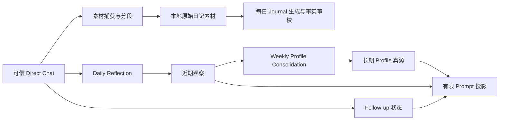
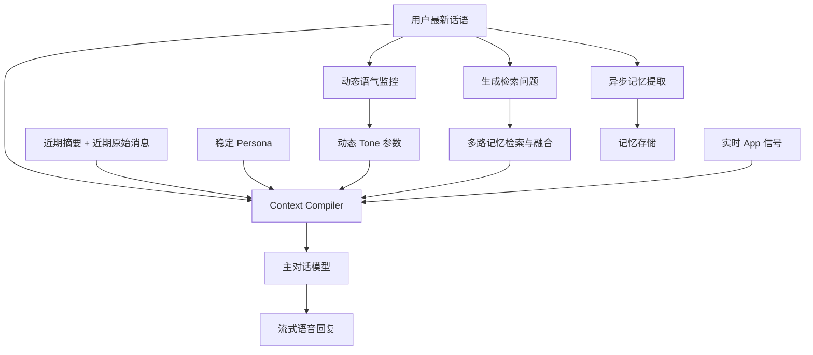
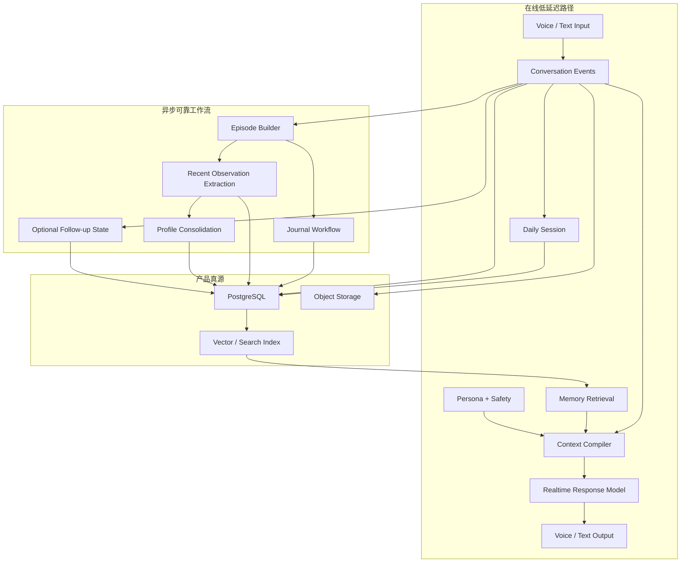

# SayHear Agent 运行系统调研：OpenClaw 实践与 Tolan 架构

> 状态：技术选型前的研究输入，不是最终架构决策
>
> 更新时间：2026-07-24
>
> 产品事实来源：[AI Life Journal 产品文档 v0.1](../product/AI_Life_Journal_Product_Document_v0.1.md)

## 1. 结论摘要

OpenClaw 与 Tolan 分别验证了 SayHear 所需系统的两个侧面：

- **OpenClaw 验证了后台运行系统**：从私聊捕获素材，生成日记，形成近期观察，维护待跟进事项，再将多日证据巩固为长期 Profile。
- **Tolan 验证了在线对话系统**：每轮重新构建上下文，快速召回相关记忆，将稳定人格与动态语气分离，并在后台持续压缩长期记忆。

两者共同指向的核心架构不是一个拥有巨大 Prompt 的单体 Agent，而是：

> **以 Conversation Event 为原始证据，以 Context Compiler 驱动实时对话，以异步工作流维护 Journal、近期观察和长期 Profile 的双速运行系统。**

对 SayHear 最重要的结论是：

1. **模型只负责提出候选与生成语言，系统代码负责事实边界和状态变更。**
2. **每轮对话重新编译上下文，不把模型会话或长 Prompt 当成长期状态。**
3. **原始对话、Daily Session、Journal、Memory Claim、Profile 是不同的数据对象，不能混成一份“记忆文本”。**
4. **记忆系统必须同时保留证据、认识状态、置信度、生命周期和删除语义。**
5. **Journal 是 SayHear 的核心交付，生成过程必须可追溯、可审计、可重试，并从第一版就支持内部版本记录。**
6. **向量数据库是检索索引，不是事实数据库；关系数据库应是产品状态和用户控制的真源。**
7. **OpenClaw 的文件、Shell、Cron 适合个人实验，但不能直接迁移为消费级产品基建。**

初步技术方向：

- iOS：原生 Swift / SwiftUI，语音传输层保持可替换；
- 在线服务：Node.js / TypeScript；
- 离线 AI 工作流：Python；
- 真源数据库：PostgreSQL；
- 热状态与并发控制：Redis；
- 向量检索：早期优先 PostgreSQL + pgvector，规模和延迟证明需要后再迁移专用服务；
- 长任务：采用可持久化、可重试、可观测的 Workflow 系统，而不是 Cron + Shell；
- AI：通过内部模型网关隔离模型、Embedding、语音和供应商变化。

这些是架构方向，不等同于已经完成供应商选型。

---

## 2. 研究范围与证据等级

### 2.1 本地实践

本次检查了以下 OpenClaw Skills 的说明、配置、核心脚本和测试：

- `companion-diary-capture`
- `daily-diary-to-dayone`
- `mandy-reflection`
- `mandy-follow-up`
- `mandy-profile-consolidation`
- `openclaw-diary-core`

本地 Skill 属于实际运行过的个人系统，能说明哪些领域规则在真实使用中重要，但不能直接证明其技术形态适合规模化产品。

### 2.2 Tolan 公开资料

证据优先级如下：

1. OpenAI 与 Tolan/Portola 官方资料；
2. Tolan 团队成员公开技术说明；
3. 基础设施供应商对客户使用方式的说明；
4. App Store 用户反馈，仅用于确认产品体验，不用于断言后台实现；
5. 第三方报道，仅作补充。

本文使用三种标记：

- **已确认**：公开来源直接说明；
- **强推断**：多个证据共同支持，但没有完整实现披露；
- **未知**：公开资料不足，不能当作事实。

---

## 3. OpenClaw：已经验证的产品运行系统

### 3.1 运行链路

OpenClaw 当前形成了近似如下的分层流水线：



它已经验证了几个重要的领域边界。

### 3.2 素材捕获不是“总结所有聊天”

`companion-diary-capture` 的关键实践：

- 只读取可信的 direct chat，排除群聊、Cron、工具输出、开发任务和内部 Prompt；
- 将长会话切成候选片段，而不是整段一次性总结；
- 用户在某个片段明确 opt-out 时，只排除相关片段；
- 优先使用稳定 `message_id` 去重，内容哈希作为辅助；
- 保留 `source_session`、`source_hash`、`source_message_ids` 和 `dedupe_key`；
- 原始引文保持不变，模型生成的标题、摘要和观察与原文分离；
- 本地写入验证成功后才允许同步外部系统；
- 部分成功不能被报告为全部成功。

对 SayHear 的含义：

> 用户说过什么、系统如何理解、系统最终写了什么，必须是三层不同的对象，并通过证据引用关联。

### 3.3 Journal 流水线采用“模型生成 + 确定性质量门”

`daily-diary-to-dayone` 已从自由发挥的 Agent 流程演进为脚本主导：

- 代码确定输入范围、运行顺序、格式约束、写入与错误处理；
- 模型负责生成标题和正文；
- 独立模型或步骤审校事实支持关系；
- 结构不合法是硬失败；
- 审校不可用时保留最近一个结构合法稿，并明确标记需要复核；
- 计划、愿望、考虑不能被升级为已经发生的事实；
- 后台诊断与用户通知分离。

对 SayHear 的含义：

> Journal 生成不是一次 Prompt 调用，而是一条拥有输入快照、生成结果、审校结果、发布状态和失败恢复策略的正式工作流。

### 3.4 Reflection 是近期、会过期的观察

`mandy-reflection` 将近期理解视为有生命周期的状态，而不是永久画像：

- 模型只输出候选，不能直接修改状态；
- 候选必须引用真实用户消息；
- 区分明确观察与不确定 hypothesis；
- hypothesis 需要多条相互支持的证据和最低置信度；
- 不保存诊断、敏感属性和不必要的第三方隐私；
- 观察拥有 TTL，到期后归档而非无痕消失；
- 新证据可重新激活旧观察，并保留历史证据；
- 支持 counterevidence、用户纠正、忘记和来源会话清理；
- 底层 ledger 与当前状态分开；
- 注入 Prompt 的只是有界投影，不代表完整真源。

这是 SayHear “AI Impression” 的重要原型。它说明 Impression 不应只是自然语言 Bio 中的一句话，而应先存在为结构化、可审计的 Claim。

### 3.5 Follow-up 是短期开放状态，不是长期人格

`mandy-follow-up` 将待跟进事项单独建模：

- 只捕获明确未来计划、等待结果、重要时间点或用户明确请求；
- 普通见闻、模糊愿望、一次情绪不进入 Follow-up；
- `opportunistic` 与 `proactive` 分开；
- proactive 必须有时间窗、过期时间且最多主动询问一次；
- 后续消息可以更新、解决或取消事项；
- checkpoint 增量扫描，没有新消息或本地预筛无信号时不调用模型；
- 模型遗漏不能删除旧事项；
- 使用原子写、运行锁和稳定 ID 避免并发破坏。

对 SayHear 的含义：

Follow-up 可以增强“它记得我”，但它不是 External MVP 核心，也不能悄悄把产品变成计划和目标管理工具。未来若加入，应作为独立短期状态域，而不是塞进长期 Profile。

### 3.6 Profile Consolidation 是证据晋升系统

`mandy-profile-consolidation` 的关键实践：

- Profile 是真源，注入 Prompt 的用户介绍只是有界投影；
- Weekly Consolidation 读取近期 Reflection 证据，而不是重新扫描所有原始私聊；
- 长期 Claim 需要跨日期、跨时间跨度和高置信度证据；
- 模型遗漏不能删除现有 Claim；
- 用户确认或固定的 Claim 受更强保护；
- 推断型 Claim 会进入 review due、dormant、contested、superseded 等状态；
- 用户删除后清除 Claim 文本和证据，只保留无原文 tombstone；
- tombstone 防止后续批处理或历史回滚复活已删除内容；
- 历史版本、当前状态和 Prompt 投影相互分离。

这是最值得 SayHear 继承的模式：

> 长期记忆不是“模型每周重写一次 Bio”，而是对证据化 Claim 进行晋升、合并、降级、替代和删除，再由投影器生成用户可读 Bio 与模型上下文。

### 3.7 OpenClaw 中不应直接复制的部分

- 本地 Markdown 文件作为核心数据库；
- Shell 脚本串联主流程；
- Cron 作为可靠任务调度器；
- 绝对用户路径、固定时区和手工月份文件；
- 通过 managed Markdown block 模拟数据库投影；
- 将某个模型名称写死在业务配置；
- 多处工作流分别读取会话文件并各自实现过滤；
- 外部同步依赖 CLI 和临时文件；
- 仅靠个人环境中的静默失败、运行日志和手工恢复。

这些形态适合 Mandy Lab，但在多用户、跨端、并发、删除合规和生产观测下会迅速失控。

---

## 4. Tolan：对话、长期记忆与 Journal

### 4.1 在线对话架构：每轮重建 Context

**已确认。** OpenAI 的 Tolan 案例说明：

- Tolan 使用 GPT‑5.1 与 Responses API 后，语音启动时间缩短超过 0.7 秒；
- 每一轮都从头重建上下文窗口；
- 输入包括近期消息摘要、近期原始消息、人格卡片、向量召回记忆、语气指导和实时 App 信号；
- 对话历史会定期重新摘要和压缩；
- 用户回复后，语气更新和记忆提取在并行路径中发生。

来源：[OpenAI：GPT‑5.1 如何助力 Tolan 构建语音交互 AI](https://openai.com/zh-Hans-CN/index/tolan/)

Tolan 创始人也明确表示，缓存 Prompt 不适合语音，因为用户会频繁切换话题。

来源：[Quinten Farmer 的公开说明](https://www.linkedin.com/posts/quintendf_how-tolan-builds-voice-first-ai-with-gpt-activity-7414730280374136833-yh2H)

因此，Tolan 的核心不是一个长期存活的模型会话，而是一个每轮执行的 **Context Compiler**：



对 SayHear 的直接启发：

- Daily Session 是产品组织单位，不应被等同于模型会话；
- 每轮上下文应根据当前话题重新选择，而不是机械携带整日历史；
- 稳定人格、当前情绪语气、用户记忆和安全边界应是独立的上下文层；
- 记忆写入不应阻塞用户听到第一段回复。

### 4.2 长期记忆：在线召回 + 夜间整理

**已确认。** Tolan：

- 保存事实、偏好以及影响回应方式的情绪 “vibe” 信号；
- 使用 `text-embedding-3-large` 生成向量；
- 使用 Turbopuffer 检索，公开指标为 50ms 内；
- 不只用用户最新消息检索，还生成诸如“用户的配偶是谁？”的内部问题；
- 多个检索结果通过倒数排名类方法融合；
- 新记忆会经过 reflection，再通过 embedding kNN 聚类；
- 聚类内进行合并、编辑和精炼；
- 夜间任务删除低价值或重复项并处理矛盾；
- 公开效果包括记忆召回失误下降 30%、次日留存提升 20% 以上。

来源：[OpenAI Tolan 案例](https://openai.com/zh-Hans-CN/index/tolan/)

这形成了两种速度：

- **在线路径**：快速召回、快速提取候选，不阻塞对话；
- **离线路径**：聚类、合并、去重、冲突处理和压缩。

### 4.3 检索不应只查询“最后一句话”

Tolan 会根据最新话语合成多种检索问题。团队工程成员进一步说明，他们在记忆生成和召回阶段都会合成多种查询，以提高命中率。

例如，用户说“他周末也会去”，字面向量检索可能不知道“他”是谁。系统可以并行生成：

- 最近谈到的男性人物是谁？
- 用户本周末有什么安排？
- 最近是否有与旅行相关的计划？

然后对多路结果进行融合和重排。这比单一 embedding query 更适合口语、代词和跳跃话题。

来源：[Tolan 团队成员 Evan Goldschmidt 的公开技术说明](https://www.linkedin.com/posts/tom-shapland-b4494212_how-tolan-builds-voice-first-ai-with-gpt-activity-7415868500616892416-14bh)

### 4.4 语音层的公开细节

**团队公开说明，但 OpenAI 正文未展开。**

Evan Goldschmidt 说明 Tolan：

- 使用 LiveKit；
- 使用其 CPU 友好的 EOU 模型与 turn detection；
- 使用轻量监控 Prompt，根据对话进展动态改变 Agent 行为；
- 记忆压缩 Prompt 输出 diff，而不是每次输出完整快照；
- Turbopuffer 将 embedding 从冷对象存储带入 NVMe 完成快速 ANN 查询。

来源：[Tolan 团队成员公开技术说明](https://www.linkedin.com/posts/tom-shapland-b4494212_how-tolan-builds-voice-first-ai-with-gpt-activity-7415868500616892416-14bh)

Tolan 的招聘信息还显示：

- 后端主要使用 Node.js（TypeScript）、Python、PostgreSQL、Redis；
- iOS 为原生产品，并将复杂音视频系统视为核心能力。

来源：

- [Tolan Backend Product Engineer](https://www.tolans.com/careers/role?id=a3d04d1f-8b7d-4b04-ab9d-7f98eb4d6503)
- [Tolan iOS Product Engineer](https://www.tolans.com/careers/role?id=d9bc3fac-77e9-4cc8-8a05-e00c71663b27)

招聘信息能确认技术栈存在，但不能证明每个组件在其系统中的具体职责。

### 4.5 原始历史与压缩记忆可能并存

**强推断。**

Turbopuffer 的创始人以客户 Portola/Tolan 为例说明：Tolan 面对的不只是少量压缩记忆，还有非常长的历史聊天；长期系统存在一个连续谱，一端是凝练记忆，另一端是搜索全部历史上下文。他推测检索完整历史的系统可能优于只保留压缩记忆的系统，同时压缩记忆应拥有更高权重。

来源：[Turbopuffer：The infrastructure company powering the top AI apps](https://turbopuffer.com/blog/podcast-unsupervised-learning-redpoint-ai-podcast-infrastructure-company-powering-top-ai-apps)

这不能证明 Tolan 当前的完整表结构，但足以支持 SayHear 不要在“保留原始对话”和“只保留摘要记忆”之间二选一。

更合理的结构是：

- Conversation Event：完整原始证据；
- Episode / Daily Summary：时间和主题压缩；
- Memory Claim：高价值、跨会话可复用的知识；
- Retrieval Index：对以上数据的可重建索引。

### 4.6 Tolan 的 Journal：确认了体验，未公开运行管线

**已确认的产品现象：**

- Tolan App 存在每日 Journal；
- 用户将其描述为“通过另一个人的眼睛回看自己的一天”；
- 这类第三方视角是用户感到“被看见”的重要来源。

来源：[Tolan App Store 页面与用户评价](https://apps.apple.com/us/app/tolan-your-friendly-guide/id6477549878)

**公开资料没有确认：**

- Journal 是实时更新、当晚生成还是次日批处理；
- 输入是完整对话、摘要、记忆还是混合数据；
- 是否存在事实审校、版本、人工抽检或重新生成；
- Journal 与长期记忆谁先生成、谁引用谁；
- 失败、空白日、跨午夜和多设备并发如何处理。

因此，下面只能作为 SayHear 的设计推断，不能写成 Tolan 的实现事实：

```text
Daily Conversation
  → Daily Episode / rolling summary
  → 当日事实与观察候选
  → Journal draft
  → 事实与认识状态检查
  → published Journal
  → 次日展示
```

### 4.7 Tolan 的产品和隐私边界不适合直接复制

Tolan 当前定位包含建议、目标、待办和帮助用户推进生活，而 SayHear 默认不做 Coach、计划或行为改变。

来源：[Tolan FAQ](https://www.tolans.com/faq)

Tolan FAQ 说明所有对话都会记录并用于生成记忆，日志保存在其服务器。其隐私政策还说明会收集语音、文本、图片及使用数据，并可能提供给 AI、分析、广告及其他服务商；删除请求也存在备份、归档、分析和法律等保留例外。

来源：

- [Tolan FAQ](https://www.tolans.com/faq)
- [Tolan Privacy Policy](https://www.tolans.com/privacy-policy)

SayHear 的长期信任和敏感生活记录定位要求更严格的数据最小化、供应商隔离、访问审计、删除传播和透明解释，不能把 Tolan 的公开隐私姿态当作默认模板。


---

## 5. 面向 SayHear 的统一运行系统

### 5.1 建议的领域分层



### 5.2 核心数据对象

建议至少明确以下边界：

| 对象 | 作用 | 是否真源 |
| --- | --- | --- |
| Conversation Event | 用户/AI 的原始 turn、时间、渠道、稳定 ID | 是 |
| Daily Session | 按用户时区组织一天内的多次交流；连续交流跨午夜时保留开始日期归属 | 是 |
| Episode | 从连续交流中提取的事件或主题单元 | 派生但持久化 |
| Journal | AI 第三人称观察及其发布状态 | 是，需版本 |
| Objective Memory Claim | 人物、关系、工作、事件等相对客观事实 | 是 |
| AI Impression Claim | AI 的观察、假设及认识状态 | 是 |
| Open Loop | 有明确生命周期的短期待跟进状态 | 是，但独立于 Profile |
| Profile Projection | 给用户阅读或给模型注入的自然语言 Bio | 否，可重建 |
| Vector Index | 语义检索索引 | 否，可重建 |
| Workflow Run | Journal、Extraction、Consolidation、Deletion 的运行记录 | 是 |

### 5.3 Memory Claim 的最低字段

长期记忆至少需要：

- `id`
- `user_id`
- `kind`
- `canonical_key`
- `statement`
- `epistemic_status`：confirmed / observed / inferred / contested
- `confidence`
- `status`：active / review_due / dormant / superseded / retracted
- `valid_from` / `valid_to`
- `last_observed_at`
- `source_event_ids`
- `counterevidence_event_ids`
- `supersedes_id`
- `created_by`：user / model / consolidation
- `model_version` / `prompt_version`
- `deleted_at`

对 SayHear 尤其重要的是：

- “用户明确说过”不等于“客观世界事实”；
- “AI 感觉到”不能升级成事实；
- 一次情绪不能成为稳定人格；
- 当前状态不能覆盖历史状态；
- 删除不能只从 UI 隐藏，还要阻止批处理和回滚复活。

### 5.4 每轮 Context Compiler

建议把 Context Compiler 作为正式服务，而不是散落在 Prompt 拼接代码中。其输入可包括：

1. 不可覆盖的产品与安全边界；
2. 当前 Persona 的稳定特征；
3. 当前 Daily Session 的滚动摘要；
4. 最近若干原始 turn；
5. 当前语气与会话状态；
6. 通过多查询召回的 Objective Memory；
7. 少量相关且未过期的 AI Impression；
8. 必要的 Open Loop；
9. 实时 App/设备信号；
10. 数据来源标签与 token budget。

编译结果应该可记录、可回放、可评估，但日志中需要对敏感内容进行严格控制。

### 5.5 Journal 工作流

SayHear 的 Journal 不应直接读取“当前 Profile 文本”后自由创作。建议的输入优先级：

1. 当日 Conversation Event；
2. 当日经过验证的 Episode；
3. 当日明确事实与近期观察；
4. 少量与当天确实相关的历史记忆；
5. Persona 只控制观察视角与语言，不提供事实。

建议状态机：

```text
evaluation_pending
  ├→ insufficient_expression
  └→ queued
  → drafting
  → validating
  → published
  → superseded / deleted

失败状态：
  retryable_failed
  terminal_failed
  needs_review
```

完全无 Conversation 的日期不进入工作流；`insufficient_expression` 只表示现有
用户表达无法支撑一条真实 Journal Statement，不能代表内容“不重要”。

每次生成需保存：

- 输入事件范围及快照版本；
- 生成模型、Prompt 和策略版本；
- Draft；
- 事实支持与认识状态检查结果；
- 发布版本；
- 失败和重试记录。

即使 Internal Core 与 External MVP 都不允许自由编辑或随意重新生成，
仍必须保留版本和 supersede 能力；Journal Correction 通过纠正来源并生成新版本，
安全修复错误 Journal。

### 5.6 两速记忆系统

**在线：**

- 当前 turn 之后快速提取候选；
- 轻量去重；
- 为下一轮或同日续聊提供即时记忆；
- 延迟预算独立，不阻塞语音首响应；
- 低置信度候选不能直接进入长期 Profile。

**离线：**

- Daily Episode / Observation；
- 记忆聚类、合并、冲突检测；
- Claim 晋升、降级和过期；
- Weekly Profile Consolidation；
- Journal 生成或补偿；
- 删除传播、索引清理和质量评估。

### 5.7 隐私和删除必须贯穿所有派生层

删除一个 Conversation Event 可能影响：

- 原始音频；
- 转写文本；
- Daily Session 摘要；
- Episode；
- Journal；
- Memory Claim；
- Profile Projection；
- Embedding；
- 缓存；
- Workflow 日志；
- 备份和第三方供应商。

因此需要 lineage，而不是只执行一条 `DELETE conversation`。至少应能够回答：

> 这条 Journal 句子和这条长期记忆来自哪些用户表达？删除或纠正原始表达后，哪些派生数据需要撤回、重算或标记失效？

已确认的产品边界是：完整 Profile 编辑 UI 可以延后，但从第一条可召回
Memory Claim 开始就必须支持对话内 Memory Correction 与 Memory Forget Request。
用户询问或质疑记忆时，SayHear 还必须能通过对话解释相关日期、用户表达，以及它是
Objective Memory 还是 AI Impression；产品界面不需要专门展示引用。底层 Claim、
证据、tombstone 和可展开来源能力从 Phase 1 Internal Core 存在。

两类 Claim 的召回语言也不能混用：Objective Memory 可以归属于用户先前陈述，但
不能暗示已经独立核验；AI Impression 必须保留“我有一个印象”或“我可能理解为”
一类不确定性，不能说成“我记得你就是”。

---

## 6. 初步技术选型建议

### 6.1 客户端

**iOS：Swift + SwiftUI，复杂音频部分使用原生 AVFoundation/AudioSession 能力。**

理由：

- iOS 是长期高频主端；
- 音频中断、蓝牙、耳机、后台、来电、权限和系统生命周期需要原生控制；
- Voice 是核心体验，不适合被跨端框架的最低公分母限制。

实时传输层可以优先评估 LiveKit，但应通过内部 `VoiceTransport` 接口隔离，避免把会话、转写、模型和记忆逻辑绑定到供应商 SDK。

Web 服务 Phase 1 Internal Core，也是 Phase 2 External MVP 的确定平台；
正式 iOS 是否进入 External MVP 仍待确认。Web 技术不应约束未来 iOS 的最终语音体验。

### 6.2 在线后端

**Node.js + TypeScript。**

适合：

- API 与 WebSocket/WebRTC 会话编排；
- Daily Session 状态；
- Context Compiler；
- 流式模型调用；
- 鉴权、订阅和跨端同步；
- 类型化事件和业务状态机。

使用 TypeScript 的主要理由是在线 I/O 密集、客户端协作和快速迭代，不是因为 Tolan 也使用它。

### 6.3 离线 AI 与评估

**Python。**

适合：

- Journal 生成与事实审校；
- Memory Extraction / Consolidation；
- Embedding、聚类和离线重建；
- 数据分析、评估集和回归测试；
- 模型供应商批处理。

在线服务与 Python Worker 应共享版本化 Schema，而不是通过自由文本文件交换。

### 6.4 数据层

**PostgreSQL 是真源。**

适合承载：

- 用户、设备、订阅；
- Conversation Event 与 Daily Session；
- Journal 及版本；
- Memory Claim、证据和 tombstone；
- Workflow 状态；
- 删除 lineage 与审计元数据。

**Redis 只承载短期热状态：**

- 会话 presence；
- 流式连接与节流；
- 分布式锁；
- 短期 Context 缓存；
- 幂等键；
- 队列或 Workflow 辅助状态。

Redis 不应成为长期记忆真源。

**向量检索：**

- Internal Core 和 External MVP：优先 pgvector，减少系统数量并保留事务一致性；
- 当向量规模、P95/P99 延迟、索引更新压力或成本出现明确瓶颈后，再评估 Turbopuffer 等专用检索服务；
- 从第一天通过 `RetrievalStore` 接口隔离实现；
- Embedding 必须能够从 PostgreSQL 真源重建。

Turbopuffer 自己也建议：在约百万向量规模附近，将向量扩展放在关系数据库中是合理起点；数量进入千万、亿级后，专用搜索基础设施的经济性才更明显。

来源：[Turbopuffer 访谈](https://turbopuffer.com/blog/podcast-unsupervised-learning-redpoint-ai-podcast-infrastructure-company-powering-top-ai-apps)

### 6.5 Workflow

Journal、Daily Extraction、Weekly Consolidation、删除传播和补偿任务需要：

- 持久化执行状态；
- 幂等；
- 自动重试与退避；
- 定时与延迟执行；
- 单用户/单日并发控制；
- 可取消；
- 可观测；
- 版本迁移；
- 死信和人工重放。

正式产品应选用 Durable Workflow，而不是把 Cron + Shell 搬到云端。具体选 Temporal、云厂商方案还是更轻量的工作流服务，需要结合团队能力和部署方式单独决策。

### 6.6 模型与语音供应商

建议建立内部接口：

- `ConversationModel`
- `JournalModel`
- `MemoryExtractionModel`
- `EmbeddingModel`
- `SpeechToText`
- `TextToSpeech`
- `RealtimeSpeechModel`
- `SafetyClassifier`

目标不是第一天支持任意模型，而是：

- 记录每个输出由哪个模型与版本生成；
- 允许对话、Journal、审校使用不同延迟/质量档位；
- 允许 Shadow Evaluation 和受控迁移；
- 避免供应商响应结构渗入领域数据库。

不要一开始建立过度通用的多供应商框架。先服务 1 个主路径和 1 个可验证 fallback 即可。

---

## 7. Core Feature Flow 应该验证什么

非正式 Interface 可以简化，但 Core Engine 不应简化以下能力：

### 必须真实存在

- 稳定 Conversation Event ID；
- Phase 1 单一 Internal Owner Account 与所有私有数据的稳定 `user_id` 边界；
- 用户时区与 Daily Session 边界；
- 同日多次续聊；
- 跨午夜连续交流不拆分，结束后的新日期交流创建新 Session；
- Continuous Exchange End 只由用户明确结束或版本化 inactivity timeout 决定，
  模型的自然收尾不能直接改变 Session 状态；
- 每轮 Context Compiler；
- 最近消息摘要与原始 turn 混合上下文；
- 1A.1 只有完整成功的 Assistant Response 进入 Context；Interrupted Response
  明确失败并允许显式 Retry；
- 1A.1 所有模型调用经过单体内部唯一的 Provider Egress Port，普通模块不能
  直接调用 Provider adapter；
- Memory Claim 与证据引用；
- Journal 异步生成状态机；
- 幂等重试；
- 模型/Prompt 版本记录；
- 数据删除的基本 lineage；
- 可回放的评估样本；
- 用户内容不进入普通应用日志。

### 可以暂时简化

- 消费者注册、邀请、账号恢复、多用户生命周期和用户管理；这些属于 Phase 2，
  但 Phase 1 数据模型不能省略 `user_id`；
- 逐 chunk 持久化、rendered ACK 和崩溃断点恢复；只有 Realtime 或未来明确批准的
  交付渠道经评估证明需要时才通过新 ADR 引入；后续 ADR-050 已移除 PTT 产品路径；
- 独立 Provider Egress Gateway、credential broker 和 claim-and-fetch 网络协议；
  在 Replay / Voice 独立 runtime 处理真实私人数据前再按信任边界抽离；
- 完整消费者 UI；
- 订阅和支付；
- 多人格和多 Voice；
- Web/iOS 同时完善；
- 专用向量数据库；
- Weekly/Monthly 可视化产品；
- 主动 Follow-up；
- 完整 Profile 管理界面；
- 外部生活数据接入。

### 不应为了 Demo 引入的债务

- 把所有状态塞进一个 JSON/Markdown；
- 用单一长 Prompt 代替 Context Compiler；
- 每次把完整历史发送给模型；
- 让模型直接写数据库；
- 先生成 Journal，再事后猜它引用了什么；
- 用向量数据库保存唯一真相；
- 用定时脚本覆盖用户当前 Profile；
- 依赖模型“记得不要编造”而没有证据检查；
- 保存原始音频但没有明确保留和删除策略；
- 把最小高风险响应推迟到公开发布前，或反过来在 Internal Core 先建设完整危机运营系统。

已确认的安全分层是：Core Flow 1A.1 从第一天具备 Minimum High-Risk Response
行为边界和回放测试；地区化危机资源、正式处置流程与安全事件运营是
External MVP 面向真实用户前的上线门槛。

---

## 8. 需要在最终技术选型前对齐的关键决策

1. **[已确认] 首个 Core Flow 的目标客户端是什么？**

   Phase 1 Internal Core 使用内部 Web；Phase 2 External MVP 也必须包含 Web。
   正式 iOS 是否进入 External MVP 仍待确认，当前倾向仅 Web。

2. **第一版语音采用级联还是端到端 Speech-to-Speech？**

   级联 STT → LLM → TTS 更可观测、易生成可靠 transcript；端到端语音可能更自然，但事实审计、打断和供应商绑定更复杂。

3. **Transcript 是否是 Conversation 的权威文本？**

   如果转写错误会进入 Journal 和长期记忆，就需要置信度、用户纠正和音频短期回放策略。

4. **原始音频保存多久？**

   完全不保存、短期保留用于纠错、或长期保存，会显著改变隐私、成本和产品承诺。

5. **[已确认] Journal 在什么时候发布？**

   用户表达结束意图后，或当天达到后台自动评估条件后，SayHear 以很低的证据门槛
   判断能否支撑至少一条真实记录；成立后直接发布，不要求用户手动生成或审核批准。
   门槛不判断内容是否重要，日常琐事和事务性内容可以成立。同日后续表达通过新
   Journal Version 更新记录。

   完全无 Conversation 的日期静默跳过；有 Conversation 但仅有问候等不足以支撑
   真实记录时，产品界面显示 No Journal Notice，该状态不属于 Journal。

6. **[已确认] 用户如何纠正 Journal？**

   不支持自由编辑或随意重新生成；用户指出错误后，纠正来源并生成取代旧版本的新 Journal。

7. **[已确认] Profile 纠错 UI 可以延后多久？**

   完整 UI 可以延后；从第一条可召回 Memory Claim 开始，底层纠正、忘记、
   tombstone 和重算能力不得延后。

8. **部署与团队约束是什么？**

   单人/小团队、预算、云厂商偏好、是否接受 Temporal 等运维成本，会影响 Workflow、数据库和实时语音选型。

9. **主模型是否确定使用 OpenAI？是否要求供应商 fallback？**

   这会决定首版模型网关的复杂度、评估策略和数据处理协议。

10. **Core Flow 的成功指标优先验证什么？**

    “语音自然”“被理解”“Journal 准确且独特”“一周内感到被记住”需要不同的工程优先级和评估集。

---

## 9. 建议的下一步

主线程的技术选型讨论可以按以下顺序进行：

1. 先确认上面的 10 个决策，尤其是客户端、语音形态、音频保留和 Journal 时机；
2. 定义 Core Feature Flow 的质量预算：首响应延迟、打断、转写准确性、Journal 事实错误率、记忆命中与误召回；
3. 画出一版正式的 Context Compiler、Memory Claim 和 Journal Workflow 数据契约；
4. 再决定具体供应商与组件；
5. 用 10–20 条真实、匿名化或合成的跨日对话建立回放评估集；
6. 实现最小正式垂直切片，而不是先搭完整 App。

最小正式垂直切片应覆盖：

> Voice/Text 输入 → Daily Session → 每轮 Context Compiler → 回应 → 证据化 Memory Candidate → Journal Workflow → 次日召回 → 删除/纠正回放验证。

---

## 10. 最终判断

OpenClaw 最有价值的不是那些 Skill 文件本身，而是它在真实使用中逐渐暴露出的系统规律：

> **任何长期理解用户的 AI，都必须把“模型认为”降级为候选，把“系统记住”升级为有证据、可过期、可纠正、可删除的正式状态。**

Tolan 最有价值的也不是某个模型或向量数据库，而是它证明了：

> **实时对话每一轮都应该重新决定此刻需要知道什么；后台系统则长期决定什么值得记住、如何合并，以及什么时候应该忘记。**

SayHear 需要在此基础上再向前一步：

> **让 Journal 成为这套系统最可信、最有感情、也最可追溯的核心交付。**
