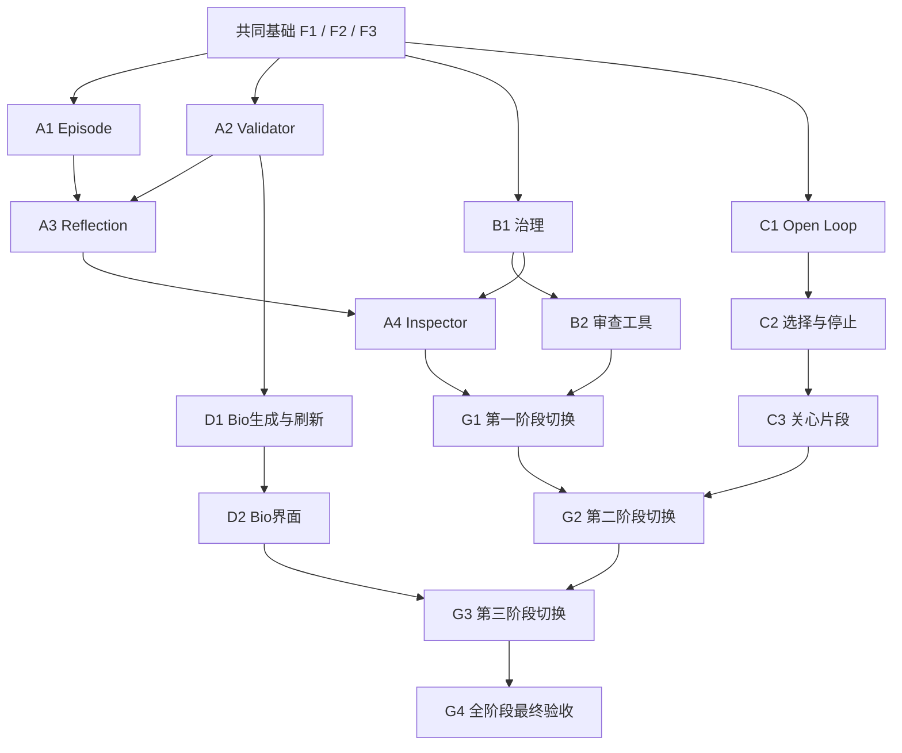

# [SPEC] Internal Core / Core Flow 1A.3b：Continuation & Reflection

## 1. 摘要与状态

本 SPEC 把 1A.3a 已有的 Memory & Recall 扩展为跨日事件组织、对话内主动关心、内部 Reflection、人工 Predicate 治理，以及面向 Internal Owner 的叙事 Bio。所有派生能力继续以有效 User Evidence 为事实根，服从 Correction、Forget、身份变化、版本与 Full Purge 边界。

**状态：Accepted。Luke 于 2026-09-08 明确接受完整 SPEC 和 18 个工作包的拆分方案。实现与上线验收尚未执行。**

本 Issue 正文、规范附录评论与标签是唯一执行真源；`docs/specs/README.md` 只增加发现索引。开发拆分共用这一篇 SPEC，不能把各票据变成相互漂移的产品定义。本任务不执行生产代码、migration 或部署。

来源地图：[Wayfinder #163](https://github.com/lukemyself-hub/SayHear/issues/163)。交接任务：[#179](https://github.com/lukemyself-hub/SayHear/issues/179)。前置实现与质量标准：[#107](https://github.com/lukemyself-hub/SayHear/issues/107)。仓库核查基点：`167182af9552aaed0990dbc430b23d3cf2d03cae`。这表示文档与代码的审计版本，不表示新功能已通过验收或已部署。

## 2. 用户问题、范围与体验

已有 Memory 能保存并召回用户说过的人和事，但尚不能完整地承接一次跨日旅行、一个待揭晓的结果，或在合适的空档自然问候过去的牵挂。后台也缺少可检查的跨日观察及人工处理新 Predicate 的工具。用户尚看不到基于已准入 Memory、可理解其依据且尊重纠错的 Bio。

本阶段交付以下完整行为：

- 用户跨天聊到同一次旅行时，Episode 在有真实事件锚点和可靠连续性时组织这些表达；证据不够就保持未绑定，不为补齐结构追问。
- 用户说下周有一个已安排的面试或正在等检查结果时，可以形成有期限的 Open Loop。单纯“明天要交报告”不能因为有日期就变成任务追踪。
- 用户主动开启对话或交流出现自然空档时，SayHear 可以选择一个合格的过去事项，以一句可接话的问题或关心表达连接当下。正在处理当前话题、直接任务或安全需求时让位；拒绝或回避后尊重该目标的停止状态。
- Daily / Weekly Reflection 形成有来源的内部观察，只能建议新 Memory Candidate，由既有 `memory.consolidate` 决定准入。开发者可以逐层检查其 Evidence、Candidate 处置、Claim 资格和 Bio 支持关系。
- 人工通过独立 Review Tool 处理 unmapped Candidate，必要时形成无用户内容的 Predicate Change Proposal。Registry 发布仍经代码、测试与 migration，Web 和模型不能直接发布或创建 Claim。
- 用户看到章节式、第三人称的 Bio，按需展开原话与日期，知道何时更新、何时可刷新。不准确或不想保留的理解先进入 Memory Correction / Forget，信任失效后旧 Bio 立即不可见。
- 每个新增私人数据面在写入真实内容前就具有可验证的删除、保留期、恢复防复活与晚到结果保护。

这里的“上线”只指单 Internal Owner 的 Internal Core 切换。它不代表 External MVP 或对外发布。

### 明确排除

不建设 Embedding、pgvector、向量列或 Embedding Champion；不更改 retrieval budgets v2；不回填上线前历史 Conversation；不做私人对话 Shadow、正式 Replay Runtime、1A.4 Model Routing Policy 平台、Conversation Text Champion 更换或 Realtime Voice。离线固定合成数据验收不等于提前建设正式 Replay 产品。

不发送对话外消息或通知，不做提醒、任务、目标管理、完成率或进度评分；不建设用户式 Reflection 页面、Bio 正文编辑、逐条 Bio 删除、发布前预览审批、多候选抽卡或强制发布。不同生成配置的离线盲评不向产品用户提供多候选选择。

不增加消费者账号、注册、邀请、Onboarding、订阅、iOS、多用户生命周期、Account Data Export 或消费者删除入口。Internal Owner Full Purge 沿用操作员专用能力，不能由对话模型执行。

## 3. 共同技术合同与现有基础

### 3.1 真源、身份与依赖方向

PostgreSQL 保存 canonical state、不可变 Version、current pointer、命令与审计。TypeScript 模块化单体继续承载 domain/application；UI、Workflow 和模型 adapter 调用明确的应用接口，不拥有第二份业务真源，不引入新框架、Redis、Python Worker 或 Temporal。

领域对象以 opaque UUIDv7/branded ID 区分 logical identity 与 Version identity。私人 row 带服务端推导的 owner，API 不接受 client-supplied owner。外键与数据库约束约束跨对象和跨 owner 引用，名称、locale、模型 confidence 不决定身份。语义分类与策略使用独立版本化 ID。

只有有效 final / corrected User Event Revision 经 EvidenceItem 精确引用才能作为生活事实的 Evidence。Assistant、Journal、Summary、Reflection、Bio 和模型推断均不能反向证明用户事实。运行 lineage 说明“怎样生成”，support 说明“依据何在”，两者必须分开存储和校验。

User Profile 是 Objective Memory 与 active AI Impression 构成的长期理解；Bio 是基于合格 Claim 写成的作品。实现使用 `Bio` / `BioVersion`，不新建 `ProfileVersion` / `ProfileProjectionVersion` 同义模型。Person Portrait 继续是对话中逐条、有限的 Claim 选集。Episode、Reflection、Bio 原文不进入对话 Context，Episode 只允许经 Open Loop 的已验证引用间接参与。

### 3.2 命令、事务与恢复

GenerationCommand 冻结一次逻辑意图的 source、data epoch、Prompt、Schema、policy、模型配置与 freshness。ModelRunAttempt 是真实 Provider 调用。技术 retry 只增加 attempt；不同生成阶段使用不同 command。不得把模型、部署版本变化当作创建第二次用户意图的理由。

所有权威提交在同一短事务中锁定 owner/aggregate，验证 active owner、expected epoch、有效 source、目标版本、current pointer、适用 freshness 与 active rollout pins，再提交领域结果和 outbox。不能在事务外先检查再写；事务不等待 Provider 或其他网络请求。模型输出经验证前始终非权威。

`source_valid` 用于可独立提交的冻结 Evidence 派生；Reflection/Bio 发布采用 `exact_head`，Summary/DialogueState 保持已有单调 coverage。不得把可保留历史结果等同于可成为 current。具体领域额外的 baseline、support、reservation 和期限检查见各章。

复用现有 transactional outbox、Workflow application entrypoint、短事务 lease、CAS 和 Recovery Scan。SDK wrapper 只做 at-least-once 编排。Workflow 输入、输出和 closure 仅传 ID、revision、policy、状态与 allowlisted error code，不传私人正文、credential 或内容 HMAC。恢复扫描可补调度、物化到期和处理 abandoned command，不能因为时间到了生成对话外 Assistant Event。

每个写入能力必须注册真实入口：command type、数据库约束、outbox routing、server composition、global recovery scan，以及部署后的触发验证。只写一个领域函数不构成端到端交付。

### 3.3 已有实现与必须补齐的接缝

当前代码已有 Journal/Evidence、Memory Candidate/Claim 准入与 consolidation、Predicate Registry、structured-lexical retrieval、Context Inspector、Trust Actions、owner purge/recovery gate。可复用的入口包括：

- `packages/application/src/journal.ts`、`journal-eligibility.ts`、`memory-consolidation.ts`、`memory-claim/`；
- `packages/application/src/context-compiler.ts`、`memory-retrieval/`、`conversation-agent-harness.ts`、`conversation-response.ts`、`dialogue-state.ts`；
- `packages/application/src/predicate-registry/`、`internal-inspection.ts`、`internal-owner-access.ts`；
- `packages/application/src/owner-purge.ts`、`recovery-gate.ts`、`recovery-reapply.ts`；
- `packages/data/src/` 下对应 PostgreSQL repositories，以及 `apps/web/src/workflows/` 与 server composition/recovery handler。

Episode、Reflection、Open Loop、Proactive、Bio 及七个新模型角色尚无运行实现。`memory_candidates.source_reflection_version_id` 只是占位列；`memory-trust-followup` 是纠错后的 Journal 复核。Full Purge 当前仍用手工 surface 清单，必须落实 Purge Surface Registry，不能仅在旧 SQL 后追加新表。

实现必须修正 `packages/application/src/predicate-registry/v1-localizations.ts` 两处把 short-horizon to-dos 归入 Open Loop 的旧文案，并更新 mapper 回归；这是 #170 已记录的迁移要求，不新增任务产品能力。Migration 序号从实际合流 head 分配，不能把本次审计的 0043 视为永远最新。

## 4. Episode：现实生活事件及其保守续接

### 4.1 职责、身份与生成输入

Episode 把有直接 User Evidence 支持的同一次旅行、搬家、项目阶段或其他现实事件组织起来。聊天、Daily Session、一般话题、地点词、情绪或关系事实本身不形成 Episode；系统接受漏掉跨日联系，也不把两次不同经历拼成错误的人生叙事。Episode 缺失不会阻塞 Conversation、Journal、Reflection 或基础 Memory，也不会为了补齐它主动追问。

采用稳定 `episodes.id` 与不可变 `episode_versions.id`。主对象保存 owner、kind、current pointer、`status=active` 与 `deleted_at`；完成状态放在 Version 的 `phase`，不把完成误写为逻辑删除。每个 Version 保存 source revision、policy、supersedes lineage、typed content 及 Evidence links，必须能展开到 final/corrected User Event revision，不能只引用 Summary。

`episode-kind-catalog:v1` 为代码版本化闭集：`sh.episode.trip`、`sh.episode.relocation`、`sh.episode.project_phase`、`sh.episode.occurrence`、`sh.episode.other`。模型只能选择 catalog；未映射 kind 由确定性代码降级到 `other`，不拒绝整份合格现实事件、不进入 Predicate Registry review queue。增加具体 kind 通过代码发布；`other` 也适用全部现实锚点和唯一续接门禁。

内容使用统一 envelope：kind、源 Evidence locale 的简短 label、temporal anchor、entity anchors、phase，以及 kind schema 允许的可选 typed fields。每个时间边界保存 `date?` 和 `precision=exact|month|year|approximate|unknown`；`phase=planned|ongoing|completed|unknown` 只能从 Evidence 得出。完全粗略的锚点可以存在，禁止自动补成精确日期。Entity anchor 必须是当前用户下的具体 Entity ID；unresolved Entity 可以引用，但多候选歧义 mention 不能充当确定锚点。

独立模型角色使用最终名称 **`episode.build`**，不沿用 #168 早期 `episode.builder` role 名。Episode Builder 是工作流名称。Command 冻结 Evidence snapshot、模型配置、Prompt、Schema、catalog、`episode-admission:v1` 和 freshness policy。模型输入仅含获准 IDs 与语义字段，输出始终是 proposal；模型不直接创建或 merge Episode。

### 4.2 Candidate、确定性准入与续接

`episode_candidates` 至少保存 proposed kind、existing episode、temporal/entity anchors、Evidence links、policy、创建时间，以及互相独立的两组状态：

- `resolution_status=new|matched|unresolved`：提案与现实事件身份的对应情况。
- `status=proposed|accepted|rejected|stale`：提案自身生命周期。

提案同时给出 cited spans、proposed resolution、可选 explicit continuity span。代码验证 `actor=user`、final/corrected revision、同 owner、有效 Evidence、真实世界锚点和 typed schema，然后执行：

1. 新现实 occurrence 由直接 Evidence 明确支持时，可形成 `new`；明确不同 occurrence 不续接旧 Episode。
2. `matched` 必须有明确连续性 span，或锚点组合在同 kind、重叠时间窗口中唯一命中一个 active Episode。
3. 续接候选零命中或多命中，且没有能证明新 occurrence 的 Evidence 时，保持 `unresolved`。模型相似度、confidence、相同地点或主题不能代替唯一性证明。
4. `accepted` Candidate 创建 Episode/Version 与冻结 Evidence links；补充信息只追加 Version。仍不确定的提案不 merge、不污染 enrichment。

Candidate 继承 Memory Candidate 的终态不可复活、keyed dedupe fingerprint、terminal content 7 日 grace 与 Materially-New-Evidence successor 规则；unresolved open 最长 30 日后 stale。重跑旧 Evidence、换 Prompt、改 confidence 或技术修复不能使 terminal Candidate 自动复活。

### 4.3 调度、事务与失效

Episode Builder 每日采用 Journal 风格 eligibility/scheduler 与 Recovery Scan，对冻结 snapshot 使用 `source_valid`：底层 Evidence 仍有效才允许提交，不把“有更晚但无关的 source head”自动当作拒绝一切 Episode 的原因。Command 唯一键为 `(user_id,daily_session_id,source_revision,policy_version)`；Candidate 以 source revision、Evidence set、semantic target 的 fingerprint 幂等。领域写入、current pointer 与 command outcome 按 owner/Data Epoch/source fences 提交；晚到结果不能回退 current projection。

Entity merge/split 或 Evidence correction 通过反向 lineage 只定位受影响 EpisodeVersion，立即暂停其 enrichment，并触发 Episode Impact Review。复核只使用底层 Evidence，结果为恢复合格引用或追加 superseding Version；不原地改写旧锚点，不无目标扫描全部 Episode。

`episode.build` 仅对 timeout、429、5xx、result-unknown 允许同一冻结模型配置重试一次；auth/config、incompatible Schema、业务 fence、stale source、Data Epoch 失败不重试，不跨模型 fallback。Builder 最终失败记 typed failure，由 Recovery Scan 幂等处理后续合格工作；无 Episode 是允许的降级，不发用户通知。

Journal 可使用当前且能展开有效底层 Evidence 的 EpisodeVersion 作 day-scope enrichment；Reflection 冻结窗口内 touched current accepted EpisodeVersions 作组织输入。Open Loop 可有可选 EpisodeVersion reference。**Episode v1 不直接注入对话 Context，不进入 Bio**；对话只可能通过合格 Open Loop 间接引用。没有新增 Episode Conversation Action；纠正走 Evidence correction 和同 Evidence 上已有 Memory trust actions，诊断由只读 Inspector 承载。

成功 EpisodeVersion 的领域内容和 lineage 保留到 Full Purge；Candidate 终态内容按 7 日规则清除。模型原始 request/response 最长 7 日，不能以保留 domain history 为由保留另一份模型原文。

### 4.4 本章验收

必须覆盖同地点不同旅行、跨日同次旅行的明确续接、唯一/零/多锚点命中、粗日期不补精度、`other` 仍受锚点门禁、Entity 歧义不能锚定、Candidate 30 日过期及终态 successor、重复/晚到 Command、Correction/merge/split 的立即 enrichment fence，以及 Builder 故障不阻塞其他工作流。沿用当前架构 Tokyo 场景集并记录每条的 Evidence、proposed resolution、确定性结果和 reason；不能用自然语言看似合理代替错误 merge 的硬门禁。

依据：[Issue #168](https://github.com/lukemyself-hub/SayHear/issues/168)、ADR-0037/0074/0083/0089/0120/0130/0132；`CONTEXT.md` Episode 词条；架构 §7.11、§12.1 和 §24–29。

## 5. Daily / Weekly Reflection：从原始表达提出观察与候选

### 5.1 范围、调度与输入快照

Reflection 是非权威、内部可检查的观察，不是 Journal、用户事实或第二个 Memory 源。Daily logical identity 为 `(user,daily_session_id)`，`scope_type=daily_session`；有有效 Evidence 即可观察，不加“重要性”阈值，Journal 的 `insufficient_expression` 不自动排除 Reflection。无交流日期没有 Reflection row 或 placeholder。Weekly identity 为 `(user,week_window_id)`，`scope_type=date_range`，窗口是连续七个本地日期，冻结完整日期范围和 `YYYY-Www` 周标识；`episode_set` 可保留 schema 兼容位但 v1 不使用。

正常调度：Daily 所属本地日关闭、无该日期所属活跃 Continuous Exchange 后，等待该日 Journal settled；Episode Builder 先运行，Reflection 在其 target time 加版本化默认 30 分钟间隔后尝试，缺少或失败的 Episode enrichment 不阻塞 Reflection，必须记录 degraded reason。Weekly 最早本地周一 00:00，冻结完整上周窗口，按下述本次确认的实际活动日期 readiness 和 Episode 间隔运行。用全局 UTC scheduler 与 Recovery Scan 补捞，不为每个 owner 建 Cron，不发送消息。

本次 Q2 已由 Luke 确认：有有效用户表达时，Journal 成功、明确跳过或最终失败均允许 Daily 继续；正常 running/retryable 仍等待，不新增任意 timeout。`needs_review` 只有其 Command 已终止且不再 retry 时，才视为此次最终失败，不等待人工修复。Weekly 只等待本周实际有交流的日期；Sunday 无活动不阻塞，整周无活动不创建 Weekly row。Episode 使用既定 30 分钟间隔，到期可缺省 enrichment 并记录原因，不把 Episode 缺失变成永久前置条件。

Daily `source_revision` 复用 Daily Session 现有 source-revision head；Weekly 是每日本地日 head 与冻结 Evidence/Episode/Summary/Claim-baseline manifest 的确定性 composite digest。输入必须固定为：

1. scope 内全部有效 final/corrected user EvidenceItems，作为唯一认识论支持。
2. 窗口 touched 的 current accepted EpisodeVersions，仅组织素材；能展开有效 User Evidence，缺失 fail-open。
3. 必要 SessionSummaryVersions，仅依版本化 token-budget policy 对长会话压缩，仍能展开 committed user events，不能作 support。
4. 与 Bio eligible Claim set 使用同一资格 fence 的结构化 Claim comparison baseline：kind、predicate、typed value、scope、temporal status、valid bounds、epistemic status、last_observed_at。排除 Candidate、contested、review_due、dormant、forgotten、invalid-Entity；不传 Bio/Claim narrative projection 正文。Daily 与 Weekly 均使用此基线。

禁止输入 Journal 文本、自己或其他 Daily/Weekly Reflection 历史正文、Bio 正文、Open Loop、Candidate 文本。Weekly 不读取 Daily Reflection 来概括一周；每项跨日比较须由覆盖所声称日期/状态的原始 Evidence 支持。baseline 只帮助知道“与已有理解比较什么”，不变成 Evidence。

### 5.2 输出、验证及 Candidate 边界

每个 Version 选择一个由 scope dominant source locale 和版本化 policy 冻结的 locale。输出 `statements[]` 含 `statement_id,text,locale,statement_kind,atomic_propositions[]`；类型为 `day_observation|cross_day_theme|change_observation`，Daily 仅允许第一类。原子命题含 `normalized_proposition`、`proposition_kind=fact|impression|synthesis`、`epistemic_rendering=confirmed|inferred`、`support_ids[]`。support IDs 只允许冻结 EvidenceItem IDs。

`cross_day_theme`/`change_observation` 必须有至少两个不同 Daily Session 的支持；`change_observation` 另列 `baseline_claim_ids[]`，必须是冻结基线子集。生成器提出原子命题后，`narrative.validate` 独立重拆全文并比较，不能照抄生成器列表跳过遗漏或新增判断。最大 statements、每 statement 命题数、candidate 数及 budget 在实施票中冻结版本化参数，不编造未接受的数字。

Tier 1 是确定性全有或全无门禁：Schema、ID、locale、版本正确；support 均在冻结 Evidence 且可展开 final/corrected User Event；没有 Claim-based support、越界 baseline、缺 manifest；跨日类型满足独立 Session 数；candidate block 带原始 Evidence IDs；commit fences 完整。失败后版本只能 draft/failed，不产生 Candidate。

语义层逐命题记录 `unsupported/contradiction/kind_upgrade/material_absence/ambiguous` 及重拆 mismatch findings，不能用平均分抵消单条问题。未完成针对相应类别、两类产物适用的人工校准前，语义 verdict 本身为 advisory；只有新版本 validation policy 和已接受校准证据才能把特定类提升为 blocking。**advisory 不等于可以跳过 validator：ADR-0132 要求 `narrative.validate` 完成，否则 Reflection 不得 current，也不得创建 Memory Candidate。**安全的旧 current 仅在自身 source/lifecycle fences 仍有效时保留。Reflection v1 不做有界自动语义重写；Bio 的一次修复规则不外推到 Reflection。

`candidates[]` 使用原有 MemoryCandidate schema，通过同一 admission pipeline，带 `source_reflection_version_id` 作 lineage，原始 Evidence IDs 作实际依据。只允许 `propose_new`；reinforce、contest、supersede、mark_review_due、dormancy/retraction 仍由 `memory.consolidate` 独占。想加强既有印象也只能提出有 Evidence 的 Candidate，再由已有 dedupe/准入决定。Reflection 状态不是 Claim 生命周期权威：stale/superseded 不自动撤回已创建 Candidate；它们受自身 Evidence、trust、deadline 和 terminal fences 管理。

Reflection 不拥有、触发或等待 Bio。唯一影响路径是 Reflection proposal → Candidate → 独立 admission → eligible ClaimVersion → Bio；Bio 周刷新使用自己的 schedule。

### 5.3 提交、幂等、历史与失败

生成/验证 Command 与 Attempt 沿用 Journal 模式并各自冻结模型、Prompt、Schema、policy。`reflection.daily`、`reflection.weekly` 即使选择同一个底层模型，也保持独立配置和失败边界；共享 validator role 但按 artifact kind 冻结 Prompt/Schema/policy。

提交 current 必须重算并同时检查 **`data_epoch + aggregate exact head + claim-baseline digest`**，通过 CAS 更新 current pointer。同一 logical Reflection/source/policy 最多一个 current；旧 source 的运行可完成供审计但不能覆盖 current。Weekly digest 已包括 baseline；Daily 的独立 baseline fence 同样必须执行，不能只检查 Session head。

本次 Q3 已由 Luke 确认：Daily Command 使用版本化 identity key，唯一键明确为 `(user_id,daily_session_id,source_revision,claim_baseline_digest,policy_version)`。`source_revision` 保持 Daily Session head 的原义；baseline 单独变化即冻结新 snapshot、创建新 Command，旧结果不能发布，也不能覆盖旧 Command 的冻结输入。同一完整 snapshot 重复触发复用同一 Command、只处理一次；identity-key schema/构造 policy 必须显式版本化，不能把拼接方式藏在调用者。Weekly 仍使用 `(user_id,week_window_id,source_revision,policy_version)`，因为其 composite source revision 已包含 baseline，无需重复改身份。Candidate 继续用既有 source revision/Evidence set/semantic target fingerprint 幂等，不能因生成 Command 变多而重复准入。 Daily ReflectionVersion 的派生去重键及相关 draft locator 同样必须区分 claim-baseline digest；不能保留会禁止同 Daily head 新 baseline Version 的旧物理 UNIQUE(reflection_id,source_revision,policy_version)。逻辑 Reflection identity 不变，通过 CAS 替换 current 后仍只有一个 current，历史版本保持不可变。

Evidence correction/deletion/invalidation 立即按 reverse lineage 把受影响 ReflectionVersion 标 stale，当前读取停止把它当有效 current；重生成在下一 cadence，不立即另建强制 regeneration。普通 Forget、contested、Entity merge/split 不触发 Reflection-specific revalidation，因为 Reflection 不用于 Recall；Candidate/Claim 自身 trust fences 仍必须执行，source deletion 与 Full Purge 更强。旧版本不可原地改写。

current committed 内容在 current 时可读；superseded committed 内容 30 日；draft/stale/failed/其他 uncommitted 内容 7 日；到期只留无内容 lineage envelope。期限在 read path 生效，不能等待 sweeper；source deletion/Full Purge 优先。模型 raw request/response 不超过 7 日，不能以旧响应重建已过期 Reflection。Inspector 按独立读合同展示历史、retention/purge 缺失结果，不由本工作流提供编辑或发布入口。

两个 Reflection role 和 validator 的 timeout/429/5xx/result-unknown 各仅按同冻结配置重试一次；其他不可重试类依 ADR-0132，禁止跨模型 fallback。最终 builder failure 表示该 cadence 无新 Reflection，记录失败、供恢复补捞，不通知用户，不阻塞基础体验。旧 current 失效则不能为了“有内容”继续展示。

### 5.4 本章验收

覆盖无交流日、有低信息但有效 Evidence 日、跨日类型的 1/2 Session 边界、Evidence-only support、baseline 越界与 Claim 冒充 support、生成器漏报命题、validator 未完成、校准前 advisory 与校准后 blocking、无自动重写、旧 head/旧 baseline/旧 epoch 提交拒绝、重复候选与晚到结果、Reflection stale 不自动撤 Candidate、无 Reflection→Bio 直接触发、7/30 日 read-time retention。必须包含最终失败/仍在重试的 Journal、terminal needs_review、有活动工作日加空 Sunday、整周无活动、Episode 间隔到期的确定性案例；另须覆盖 baseline-only change 创建新 Command、旧结果不发布、同 snapshot 重复触发复用、冻结输入不可覆盖的命令身份案例。

依据：[Issue #169](https://github.com/lukemyself-hub/SayHear/issues/169)、[#165](https://github.com/lukemyself-hub/SayHear/issues/165)、[#175](https://github.com/lukemyself-hub/SayHear/issues/175)、[#177](https://github.com/lukemyself-hub/SayHear/issues/177)、[#178](https://github.com/lukemyself-hub/SayHear/issues/178)；ADR-0054/0074/0083/0087/0089/0121/0130/0132；架构 §7.9、§12.1–12.2。

## 6. Open Loop：有期限、可独立关闭的 pending state

### 6.1 非任务边界与数据模型

一个 logical Open Loop 只代表一个可独立关闭的现实 pending state。闭集 kind 为 `upcoming_event`、`awaited_outcome`；reminder、goal、task、unfinished topic、emotion 不进入，即使待办带日期也不能包装成 upcoming event。多个 milestone 只有各自获直接 Evidence 支持且可独立关闭时才拆分。它不创建任务列表、完成率、提醒或出站通知，也不进入 Bio。

独立 `open_loop.extract` role 只产瞬时 `OpenLoopProposal`，不复用 `memory.extract`，不建立 `open_loop_candidates` 或 review queue。提案包含 kind、Evidence locator、pending anchor、用户时间表达、可选 Claim/Episode reference；模型输出不是持久状态。代码验证同 owner、final/corrected direct User Evidence、非任务语义、原子 pending state、现实锚点、时间、binding、dedupe 与 source/epoch 后才提交。单条不合格只记无正文 skip reason，不保存提案语义、不触发澄清。

`open_loops` 保存 identity/owner/current pointer/created/deleted；`open_loop_versions` 保存 revision、kind、`source_evidence_id`、可空 `source_claim_version_id/source_episode_version_id`、`localized_summary`、expected start/end/precision/timezone、`followup_eligible_from_at`、`expires_at`、`expiry_source`、status、closure Event revision、policy/supersedes、terminal effective/processed/content retention/purged timestamps。

direct Evidence 始终是事实根；Claim reference 只允许精确表达同一事实的 active Objective ClaimVersion，Episode reference 只表示可靠归属，二者可同时存在也可不存在。不能继承它们的其他 Evidence/推断或生命周期。`localized_summary` 是可重建 rendering；render-only 重建不改变 logical identity/语义 Version，事实/binding/lifecycle 变化必须追加 Version。

### 6.2 时间与形成资格

时间只解析一次并冻结。exact datetime 存 instant、end 为 null；date-only/bounded local range 存 inclusive start、exclusive end，采用 Evidence Daily Session 的 IANA timezone 与 calendar 运算，DST 不能用固定 24h 代替。approximate/unknown 不捏造边界；后续时区变化不重算旧窗口，用户纠正以新 Evidence 创建 Version。

| 规则 | upcoming_event | awaited_outcome |
| --- | --- | --- |
| anchored expiry | expected instant/range end + 7 本地日历日 | +14 本地日历日 |
| 无 anchor expiry | Evidence committed time +14 本地日历日 | 同左 |
| anchored 可主动提起起点 | expected start 前14 本地日历日 | expected start |
| 无 anchor 可主动提起起点 | Evidence committed time | 同左 |

bounded window 最长 31 本地日历日；expiry 不能超过 Evidence committed time 后 360 本地日历日。超限 Proposal 拒绝，不截短伪造现实时间；同 Evidence 可独立形成合格 Memory/Episode。模糊自然语言仅命中版本化 lexical near-term allowlist 时可进入无 anchor 14 日策略，模型不能自定 near-term。未接受的 lexical 表、解析参数在实施票中显式版本化，不悄悄补默认。被拒的宽/远期表达不会随时间自动激活；须有新 User Evidence。

形成与可提起资格分离：未来 Loop 可以存在以参加 dedupe、closure、correction，但 selector 只能在 `followup_eligible_from_at <= now < expires_at` 读取。expected time 到达不表示发生/结果已出，不自动变 terminal。policy 升级只适用于新 proposal/version，不重算历史。

### 6.3 身份、关闭与事务

技术幂等为 `(event_revision_id,proposal_index,extraction_policy_version)`；跨 Evidence logical identity 必须另外证明：唯一 explicit existing-loop binding，或同 canonical Objective Claim、同 kind、兼容时间。Entity/Episode/相似文本/时间/embedding/confidence 只能检索候选，不能授权 merge。没有身份候选时可新建；有相似候选但无法唯一证明时 `ambiguous_loop_identity` skip，既不 merge 也不制造可能重复的新 Loop。

status 为 `open|occurred|resolved|canceled|expired|retracted`。`upcoming_event` 只能以 `occurred` 表示发生，`awaited_outcome` 以 `resolved` 表示结果已出；共享 `canceled`、`expired`、系统 `retracted`。终态不编码成功/失败/满意度。closure proposal 给出 target、terminal kind 和 locator；直接 Evidence 必须明确终态或讲述只有终态成立才可能知道的亲历内容。不依固定关键词，但拒绝假设、可能、未来、条件表达、沉默、时间到达和 Assistant/System 内容；取消还须明确取消、撤回、放弃或确定未发生。

closure 语义成立却命中多个合理 target 时，关闭零个，对所有合理候选原子提交 `ambiguous_closure` suppression；只留 Evidence/candidate IDs、proposed status、resolver/policy、disposition 的无正文 audit，不强制澄清。后续唯一识别 Evidence 关闭目标并释放被证明非目标的其他候选；否则保持 open+suppressed 到 expiry。

每个 Event 的 source-revision-fenced 事务固定顺序：先 source invalidation/Correction/Forget；再对事务前旧 open snapshot 作 closure/歧义 suppression；最后对更新后状态 formation/dedupe。新形成 Loop 不能被同 Event closure resolver 关闭。可原子关闭旧 upcoming 并形成新 awaited，kind 改变必须是另一个 logical Loop。所有有效 effects 与 run settlement 同事务，失败不留下部分 Loop/Version/link；单条语义无效不影响其他合格 effect。

每 Event 最多 4 个新 logical Loop，每 owner 最多128 个 current open（含 suppressed）；先 closure/retraction 释放容量。超4按 `followup_eligible_from_at ASC,expires_at ASC,evidence_locator ASC` 选择，不用模型 importance。满容量只 skip 新 formation、记无正文 reason/count，不驱逐旧 Loop、不持久提案、不通知、不自动重试；只有新 User Evidence 可再次提出。

### 6.4 竞态、失效、失败与保留

read path 在 `now>=expires_at` 立即排除；全局 recovery scanner 只按稳定排序/分批/row lock或CAS 幂等物化 expired 历史。expiry identity 为 `(open_loop_id,expiring_version_id,expired,policy_version)`；`terminal_effective_at=原expires_at`、`processed_at=实际提交时间`。scanner 不创建 GenerationCommand/Assistant Event/消息，不按每 Loop 建 Cron。

closure/expiry 唯一裁决为 authoritative User Event `committed_at < expires_at`。边界前 Event 胜出，即使 scanner 已写 expired，也可经 owner/source/current-chain CAS 追加正确 terminal successor；中间 expired 保留。边界相等/之后不改 expired。不能按 worker 完成顺序或用户讲述的现实发生时间倒推赢家。

Evidence revision、Forget/deletion fence、identity binding 失效即 read-fence 旧 Version，并幂等 revalidate。新 direct Evidence 仍支持相同 pending state 时追加 open Version并重算时间/binding；不支持、变成 task/宽范围或身份歧义则 `retracted`，表示派生资格失效而非现实取消。Claim/Episode 变化仅触发从 direct Evidence 重判/移除 enrichment，不复制来源状态。失败保持 fence。

`occurred/resolved/canceled` 永不 reopen；重新预约/新事件/新结果等待建新 Loop。`expired/retracted` 仅由新且唯一匹配的 direct Evidence、通过当前全部 formation/trust/time gate 后可在同 logical identity 形成新 open Version。旧 Evidence、时间流逝、confidence、repair、reconciliation 均不能复活。

每 source revision 保存 run outcome/policy。transport/timeout/无法解析 response Schema 不提交任何提案；ADR-0132 只允许 timeout/429/5xx/result-unknown 同冻结配置重试一次，incompatible Schema 及 stale source/epoch 不重试。run source 已变记 `stale_source`。snapshot 前所有 final/corrected Events 的 formation/closure 必须 settled且无 pending invalidation，否则整个 Open Loop section 为空，不能用旧 snapshot。超阈值仍 fenced、无正文 operator alert；基础 Conversation/Journal/独立 Memory 不阻塞。

current open summary 可保留；退出 current open 后从 supersede time 或 terminal effective time 起30日清正文。grace内只限受控诊断及仍获授权精确 Replay，不重新进 Context。普通清理后结构化 lineage 仍按 Sensitive Derived Data 保护。source deletion 立即清 summary、时间窗、关联、locator/fingerprint，仅保留 fencing 必需无内容 envelope；Forget 立即排除/retract且不延长grace；Full Purge 删除整个数据面。恢复备份必须先重放 purge/retention，不能让延迟 sweeper 延长读资格。

### 6.5 本章验收

覆盖 dated task 拒绝、两 kind/status 配对、无锚点/31日/360日/DST/时区变更/精确边界、过早不选但可关闭、相似歧义不 merge、歧义 closure 全目标 suppression、expiry 前/等于/后 Event与两种 worker 顺序、同Event关旧开新、4/128容量及排序、重复事务/局部语义skip/整体rollback、retracted与现实取消区分、禁止 terminal复活、lane gap、恢复备份与30日到期读取。迁移 `packages/application/src/predicate-registry/v1-localizations.ts` 中两处“short-horizon to-dos are Open Loops”旧定义并补语义回归，不把待办重新引入。

依据：[Issue #170](https://github.com/lukemyself-hub/SayHear/issues/170)、ADR-0042/0043/0132；产品 §14.2.4；架构 §7.10.2、§12.4、§13.6、§20.4.2。

## 7. Proactive Memory Follow-up：选择一个合适时机里的关心对象

### 7.1 机会门禁与候选排序

只在新的 User Event 已发起的对话中工作，每 Continuous Exchange 最多一个 use、没有最低配额。问候、开放式开场、自然空档可选；直接任务、实质当前话题、紧急需求、高风险、`current_request_requires_focus=true` 均选零，即使主回应已答完也不能硬接。focus null/stale/未绑定当前 Event/低于policy confidence 时 fail closed；false只是通过该门禁，不要求主动关心。

候选为所有当前 eligible Open Loops，加当前 Person Portrait/query retrieval 已 selected 或 explicitly matched、经trust过滤且去重的 current ClaimVersions；不隐藏扫描全部 Memory。目标须active/open、未过期、非contested/dormant、未Forget、Entity有效。用户已在本Exchange提起的target属于普通对话；当前Event刚形成的Loop本Turn不主动询问。

`proactive-followup-selection:v1` 是确定性字典序：两种 profile 均非敏感先于敏感；问候/开放开场先按时间排Open Loop再Memory；自然空档先按当前检索/Portrait rank排Memory再Open Loop。同tier再按never used、least recently used、Evidence time、stable ID打破平手。不能以模型salience或加权分取代；冻结完整rank tuple与来源，未规定的机械排序编码由实施票显式版本化并测试。

selector只选target。独立`proactive.followup`生成器通常为Loop给简短可接话的问题；Memory默认acknowledgment，只有Evidence支持具体可回答的发展才问。AI Impression不能编造最近事件制造问题。敏感目标必须有直接User Evidence及简短可不回答的表达；不用仪式化长免责声明。问题和关心陈述都消耗一次use；与普通follow-up共享整条response最多一个问题。主回应已有普通问题则无任何主动segment，不能用陈述绕过限额。

### 7.2 主回应、Segment、reservation与提交证明

新User Event并行启动普通Conversation Decision和current-Event DialogueState projection；主CompiledContext不含proactive target，主回应可流式输出。主回应完成时仅检查一次已提交状态，不额外等待；未就绪/不匹配以`state_not_ready_at_main_completion`选零。

门禁通过且主回应无普通问题，selector以CAS取得`(user,daily_session,continuous_exchange)`唯一active durable reservation，冻结main Command、target identity/version、policy bundle；并发loser选零。reservation不算use、不suppression、不设可被抢占的时间lease。只由Segment Command terminal transition或reconciler证明Command已abandoned释放，不能按超时猜测仍活着的Command死亡。

创建独立tools-disabled Segment Command及窄CompiledContext，仅含冻结主回应、DialogueState、target、reservation、framing与bundle。不能改写主回应或调用tools，也不继承`conversation.text`配置。segment先保持隐藏，展示前重新核验target current Version、expiry、trust、reservation、locator、question/framing；失败/过期/stale/并发丢失只省略segment，保留主回应。

成功合成一条Complete Assistant Response；Assistant Event lineage引用main与Segment Commands。**唯一use证据**是同一事务提交的Assistant Event、typed use、exchange usage marker和reservation→committed。`proactive_followup_uses`保存target kind/identity/version、expression kind、final-text content locator、CompiledContext、两个Command、reservation及精确policy/prompt版本；不复制Assistant正文，不把临时Handle当持久身份。每exchange唯一use、Assistant Event revision唯一绑定。

selection、流式输出、interruption、失败/result-unknown Attempt、模型自报都不算use。`proactive.followup`不技术重试、不fallback；用户Retry从新的main Decision重新编译，不继承旧state/reservation/segment。未知结果不能靠重发segment冒险重复提起。

### 7.3 target suppression与释放

use后的首个User Event由模型提出`no_stop_signal|short_response|evaded|refused|topic_changed`及locator；代码复核owner、Event顺序、确切use/target Version/locator后提交唯一disposition。未settled时仅该target fail closed。简短但完整回答仍为short_response；跳过主动表达而继续别的话题为topic_changed；全量停止提问同时作用于exchange-wide Curiosity Stop Signal，并在回应target时提交refused。

| signal | 连续软停止次数对应冷却 |
| --- | --- |
| topic_changed | 第1/2/3次1/7/30本地日历日；第4次不随时间释放 |
| short_response | 第1/2次7/30日；第3次不随时间释放 |
| evaded | 第1次30日；第2次不随时间释放 |
| refused、ambiguous_closure | 立即不随时间释放 |

逻辑target维护版本化`eligibility_status`、reason、consecutive soft count、`suppressed_until_at`、release reason、last prompt/response Event与exchange、trigger Event及bundle/policy。null deadline代表不可时间释放，不是无suppression。disposition与suppressed Version必须原子提交。

无`ProactiveFollowupState` row表示`never_suppressed`，manifest记null state Version；不backfill、不预建eligible row，committed use也不创建。第一次有效suppression惰性创建logical state+Version，target唯一约束/CAS防双链；release只追加eligible Version。

有限冷却到期read path恢复资格，scanner仅补写`release_reason=cooldown`历史，不建Command/Event/消息，不清零软计数、不保证一定再选。Loop terminal/expiry永远优先。唯一明确用户重提、实质新直接Evidence推进仍有效target、明确target-specific许可，可释放并清零，供后续Turn；当前重提本身由普通对话处理。普通Version/policy/index/rendering变更、technical Entity repair、裸Correction/Forget/Reversal、confidence不能释放。一般“可以问我问题”只解除exchange Curiosity Stop Signal，不解除target suppression。歧义closure只由新唯一识别Evidence解除其歧义，不能随时间或一般许可误放行。

### 7.4 完整性、版本化与验收

所有启用candidate lanes必须有current完整watermark；任一lane/integrity/manifest/reservation失败都选零，不退到健康lane或旧缓存，否则会悄悄改变排序。target disposition/suppression/release失败仅关闭受影响target；Inspector展示失败告警但不阻塞基础对话，权威selection manifest提交失败则不可使用target。

manifest不复制Evidence原话，至少记录opportunity/focus provenance、lane状态、每candidate及rank tuple、state/count/cooldown、reservation、expression/locator/pre-display重验、committed use/disposition/release和组件精确版本。bundle统一pin opportunity、selection、suppression、typed-use schema、expression Prompt/Policy、reason schema；任一组件升级同时发布组件与bundle新版本，历史不重新解释。采用完整bundle直接切换和部署rollback，不dual-write、不shadow、不runtime A/B、不新增永久flag。

本章必须测试zero-or-one、焦点不明与状态迟到、当前topic/task无追加、当前retrieval-only、same-exchange提及排除、same-Turn新Loop排除、非敏感优先与稳定排序、共享question预算、statement计use、并发reservation和不抢lease、hidden segment重验、atomic use/interrupt/result-unknown、Retry不继承、nextEvent disposition、各冷却边界与累积、hard refusal、target隔离、lazy state、非法release、lane缺口、manifest故障、purge/recovery。自然度以#171 Luke的盲评结论作为设计来源并按最终验收合同独立评测；本次Q1确认Continuation比较保持相同Memory输入，只改变Open Loop/proactive行为，不能把原型早期不时间释放策略当新合同，也不能让口吻好抵消信任/并发硬失败。

依据：[Issue #172](https://github.com/lukemyself-hub/SayHear/issues/172)、[#171](https://github.com/lukemyself-hub/SayHear/issues/171)；ADR-0043/0044/0116/0117/0132；产品§15；架构§7.10.2、对话runtime与workflow §12.4。

## 8. Candidate Review 与 Predicate Registry 治理

本章把已经完成 Memory admission 检查、但尚需人工判断 Predicate 表达方式的 Candidate，交给独立的内部审查工具。人工审查不直接创建 Claim；模型不批准 Predicate；Web 不发布 Registry。Candidate 的私人提案内容与不含用户内容的 Registry 治理记录使用不同存储和生命周期。

依据：[#176](https://github.com/lukemyself-hub/SayHear/issues/176)、[ADR-0122](https://github.com/lukemyself-hub/SayHear/blob/main/docs/adr/0122-candidate-review-commands-are-synchronous-and-fail-closed.md)、ADR-0046 至 ADR-0053，以及[知识数据模型 §7.10](https://github.com/lukemyself-hub/SayHear/blob/main/docs/architecture/07-07-12-knowledge-data-model.md)、[Memory 工作流 §12.3](https://github.com/lukemyself-hub/SayHear/blob/main/docs/architecture/11-12-journal-memory-workflows.md)。下列合同不能被 UI 操作方便性、重复 extraction 或 Registry 发布绕过。

### 8.1 对象、边界与命令

`Candidate Review Module` 暴露单一 typed review interface，接受 `map_existing`、`reject`、`approve_for_registry_change`。`Predicate Registry Governance Module` 处理 Proposal `cancel` 与 Proposal 级显式 reconsideration，以及受治理 link 验证。Internal Candidate Review Tool 只调用相应模块公开的受限命令。Candidate 级显式 reconsideration 不在 v1 实现；`successor_trigger=explicit_reconsideration` 即使保留在 enum 中，也不能被 Web、模型或后台任务实际使用。

命令是同步的、带类型的 operator command，通过数据库条件更新完成，不为人工 disposition 新建 durable workflow。提交时从 database session 派生 owner，重新验证 capability、最近 step-up、Candidate 当前状态及 authoritative deadline。每次 disposition、cancel 或 reconsider 都追加无正文 audit。并发只能有一个处置成功；输掉条件更新的请求返回 `already_disposed`。同一已提交操作重放读取原结果，不能延长期限或再创建 ProposalVersion。返回值包含 `(outcome, candidate state after)`，前端按真实状态重新渲染，不能从提示语推断操作成功。

`map_existing` 仅允许选择当前 Registry 中 active 且符合 value schema 的 Predicate，再执行正常 mapping 与确定性 admission。`reject` 使用封闭的 `candidate_disposition_reason:v1`：

- Candidate-specific：`insufficient_evidence`、`entity_scope_unresolved`、`sensitive_inference_violation`、`value_schema_mismatch`、`duplicate_concept`。这些理由不创建 Proposal。
- Product-value：`concept_no_product_value`。这是唯一委托 Governance Module 创建或关联 rejected ProposalVersion 的 rejection 理由。

`approve_for_registry_change` 在一个事务内创建或关联已由 reviewer 选择的 awaiting-release ProposalVersion、写 Proposal–Candidate link、记录 disposition、把 Candidate 推进到 `awaiting_registry_release`，并设置独立的 90 日 deadline。它不等于发布 Registry，也不等于 admit Candidate。

### 8.2 期限、取消与不可复活

Candidate 进入 `needs_predicate_review` 时确定性冻结 `review_eligible_at` 与 `review_due_at = review_eligible_at + 30 days`。人工 disposition 只有 `decided_at <= review_due_at` 时有效；迟到命令返回 `review_deadline_passed`，Candidate 应为 stale，不因 sweeper 尚未执行而继续受理。

批准等待发布后，`registry_release_due_at = registry_release_wait_started_at + 90 days`；原 30 日 deadline 不再决定该状态。Registry 是否及时发布只看 `published_at <= registry_release_due_at`。及时发布后的 reconciliation 仍重新运行 mapping 与 admission；超期 Candidate 不因发布或扫描先后顺序重新取得资格。

Proposal 本身没有 90 日自动过期。`cancel` 把仍在 `awaiting_registry_release` 的关联 Candidate 立即、幂等地推进为 stale，reason 为 `registry_release_canceled`，`terminal_effective_at` 为取消提交时间；已经 terminal 的关联 Candidate 不变。Proposal 保留 canceled 版本。取消不是“没有产品价值”的判断，后续仍可通过正常审查产生新 Proposal，但不能把已取消的 Candidate 重新排进一个新的 30 日队列。

Rejected 或 stale Candidate 永不原地复活。只有版本化 Materially-New-Evidence evaluator 能在新增 User Evidence 实质改变 admission 条件时创建 successor；successor 引用新增 Evidence 与 terminal predecessor，重新经过全部 eligibility、mapping、admission 和 deadline。重复表达、同一 Session 的派生物、时间流逝、Registry 更新或更高模型 confidence 都不足以创建 successor。无法安全确认 predecessor 的受治理身份时 fail closed，不能凭自由文本相似度建立继承链。

产品价值 rejection 必须由人工在 Proposal 层显式重新考虑，创建 superseding ProposalVersion；旧 rejection 不可改写。新 Evidence 不自动推翻产品治理判断。Candidate terminal 内容按第 11 章七日规则清除；清除后不得从 successor、Evidence、Proposal 或模型原始响应恢复旧提案正文。

### 8.3 Proposal 数据与私人内容边界

使用三个独立 typed 存储：`predicate_change_proposals` 保存 opaque identity、current version pointer 与创建时间；`predicate_change_proposal_versions` 保存不可变版本；`predicate_change_proposal_candidate_links` 保存与私人 Candidate 的 owner-scoped 关联。Version 至少包括 proposal identity/revision、base Registry version、proposed Predicate identity、通用 entry draft、`status=awaiting_release|published|rejected|canceled`、`decision_scope=registry_change|product_value_rejection`、结构化 reason、reviewer rationale、`reviewer_principal_id`、supersedes link、创建时间，以及发布后 Registry version 与 `published_at`。唯一身份和 revision 约束必须阻止重复或覆盖历史版本。

Entry draft 只承载 reviewer 撰写的通用概念标签、定义、value-schema 草案、合成正反例与治理理由。Reviewer 必须重写 concept label，不能直接复制模型从私人内容生成的 `proposed_concept`。治理 schema 不提供 subject user、Evidence、真实 typed value、Entity、原话或可识别私人场景的字段；写入还必须执行长度限制、reviewer attestation 与私人内容排除检查，拒绝把这些内容藏进自由文本。LLM 可辅助拟合成例子，但人工承担最终批准。

一个 Proposal 可关联多个语义相同的 Candidate，但关联是 reviewer 明确选择，不做自动 concept matching。后续模型引用 `matched_governance` 时，服务端只对 current ProposalVersion 验证；current rejected 阻止相关 queue entry、mapping、admission 与 Claim promotion，只有合法 superseding version 才可解除该治理阻断。Proposal–Candidate link 在 Full Purge 中删除；仅结构上不含用户内容的 Proposal identity 与治理版本历史可保留。

### 8.4 Registry 发布与恢复扫描

Registry 发布保留代码仓库权威边界。开发者按 Proposal 手工编写 TS/YAML entry、mapping tests 与 migration；Proposal 是人的开发依据，不是可以直接执行的模型输入。Release migration 在 Registry reference tables 同步的同一事务内形成 published ProposalVersion，`published_at` 取该发布事务的提交时刻。不能用后台 reconciliation 的执行时间代替它。Registry 回滚是 code revert 与 re-pin；已写 Claim 数据保留冻结历史，不由发布回滚删除或重新解释。

发布事务写 outbox；handler 为仍符合发布 deadline 的 awaiting Candidate 创建幂等 `candidate-remap/<candidate-id>/<registry-version>/<policy-version>` command，经正常 mapping/admission 收敛。Recovery Scan 补偿遗漏 outbox 与未完成 remap；条件更新保证一个 Candidate 不被重复认领。30/90 日 deadline sweep 继续由 Memory sweeper 承担。实现必须把 release outbox、remap recovery 与 deadline sweeps 接入 durable-workflow reconciliation checklist，不能仅在正常发布路径有一条回调。

### 8.5 权限、UI 与不可越权证明

活跃 queue 和 Candidate 语义读取要求 Internal Owner database session 与 `candidate_review` capability，不重复 step-up。读取底层 User Evidence 使用既有 `conversation_content:read`、十分钟内 step-up 与返回前成功 audit；原话不复制到 queue。Disposition、cancel、reconsider 均要求 capability、十分钟内 step-up 与 audit。Terminal grace 中的排错正文也保持 step-up/audit。

UI 有 `needs_review`、`awaiting_release`、`terminal_grace` 与 successor 四类视图，分别显示 30 日、90 日、7 日剩余时间，以及 predecessor、disposition、trigger、material-change reason。先按 `review_due_at`，再按 `registry_release_due_at` 的 deadline 压力排序。Review 与 Reflection Inspector 是独立路由，只共用 Portal 导航和认证组件；不把写命令嵌进只读 Inspector。不新增独立 kill switch。

Portal 把固定 code 映射为自然语言，模型生成的错误解释不直接展示。Code 至少包括 `unauthorized`、`step_up_required`、`recent_step_up_required`、`candidate_not_found`、`already_disposed`、`review_deadline_passed`、`predicate_not_active`、`predicate_deprecated`、`value_schema_mismatch`、`proposal_not_found`、`proposal_not_awaiting_release`、`reconsideration_blocked_by_rejected_version`、`linked_proposal_rejected`、`invalid_reason_code`。

不可越权必须由四层可执行证据共同保证：route inventory 不绑定 Registry-write/Proposal-publish/Claim-write repository；runtime module API 不暴露 publication；Registry 仅由 migration 同步且 Claim 只能从合法 admission 状态经 CAS 创建；所有模型角色均无 Review/Governance 工具。还必须注入私人内容偷渡、terminal 绕过和迟到发布故障。提示词中的“只能提出建议”不能单独作为证明。

## 9. Bio：叙事、来源、验证与刷新

Bio 是 SayHear 用自然语言介绍用户的可重建叙事产物；不可变版本为 `BioVersion`。`User Profile` 始终指 Objective Memory 与 active AI Impression 两层长期理解。实现禁止把 Bio 命名为 Profile Projection、ProfileVersion 或 ProfileProjectionVersion。

依据：[#173](https://github.com/lukemyself-hub/SayHear/issues/173)、[#174](https://github.com/lukemyself-hub/SayHear/issues/174)、[#178](https://github.com/lukemyself-hub/SayHear/issues/178)、ADR-0055 至 0057、ADR-0123 至 0128、ADR-0133、ADR-0137，以及[知识数据模型 Bio 部分](https://github.com/lukemyself-hub/SayHear/blob/main/docs/architecture/07-07-12-knowledge-data-model.md)、[Bio Workflow §12.6](https://github.com/lukemyself-hub/SayHear/blob/main/docs/architecture/11-12-journal-memory-workflows.md)。#174 旧评论的“整条 workflow 最多三次模型调用”已由 ADR-0133 的七次 Provider 调用明确替代。

### 9.1 页面与叙事身份

采用 #173 已接受的 chapters 体验；原型是设计依据，不是可直接合入的生产代码。正文以第三人称、按姓名介绍用户；标题、状态、刷新和纠错入口等页面文字仍对用户使用第二人称。姓名来自 current Self Entity canonical label。只使用用户明确声明的代词；缺少代词时重复姓名或改写句子，不能根据姓名、语言或经历推断性别。

每个 BioVersion 冻结一个 `presentation_locale`，正文在该 locale 生成和验证；Basis 引文保留原语言，不能在读取时把未经验证的翻译当作 Bio。locale 改变触发 ordinary rebuild；姓名或明确代词改变是 trust event，立即隐藏旧 Bio。章节、标题、statement 与 proposition 的 identity 只在所属 BioVersion 内稳定；包含用户判断的标题必须像正文一样验证。

无 eligible Claim 时为 `empty`，不调模型、不创建空 BioVersion。有至少一条 eligible Claim 时为 `ready_to_build`，允许用户立即生成或等待下一个 weekly schedule；第一条 Claim 本身不自动触发生成。稀疏 Memory 可形成短 Bio，不能为了填满章节补写人格判断。页面显示上次更新、下次计划更新、手动可用时间；普通新 Memory 只让仍安全的 Bio 变旧，文案解释“新的理解会在下次更新时纳入”。

### 9.2 冻结来源与提交

owner 级 `bio_source_revision` 单调增加：Bio eligibility 或解释 eligible Claim 所需内容的提交变化都推进它。一个 writer GenerationCommand 冻结：data epoch、source revision、稳定排序的全部 eligible ClaimVersion manifest/hash、Self Entity version、display name、可选 declared pronoun、locale，以及 Prompt、Schema、generation/validation/coverage/refresh/schedule policies 与 model configuration。

Eligible input 包含全部 current、active、未 Forget、EntityVersion 仍有效的 ClaimVersion，含已准入敏感 Claim，不要求第二次 Bio inclusion 授权。排除 Candidate、contested、review_due、dormant、Open Loop 与 Reflection 正文。模型必须看到完整 eligible set；coverage plan 限定本版表达内容，不得把未选 Claim 从矛盾检查的完整来源中移除。

发布使用 `exact_head` 加 current-pointer CAS：只有 frozen source revision 仍是当前 head、data epoch 有效、active rollout pins 兼容且支持链仍有效时，才原子创建新 BioVersion 并推进 current pointer。新 source revision 不能改写已经冻结的 command、manifest、repair 输入或 validator 结论；旧结果最多保留为 stale 执行历史，不能发布。需要处理新 revision 时创建新的 command。一次成功发布立即生效，没有 preview、awaiting approval、正文编辑、多候选选择或 force publish。

### 9.3 Coverage 与语义支持

版本化 deterministic Bio Coverage Policy 把完整 eligible set 映射为 Coverage Units，默认一个 logical Claim 的 current ClaimVersion 一个 unit。只有 Predicate Registry 发布相同 `bio_composition_key`，且 subject、Entity、temporal scope、epistemic kind 兼容时才允许组合；Objective 与 Impression 不组合，组合 unit 取成员最严格 class。

Registry metadata 给出 `required|compressible|background`；缺失 metadata 默认 required，敏感性不能降低等级。Policy 用稳定顺序和可读预算生成本版 coverage plan：选入的 required 要有可独立定位的忠实表达；选入的 compressible 可由更宽的 supported proposition 蕴含，但 validator 必须验证；background 可带明确 policy reason 缺席。预算不足时，policy 将未选 unit 标为 `deferred_by_budget`，Bio 仍可发布，页面明确只展示当前理解的一部分。计划内 required/compressible 缺失才是 `material_absence`。Model 只决定如何组织语言，不能重新决定哪条输入不重要。

每个 proposition 的支持集合必须联合充分，每条 Claim link 都实际贡献，禁止无关 padding link；允许多个等价的最小充分集合。一条 Claim 可支持多个 proposition。事实判断必须有 active Objective Memory 支持；可独立成立的心理、情感、价值观判断必须有 active AI Impression 支持，措辞保留两者认识状态。存在叙事张力但未 contested 的 active Claims 不能为了故事流畅删去一边；只有 active AI Impression 才能支撑进一步动机解释。无法由时间、scope 或认识类型解释的直接矛盾阻止发布。

### 9.4 Writer、validator、repair 与 typed 存储

`bio.write` 一次返回正文、statements、atomic propositions、Claim support 与 coverage dispositions。共享角色 `narrative.validate` 独立重拆最终正文，再比较 propositions、support、contradictions、epistemic kinds、coverage 与 writer manifest。确定性代码另行验证 Schema、ID、owner、source membership、Evidence 可展开性、lifecycle、epoch、revision 和 commit fences；不能让模型为自身的 ID 或发布资格背书。

`unsupported`、`contradiction`、`kind_upgrade`、`material_absence`、manifest mismatch 或 `ambiguous` 均阻止发布。不能把 ambiguous 当 supported。语义失败只允许同一冻结 writer command 下的一次有界 repair；repair 后的文本必须重新验证。第二次语义失败为 internal `needs_review`，永不 current；Internal Owner 可以裁定 checker 错误并加入回归案例，但不能强制发布。新受理的生成意图可冻结新的 Prompt、policy、checker 或来源；已有 Command 的输入不可修改，也不能仅凭部署/config 变化复制同一个已受理意图。

Writer 与 validator 分别持有 GenerationCommand 和 attempt ledger。Writer 最多首次调用、一次同模型技术 retry、一次 semantic repair，共三次 Provider 调用。每份可能发布的 draft，包括 repaired draft，都创建新的 validator command；每个 validator command 最多首次加一次同模型技术 retry。整条 Bio workflow 上限为 **七次 Provider 调用**，不是七个 GenerationCommand。Network/timeout/429/5xx/result-unknown 可按此技术预算 retry；auth、configuration、Schema 不兼容、business fence、stale source、Data Epoch 失败不 retry。不启用跨 Provider/model fallback，也不增加 NLI/QA/checker 依赖。

Typed 存储采用 `bios`、`bio_versions`、`bio_statements`、`bio_atomic_propositions`、`bio_claim_links`、`bio_coverage_units`、`bio_coverage_members`、`bio_validation_findings`。`bio_claim_links.link_role` 区分 `eligible_input` 与 `narrative_support`；版本保存冻结 manifest/hash、身份、locale、各 policy version、command 与 authoritative attempts。产品只读 validator 接受的 typed rows，不读取或重新解析原始 model JSON。Raw request/response 留在 ModelRunAttempt 的短期诊断内容面，按第 11 章清除。

`narrative.validate` 首次启用所需的危险错误集合固定 **18 例**：中文、英文、code-switch 各 4 Bio + 2 Reflection，总计 12 Bio + 6 Reflection；所有已知 blocking class 至少出现一次，Luke 逐例判断，危险漏判阻断发布。Bio 自然度是另一套 **15 场景**的配置盲评及胜出文本人工接受，不能拿 validator 的18例替代；也不能把自然度偏好用于抵消不忠实。

### 9.5 刷新状态、幂等与信任重建

用户可见状态为 `empty|ready_to_build|building|current|refreshing|generation_unavailable|trust_rebuilding|trust_unavailable`；`needs_review` 仅内部使用。Aggregate 保留 current pointer、`last_generated_at`、`next_manual_refresh_at`、`next_scheduled_refresh_at`、refresh policy、trust invalidation time/revision 与 source revision。当前数据模型的 aggregate `refresh_state=current|regenerating|trust_invalidated` 是内部刷新维度，不能把它与页面状态混为一个 enum。

Manual 成功发布后冷却24小时；技术失败不推进成功冷却。未成功发布时，每 owner 滚动24小时最多接受3个 manual command，内部 retry/repair 不多消耗用户次数。前端显示服务端允许时间，服务端强制执行。Weekly 默认每周一用户当地04:00，由全局 scheduler 扫描，不为每个用户创建 Cron。版本化 schedule policy 必须处理 DST 跳时、重复本地时间、漏扫、retry，保证每本地周最多一次成功推进；恢复时只补最近一次到期、以当前 User Profile 生成，不能追跑全部历史周。Timezone 改变只重算下一未来时间，不能重复已经成功处理的 local week。

Manual 幂等身份为 ActionExecution ID；weekly 为 `user_id + local_week_key + schedule_policy_version`；trust 为 `user_id + trust_invalidation_revision`。同 revision 的 manual/weekly 触发复用当次生成 command，但分别保留 trigger；source revision 不是 manual 的永久唯一键，因为24小时后可以对同一 User Profile 再次重写。

Correction、Forget、contested、dormant、Entity invalidation、内容删除、姓名或明确代词变化等 trust event，在同一领域事务隐藏受影响 current Bio、推进 source revision 并创建幂等 rebuild intent。Trust rebuild 抢占 ordinary refresh，绕过普通限流和 weekly schedule；ordinary command 不能完成或解除 trust intent。Ordinary failure 可保留仍安全旧 Bio；trust failure 只能不可用，不能恢复失效旧版本。Building/trust rebuilding 可以显示相同“正在更新”文案，但内部状态与 fallback 资格必须分开。

每个 policy release 声明 `existing_bio_effect=none|stale|trust_invalidate`。风格、模型、普通 Prompt 改进通常 stale；新 eligibility、coverage 或 validation policy 若使旧 Bio 可能不安全，必须 trust-invalidate 并重建。每次读取独立复核 owner、epoch、current pointer、版本可读性与全部 narrative-support ClaimVersion fences；发现失效即同步拒绝内容，并幂等修复缺失的 rebuild intent，不能等 scheduler。

### 9.6 Basis、纠错与 Context 隔离

Bio Basis 按需展开，先显示 validator 接受的一个最小充分支持集合；等价集合可再展开并稳定排序。每项仅有人能理解的 Claim statement、精确用户原话、Daily Session 本地日期与低强调 Objective/Impression 标签；不显示 Claim/Evidence ID、Prompt、model 或 policy。引文来自仍有效 EvidenceItem 的精确 segment/text span，保留原语言，不扩展为整个 User Event，不让模型改写后冒充原话。

Bio 与 Basis 要求当前 Internal Owner database session、服务端 owner scope，API 不接收 client owner ID。Basis 不随首屏 payload 下发，不进入共享 cache/普通日志。展开 Basis 不重复 step-up，但必须写 content-free access audit，包含 actor、BioVersion、proposition、time、result。完整 Evidence 查看保留既有 step-up 边界。

页面底部只有一个“Not quite right?”入口，打开 Talk 时不附带 Bio、段落、proposition 或隐含摘要。用户用新话解释误解，该 User Event 才是 Correction/Forget 的新 Evidence；“第二段不对”不足以把 Bio 偷渡成 Evidence，需用户说明实际问题。页面刷新和 conversational `regenerate_bio` 使用同一 owner handler、snapshot、限流、幂等、validator 与 publish semantics；Action 不把 Bio 或 Basis 内容交给 Conversation Context。

结构上，Context Compiler catalog、loader、budget 中没有 Bio；Conversation 与 Memory admission 模块没有 Bio repository dependency；Evidence 类型不能接受 BioVersion；支持边只从 Bio proposition 指向 eligible ClaimVersion。需实际尝试将 BioVersion 作为 Evidence、Context item、repair source 或 stale command input，并证明 fail closed，不能只依赖提示词。Bio 也不能作为 Journal/Reflection 的 Evidence。

## 10. Reflection Inspector：只读诊断与受控证据展开

依据：[#175](https://github.com/lukemyself-hub/SayHear/issues/175)、ADR-0054、ADR-0129，以及[Reflection Workflow §12.2](https://github.com/lukemyself-hub/SayHear/blob/main/docs/architecture/11-12-journal-memory-workflows.md)。Inspector 解释已有结果与支持链，不产生或修复领域结果。

主列表以 logical Reflection 为一项，Daily/Weekly 共用稳定时间列表但拥有不同身份。默认只展示 current committed ReflectionVersion；历史折叠，没有 current 时不回退 draft/superseded 正文。Daily 显示本地日期，Weekly 显示完整七日范围与本地周号。允许 kind、scope 本地日期范围、版本状态筛选，以及 Reflection/ReflectionVersion/Candidate opaque ID 精确定位，不建立正文搜索索引。

Logical list、历史版本、Statement、Evidence、Candidate 与 Bio impact 各用独立分页，展开一层才读取下一层；默认25、最多100。Reflection 按 scope end 降序后 logical ID 稳定排序；历史 revision 降序；Statement index 升序。Opaque cursor 绑定 owner、全部 filter、sort、limit 与 query snapshot；改变任一条件旧 cursor 失效。第一页冻结稳定集合；详情在新只读事务复核 current pointer/source fence，变化返回 `state_changed`，要求刷新，不能拼接不同 revision 的 trace。

Statement 按 atomic proposition 展开精确 Evidence segment/text span、原语言、本地日期、revision 状态，不自动读取完整 Event。Candidate predecessor/successor 分方向分页，显示当时 disposition 与 successor trigger，同时返回当前有效性，不能用 current 状态覆写历史。User Profile trace 先给 ClaimVersion 当前 eligibility；Bio trace 再给指定 BioVersion 的 eligible-input、coverage disposition、narrative-support。缺少显式 typed link 只能返回无记录，不能用文本相似度猜测影响。未持久化 Candidate ID 的 Reflection 输出统一称为 Memory Candidate Proposal，不进入 disposition/Claim/Bio lineage。

详情仅给 typed generation/validation metadata、propositions 与持久 lineage，不返回 Provider raw payload。`content_purged`、source invalidated、target missing、no current version 使用不同 typed outcome；不能全部折叠为404或空数组。还需分别表示 authentication/capability、step-up、request/cursor/limit 和 state-changed 失败。过期正文只留合法无正文 envelope，不能从 Candidate、Claim、Bio、历史版本或模型响应重建。

Reflection 正文要求 owner database session 与 `reflection_inspection:read`，Internal Owner 默认获得，无重复 step-up；普通正文和 lineage 读取不写 audit。User Evidence 原话另要求 `conversation_content:read`、十分钟内 step-up；成功、拒绝、target missing 等每次 Evidence expansion 都先提交 allowlist-only access audit，再返回正文。Audit 失败必须0 byte原话返回。Purge 后旧 session/链接先被认证拒绝，不透露对象曾经存在。

Inspector 没有领域写 route、writer dependency 或嵌入命令。所有领域查询在 `REPEATABLE READ READ ONLY` 事务执行；唯一许可追加的是经独立敏感访问能力写入的 Evidence audit。导航到独立 Review、Bio、完整对话工具不等于调用其命令；Inspector 读取不能触发 generation、repair、reconciliation、retention sweep 或 purge。系统验证比较成功、拒绝、不存在、多页读取前后的全部相关领域表，保证0领域row变化，同时 route inventory 和 module dependency 检查证明写能力不存在。

必要诊断覆盖包括 Daily/Weekly；current、validated-uncommitted、draft、stale、superseded、purged、无current；Evidence allow/step-up/audit-fail/source-invalid/missing；Candidate admitted/rejected/stale/awaiting-release/predecessor/successor；Claim current/superseded/forgotten/contested/dormant/Entity-invalid；Bio narrative-support/deferred-by-budget/background-absent/eligible-without-support/superseded/trust-rebuilding。组合测试可共用 fixture，但不能删除这些类别。

## 11. 生命周期、Purge Surface Registry 与恢复防复活

依据：[#177](https://github.com/lukemyself-hub/SayHear/issues/177)、[#178](https://github.com/lukemyself-hub/SayHear/issues/178)、ADR-0104、ADR-0130、ADR-0131、ADR-0138，以及[隐私生命周期 §20](https://github.com/lukemyself-hub/SayHear/blob/main/docs/architecture/18-20-privacy-security-lifecycle.md)。本章沿用 Internal Owner Full Purge；不引入 External MVP Account Deletion 或把 Memory Forget 等同于原始内容删除。

### 11.1 保留期与立即不可读

| 数据面 | 普通内容保留与读取边界 |
| --- | --- |
| 成功提交 EpisodeVersion | typed内容与lineage保留到Full Purge；supersede/Correction/Forget立即退出Builder、Reflection、Open Loop、Context等派生读取，不能继续当current来源；source deletion立即清除 |
| current committed ReflectionVersion | 保持current时保留正文 |
| superseded committed ReflectionVersion | 从supersede effective time起30日；到期只留无正文lineage envelope |
| draft/validated-uncommitted/stale/failed及其他未提交Reflection内容 | 从相应状态effective time起7日；到期只留无正文envelope |
| Open Loop非current/terminal localized summary | 从语义退出current open时起30日Content Grace；其间也不能进Context |
| terminal Candidate私人派生内容 | rejection commit或原policy deadline起7日；grace内仅受控排错，不参与Memory/Context/admission |
| published与superseded BioVersion | typed内容和lineage保留到Full Purge，产品只读current；trust invalidation立即不可读 |
| failed/stale/needs-review Bio draft | 私人正文、propositions、support、findings最多7日，之后仅留无正文执行metadata |
| 所有1A.3b ModelRunAttempt raw request/response、解析前文本、repair输入输出与失败正文 | terminal effective time后最多7日；领域读取及长期复现不能依赖这些raw payload |

所有期限在 read path 到期即生效，不等 sweeper；停机、重试、旧备份恢复不能改用实际清理时间重新计时。Source deletion 与 Full Purge 强于任何 grace。长期复现依靠 typed rows、Evidence lineage、冻结 Prompt/Schema/policy/model config，不意味着永久保存请求正文。

Terminal Candidate envelope 仅保留允许的 disposition、reason、版本、时间、无正文 Evidence lineage 和 keyed exact-match dedupe fingerprint；fingerprint只阻止相同Evidence绕过原terminal，不可用于检索、聚类、分析、model Context或语义恢复。关联Evidence全部删除或Full Purge时，一并删除link/fingerprint。仅从私人Candidate正文提炼的内容不能转移到治理表以规避期限。

### 11.2 Full Purge 覆盖清单

清除 owner 的全部本阶段领域内容及旁路复制：Episode aggregate、所有versions/candidates/Evidence-Entity-temporal links/Impact Reviews；Open Loop全部版本、summary、closure/expiry audit和索引；Proactive State/Version/use/reservation/Segment Command/manifest/target links；Daily/Weekly Reflection所有versions/statements/propositions/Evidence links及未持久化Memory Candidate Proposal；Candidate review与Proposal–Candidate link；Bio全部current/noncurrent/draft/coverage/support/trigger/schedule/Basis audit/Inspector projection。

同时覆盖 GenerationCommand、ModelRunAttempt、Workflow、outbox、reconciliation、retention sweep、cache、index、临时文件、生成artifact、access grant/step-up credential、egress authorization，以及显式创建的Provider file/batch/conversation/vector-store等对象。列出Provider对象是删除覆盖要求，不授权本阶段新增此类功能。普通日志、Trace、外部错误Processor、共享cache不得保存正文旁路；发现实际副本必须登记清除并修复数据边界。Replay、Voice、Embedding/pgvector仍在本阶段范围之外。

Purge 后仅可保留白名单无正文 operational metadata，统一在 `active_system_deleted_at + 30 days` 清除。包括access/security audit、GenerationCommand、ModelRunAttempt、Workflow/outbox、egress、lifecycle task的限定字段；不得保留原文、摘要、typed value、领域对象ID、可逆locator、内容fingerprint、Provider payload或可恢复correlation。单owner阶段这些仍是owner-associated metadata，去直接ID后不能叫anonymous。

最新Purge Marker、Purge Order状态、Deletion Receipt随无正文owner envelope保留，为幂等和备份防复活服务，high-water只前进。无正文User、Self Entity、一对一binding沿用既有合同保留，但Self label、Relationship Memory和内容派生物必须删除。真正无用户内容的Predicate Registry/Proposal治理记录可保留，私人Candidate links不可保留。

### 11.3 封闭的 Purge Surface Registry

`purge-surface-registry:v1` 是coverage权威目录，不保存用户内容、不接管领域repository或删除编排。每个table/content row、object prefix、cache、index、generated file、Provider object、access grant、外部Processor必须声明：

```text
surface_id
surface_kind
owner_resolution
disposition # delete | content_purge | retain_owner_envelope | retain_governance
private_content_fields
clear_handler
verify_handler
receipt_destination
read_deadline_policy
restore_reapply_handler
introduced_by_schema_or_integration
```

Migration gate枚举新增或ownership改变的table、content row、foreign key、index，要求匹配entry；integration gate检查外部对象与destination。Registry遗漏、缺clear/verify/receipt/deadline/restore handler阻断接受。静态枚举与seeded-canary purge共同证明覆盖，不能只靠手写文档或正常路径测试。各领域的数据面从引入之时就须具有此合同，不能等所有功能完成再补删除支持。

### 11.4 事务、清理、验证与失败

`startOrder` 沿用既有单事务：锁owner、标deleting、推进一次data_epoch、撤销未dispatched egress authorization、撤销auth session/step-up/capability、创建幂等deletion command/outbox，然后提交。提交后私人读写、Recall、Inspector、egress、新command admission立即fail closed。API不得接受client owner ID。可取消Workflow先取消；已dispatched请求best-effort cancel。真正阻止晚到结果提交的是epoch+source revision+current pointer与active pins fence，不能依赖Provider取消成功。

Purge command冻结Registry version。业务库使用受控purge-pass transaction；外部对象/cache/Provider destination由幂等adapter处理。重试、重复workflow、Recovery Scan通过CAS收敛，不重复推进epoch、不倒退状态。Clear后由独立verifier核验并写无正文receipt，clear handler不能自行宣布成功。

所有required active destination返回`verified_deleted`或`not_applicable`，才允许`active_system_deleted`。Unknown、遗漏、verify失败、handler缺失、audit/receipt失败进入或保持`needs_attention`，owner继续关闭；不能先恢复访问再补证据。Provider显式对象调用删除并验证；无删除API的普通请求记录核验后的retention window。Provider/backup仍有保留窗口时为`retention_pending`，不能声称`fully_expired`。

在线清理和marker写入完成后，owner才在新epoch恢复active；重新登录得到空白状态，旧链接先返回`authentication_required`。Receipt分别表达`verified_deleted|policy_expired|not_applicable|unknown`，以及active-system、Provider、backup时间。Internal Core承诺Active-System Deletion，不声称所有允许保留副本已物理过期。

### 11.5 旧备份、到期恢复与防复活

Purge Marker位于业务数据库备份域之外，仅保存latest high-water epoch、时间和无正文receipt，不复制Registry。Recovery Gate在每次私人read/write/egress前比较最新marker；旧epoch、marker不可用或状态不一致均保持关闭。Gate只读判断，不执行删除。

Operator-only marker reapply使用当前可执行Registry与恢复环境schema/integration manifest，把恢复数据库直接推进到marker epoch，不创建新epoch、不改写marker。它重新clear、独立verify、清cache/index并写receipt。恢复出的owner surface未登记或handler缺失时为`needs_attention`，完成前不开放流量。Recovery Scan补偿stuck/needs-attention purge；retention sweeper沿用原effective time幂等补物理清除，不能延长期限。

本章具体证明包括：每个delete/content-purge surface植入唯一可搜索合成canary，Purge后数据库、对象、cache、index、artifact、日志/Trace及Provider显式对象均不可读/不可检索/不可重建；每类在途artifact、Workflow、Provider result分别控制Purge先提交与结果先返回两种顺序，旧epoch成功提交数为0；7/30日边界、延迟sweep、停机与旧备份保持deadline立即生效；backup快照早于purge的restore drill证明旧Episode/OpenLoop/Reflection/Candidate/Bio/Context/cache/index不能重新进入产品或egress。Registry遗漏、marker unavailable、unknown destination和verify/audit/receipt失败必须实际注入并fail closed。

## 12. 模型角色、预算与版本选择

以 ADR-0132 的最终名称登记七个 role；旧 #168 的 `episode.builder` 统一为 `episode.build`，不得同时注册两个角色。每个 role 独立冻结 Prompt、Schema、policy、provider/model snapshot、参数、超时/输出预算、失败状态与 rollback pin。共用一个模型供应商不能合并角色契约。

| Role | 责任 | 同配置技术 retry | 业务失败结果 |
| --- | --- | --- | --- |
| `episode.build` | 冻结 Evidence → Episode proposals | 最多一次 | 不形成无效 Episode；Journal/Memory 继续 |
| `open_loop.extract` | 单 Event 的 formation/closure proposals | 最多一次 | run 不完整时不能宣称 watermark settled；主动选择关闭 |
| `reflection.daily` | Daily 观察与 Candidate proposals | 最多一次 | 不发布无效 current、不从失败版本提交 Candidate |
| `reflection.weekly` | Weekly 主题/变化与 Candidate proposals | 最多一次 | 同上；不改为读取旧 Reflection 正文 |
| `bio.write` | Bio、propositions、support、coverage | 最多一次，另有一次语义 repair | 普通刷新仅可保留仍有效旧 Bio；trust rebuild 保持不可用 |
| `narrative.validate` | 独立重拆最终正文并核对 support/coverage | 每个 validator command 最多一次 | 未完成或 Bio blocking verdict 不得发布；repair 后重新验证 |
| `proactive.followup` | 独立、无工具的可选关心片段 | 零次 | 省略片段，保留主回应 |

只有网络、timeout/result-unknown、429、5xx 可以使用上述技术 retry。鉴权、配置、Schema 不兼容、确定性业务拒绝、stale source、epoch 或 rollout pin 失效不重试。1A.3b 不启用跨模型或跨 Provider fallback；不能因新 role 失败就切换 `conversation.text` 或借用 `memory.extract`。

Bio 总预算按 ADR-0133：writer 首次调用 + 最多一次技术 retry + 最多一次 repair；初稿和修复稿各创建新的 validator command，各最多两次调用。因此整条 workflow 最坏七次 Provider calls。通常涉及一个 writer command 与最多两个 validator commands，不是七个 GenerationCommand。任何 repair 都必须拿到对应新稿的独立验证结果；不能把业务否决伪装成技术失败来增加次数。

模型供应商/快照和具体参数由证据产生。候选必须已有实现 adapter，并通过真实 Egress 与凭据可用性核查，才能进入固定合成数据评估。`proactive.followup` 与 `bio.write` 各比较至少两个完整冻结配置；结构化角色只有一个可用配置时，仍需通过全部绝对标注与确定性门槛。DeepSeek incumbent 与可用 OpenAI 配置是预期初始候选，不是预选赢家；不可用项记录 unavailable，不计为失败或暗换模型。

会影响上下文或成本的数值参数若既有合同未定，必须由相应实施 Issue 发布为具体 policy，并在首次验收 manifest 中冻结。不能在生产里留无限重试/无限输出、模型自选 materiality 或隐式默认。参数调优不能改变本 SPEC 的范围、期限、次数上限、准入与信任规则。


## 13. 规范附录

见本 Issue 的[第 13 章规范附录](https://github.com/lukemyself-hub/SayHear/issues/193#issuecomment-5588427181)，属于本 SPEC 必须执行的完整合同。

## 14. 开发拆分、依赖与上线

### 14.1 拆分原则

一个完整 SPEC 管理全部范围。下面的工作包是本次提前设计的实施拆分，接受后再创建实际 GitHub Issues；F/A/B/C/D/G 是本文定位符，不是假定的 GitHub 编号。每票必须链接完整 SPEC 和适用验收编号，写明 owned modules/tables/entrypoints、输入输出、事务与幂等、source/epoch/pin fence、Purge surface、失败结果、测试和明确非目标。

并行开发不等于并行上线。后台派生、治理、Open Loop/主动关心、Bio 可以在接口稳定后独立实现；迁移序号、shared composition、dispatcher/recovery 和 model config 在各合流点由一个集成负责人协调。不能要求后开 session 的 Agent 自己猜接口或去翻全部历史讨论。

每个产出私人数据的票据同时交付注册、clear、verify、期限读取与恢复处理。最后的集成票负责组合证明，不替其他票补欠缺的删除设计。

| 工作包 | 负责的交付物 | 阻塞依赖 | 完成证据 |
| --- | --- | --- | --- |
| F1 | Purge Surface Registry；迁移现有清单；clear/verify/receipt/deadline/restore；schema与integration遗漏检查 | 接受本SPEC | 既有purge回归；漏登记与缺handler必定拒绝 |
| F2 | 七role配置接口、命令与attempt合同、source/epoch/rollout fences、outbox/recovery接入；Inspector必需的跨领域读取schema | 接受本SPEC；真实私人写入前完成F1 | retry/fallback conformance、撤pin后拒绝晚到结果、Workflow无正文；未来阶段role不提前启用 |
| F3 | 固定合成fixtures、manifest工具、两侧相同Memory snapshot、盲化与人工裁定产物 | 本次Q1及接受的验收合同 | seed/hash可复现；无production source读取；干净incumbent核对 |
| A1 | Episode model/candidates/builder、现实锚点与续接validator、Impact Review | F1、F2 | 东京旅行同次/不同次/歧义；source correction与重复运行竞态 |
| A2 | 共享narrative validator的typed接口、独立命题重拆与artifact-specific结果 | F2、F3 | validator未完成、advisory/blocking、冻结配置和错误类别测试 |
| A3 | Daily/Weekly Reflection、日/周readiness、输入冻结、publish、Candidate handoff | A1、A2 | Q2空白日/最终失败、Q3 baseline-only去重、旧head拒绝、无自证 |
| B1 | Candidate Review/Governance模型与同步命令、Proposal版本、代码release/remap/recovery | F1、F2 | 30/90/7日、CAS/cancel、私人内容排除、无直接Claim发布 |
| B2 | Candidate queue与operator controls，只调用B1公开接口 | B1 | auth/step-up/audit、四视图、固定outcome、无Web发布入口 |
| A4 | Reflection Inspector完整typed lineage查询与界面，含Claim资格/Bio影响的真实读取schema | A3、B1、F2跨领域schema | read-only/table snapshots、cursor/state_changed、Evidence audit；Bio用合成DB rows验证 |
| G1 | 第一阶段集成、migration、hosted Workflow证明和直接切换 | F1–F3、A1–A4、B1–B2 | 本阶段exact manifest的模型/确定性/migration/purge/restore门槛 |
| C1 | Open Loop extraction、formation/closure/expiry、watermark、retention；旧待办文案迁移 | F1、F2 | 时间/DST/身份歧义/expiry竞态/容量/事务effects顺序 |
| C2 | Proactive selector、manifest、reservation/use、target suppression/release | C1 | 每exchange最多一次、lazy state、分级冷却、非法release、lane完整性 |
| C3 | Harness的tools-disabled segment、展示前复核、统一Assistant Event提交 | C2 | 主回应保留、无问题绕过/重复use、零retry、晚到target/pin失效 |
| G2 | 第二阶段集成与直接切换 | G1、C1–C3、F3 | 至少两种expression配置、同Memory输入15例Continuation、exact-manifest生命周期证明 |
| D1 | Bio typed producer、eligible revision/coverage、writer/validator、manual/weekly/trust与regenerate_bio共享handler | F1、F2、A2 | source/pointer fences、7-call上限、ordinary/trust失败、rate/DST/coalescing、无Bio Context/Evidence路径 |
| D2 | Chapters/Basis界面、freshness状态、单一Talk纠错入口、同handler接入 | D1 | 精确引文/audit、无隐藏Bio载荷、auth/cache边界、全部UI状态 |
| G3 | 第三阶段Bio集成与直接切换，补真实producer到Inspector的证明 | G2、D1–D2、A4接口 | 独立18例validator与15例Bio自然度及Luke否决权；exact-manifest生命周期证明 |
| G4 | 完整Core Flow最终接受 | G1、G2、G3 | 所有阶段active，exact-main/pins全回归、三组证据分别通过、无未解决已确认硬失败 |

下图仅表示依赖和合流，不以箭头授权提前上线：




### 14.2 第一阶段的 Inspector 与第三阶段的 Bio

G1 前必须具备 Inspector 需要的真实 Bio typed read schema、版本引用、input/coverage/support link 和 Purge 登记。A4 用真实 PostgreSQL migration 与固定合成 rows，经生产 query/auth 路径验证完整 trace，包括无 Bio、deferred、历史和信任失效；不能 mock repository 或写死 UI JSON 来通过。

这不启用 Bio 写作。第一阶段生产无 Bio 记录时如实返回无记录，不能创建假 BioVersion/support。D1 在既定 schema 合同上实现 producer；G3 再证明真实 writer/validator 产物经过相同 Inspector 路径。F2/A4/D1 的实施票必须明确这个共享 schema 的所有权与合流顺序。

### 14.3 三阶段直接切换与回滚

上线严格按 G1 → G2 → G3，每阶段分别冻结代码、Schema/migration、Prompt、policy、model 和 bundle，完成自己的确定性、migration、Purge、role 与适用体验门槛后才切换。G4 是全阶段完成证明，不是第四个功能上线。没有双写、私人 Shadow、生产 runtime A/B 或永久 feature flag。

回滚先停止受影响阶段新 command admission，再撤销其 active rollout pins。任何冻结在已撤销 pins 下的在途结果都不能成为 current、进入 Context 或展示。Typed rows 保留为冻结历史，不重写、删除或按新策略重新解释。新 Schema/policy 与历史不兼容时继续 fail closed。Bio 重新开放必须使用新 pins 重生成并验证；proactive suppression/use 历史跨回滚保留，不能用一次部署消除用户停止信号。

一个经人工确认的 privacy、lineage、epoch、Purge、复活、错误 Bio 发布、stop-signal 或其他确定性硬门失败，就立即回滚受影响阶段。延迟、token、成本、429/5xx、生成成功率与安全降级次数只记账，不能抵消门槛失败，也不自动触发正确性回滚。

每个 release manifest 固定 exact main commit、DB migration/schema、所有 Prompt/Schema/policy/model/provider snapshot/bundle、fixture 版本、抽样/盲化 seed、执行命令、artifact hash、确定性结果和人工裁定。分支名、latest 模型别名或截图不足以代替 manifest。任何待完成的人评、真实 Provider 配置核验或 hosted 证明都要列为未完成，不能把文档合入当作功能验收。

### 14.4 本次确认的 Continuation 归因边界

Luke 在本次 #179 grilling 的 Q1 明确选择：两边读取相同的冻结 Memory Claim 集合，包含第一阶段通过正常 admission 的 Reflection-derived Claims。User Events、ClaimVersion/support manifest、Person Portrait/retrieval 输入及版本、Conversation Text 配置、Persona、locale、安全与其他非被测策略均一致。比较变量仅为 Open Loop/Proactive 完整功能 bundle 是否参与。

1A.3a 一侧继续使用其既有对话能力；candidate 一侧使用本 SPEC 的机会判断、Open Loop、selection、suppression 和独立 segment。不得给 candidate 额外 Claim 后把收益全部归因于主动关心，也不能故意删减 incumbent 合格记忆。

F3/G2 的证据必须保存两侧共享输入摘要和有意差异清单；先验证输入一致性，再接受盲评结果。Reflection → Candidate → admitted Claim 的生成质量、source/epoch fence、重复提案与错误准入另经端到端及绝对正确性证明。后台 Evidence 形成阶段的差异不混入这组主动关心偏好分数。旧 #166 的历史输出保留可追溯，但新比较必须满足当前干净 incumbent 与准确 pins 约束。

## 15. 规范附录

见本 Issue 的[第 15 章规范附录](https://github.com/lukemyself-hub/SayHear/issues/193#issuecomment-5588429608)，属于本 SPEC 必须执行的完整合同。

## 16. 决策状态、未完成证据与正式交接

本次 Q1 已接受同一 Memory 输入的主动关心比较；Q2 已接受最终失败/空白日的非阻塞 Reflection 调度；Q3 已接受新 baseline snapshot 创建新命令、重复 snapshot 幂等。Luke 已于 2026-09-08 明确接受完整正文与开发拆分。

模型胜出配置、Prompt/Schema具体版本、未在本合同固定的输出/上下文预算及机械policy参数，是实施票中需要产出并以固定合成数据验证的版本化交付物。它们不是允许后续 Agent 自由重开产品范围、挑掉合格来源或放宽硬门槛的空白授权。每个实施票必须列出其负责的参数、确定方式、测试和首次release冻结点；未产生具体值时不能上线该能力。

本文写的是待开发合同。生产代码、migration、角色评估、15/15/18人评、hosted Workflow、各release purge/restore及最终exact-main均未因本次文档工作完成。禁止把计划中的AC写成已通过。

交接顺序：Luke接受完整SPEC及拆分方案 → 发布一个完整GitHub SPEC Issue并回填发现索引/地图 → 按接受范围创建后续实施票及原生依赖 → 各开发泳道与G1/G2/G3/G4执行。本文先交付可审阅的拆分方案。实际创建实施 Issues 与生产实现属于后续动作，分别记录授权与状态，本轮不提前执行。

本 SPEC 的第 13 章工程验证与第 15 章来源索引发布为本 Issue 的规范附录评论，正文链接这两份附录。所有附录都是同一个SPEC的规范内容；不能另拆多个独立SPEC或只链接本地临时文件。发布前逐段检查GitHub长度限制和内容回读，任何附录缺失时不标ready-for-agent。正式发布后本地只保留轻量索引与必要任务状态，不维护第二份完整SPEC正文。

